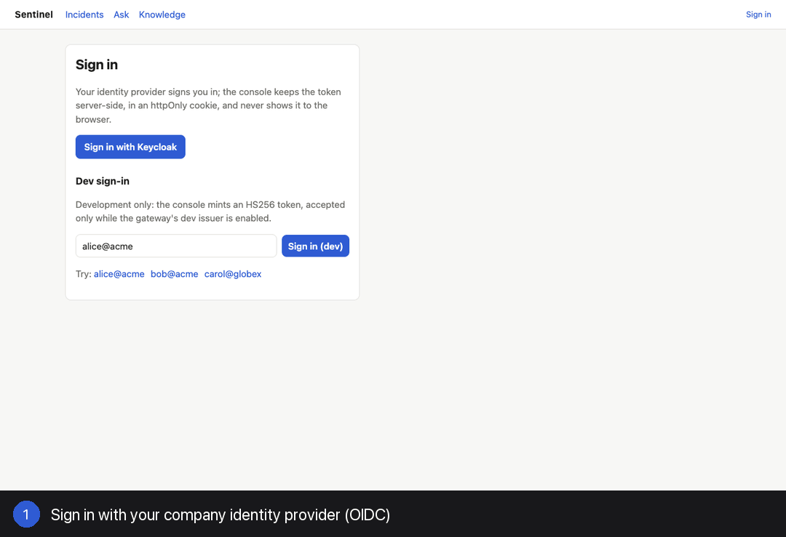
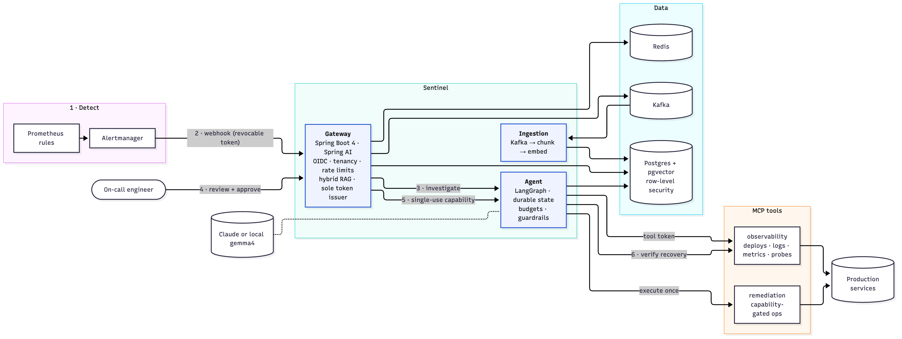
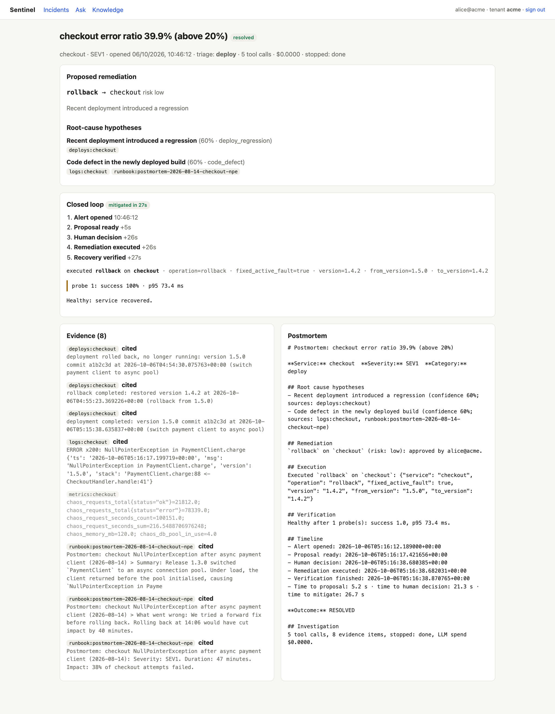
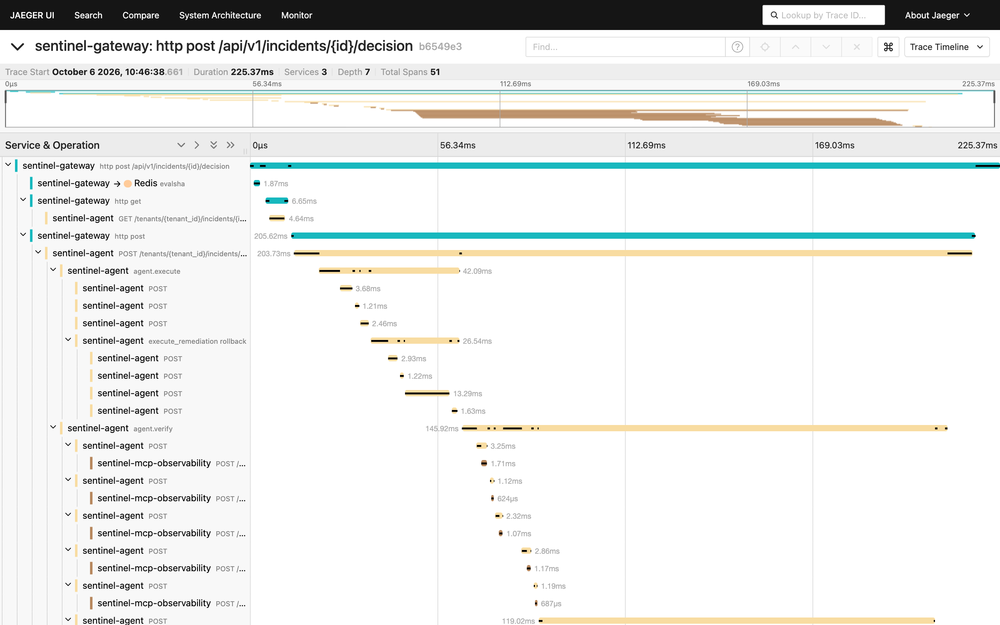
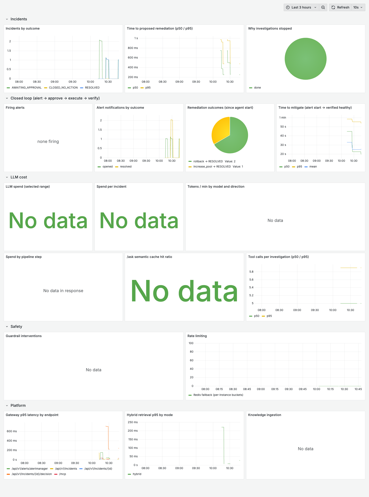
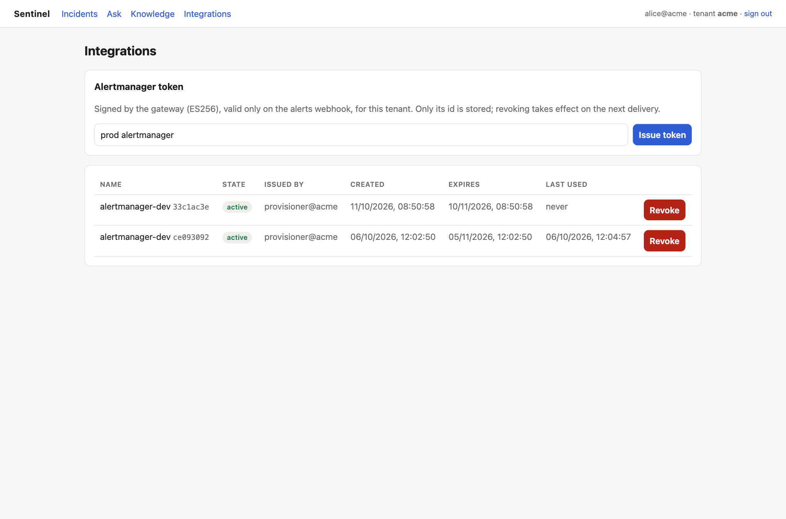

<div align="center">

# Sentinel

**An agentic incident-response copilot that closes the loop: alert → investigation → human approval → exactly-once fix → verified recovery.**

[](https://github.com/abdulmdev/sentinel-incident-copilot/actions/workflows/ci.yml)


[](LICENSE)

[Website](https://abdulmdev.github.io/sentinel-incident-copilot/) · [User guide](docs/USER-GUIDE.md) · [Engineering handbook](docs/handbook/README.md) ([PDF](docs/Sentinel-Handbook.pdf)) · [System design](docs/DESIGN.md) · [ADRs](docs/adr/) · [Benchmark report](evals/rca/REPORT.md)



*Recorded from the running system: a bad deploy → the alert opens the incident → the agent proposes a cited rollback → approve → **mitigated in 14 s**.*

</div>

## ✈️ Why Sentinel exists: the cockpit idea

> **Airliners don't rely on a pilot's nerve at 3 a.m. On-call engineers shouldn't have to either.**

Modern airliners don't rely on a pilot's memory and nerve at 3 a.m. When something fails, Airbus's ECAM and Boeing's EICAS show the alert, the affected systems and the checklist to run. Airbus's flight-envelope protection stops inputs that would take the aircraft outside safe limits. The pilot stays in command throughout. The automation's job is to keep the *right* next step in front of them, so stress, fear or fatigue don't turn a manageable failure into a reactive one.

Production incidents have the same shape. An engineer gets paged at night, under pressure, with dashboards screaming, and the tempting move is the fast, reactive one: roll back whatever deployed last, restart everything, scale it up. Sentinel brings the cockpit discipline to on-call:

| In the cockpit | In Sentinel |
|---|---|
| Failure alert with the affected systems (ECAM / EICAS) | The alert opens an incident; the agent gathers deploys, logs, metrics and runbooks |
| The right checklist for this failure | One proposed action, with every claim cited to evidence |
| Envelope protection: unsafe inputs are blocked | Policy interlocks block unsafe actions even when proposed (no rollback without a recent deploy, no restart without memory growth, …) |
| The pilot decides | Nothing runs until a human approves |
| Exactly the commanded input, nothing more | A single-use capability executes exactly the approved action, once |
| Instruments confirm the recovery | Real-traffic probes verify the service is healthy before "resolved" |
| The flight data recorder | The audit trail, timeline and auto-written postmortem |

The goal isn't to replace the engineer. It's to make the calm, correct call the easy one, at any hour.

<sub>Sentinel is not affiliated with Airbus or Boeing; the comparison describes a design philosophy.</sub>

## What it does

When production breaks, the on-call engineer's first 10–30 minutes go to gathering evidence. Sentinel does that work, keeps a human in charge, and proves the result:

1. **Detects:** Prometheus fires; the incident opens itself (deduplicated, and correlated when several rules trip on one fault).
2. **Investigates:** a LangGraph agent calls MCP tools (deploys, grouped logs, metrics, runbooks) within hard step and cost budgets.
3. **Diagnoses with evidence:** ranked root causes, each **cited** to evidence gathered in that run; deterministic guardrails block unsafe proposals.
4. **Waits for a human:** nothing touches production before approval.
5. **Executes exactly once:** approval mints a 5-minute, single-use **capability** for that one action on that one service.
6. **Verifies and measures:** real-traffic probes decide `RESOLVED`, time to mitigate is recorded, and the postmortem writes itself.

## Results (all measured)

| | |
|---|---|
| **Time to mitigate** (alert start → verified healthy, incl. the human approval) | **14–41 s** across 6 live runs ([phase history](docs/handbook/15-phase-history.md)) |
| **Rule baseline**, 112 replayed incidents (incl. red herrings, outages, prompt injection) | **92.9%** correct remediation, **0** harmful actions, **0** successful injections, **0** PII leaks |
GEMMA_ROW
| **The eval caught a real bug** | the first baseline rolled back harmless deploys in **16%** of incidents → fixed to **0%**; CI now fails on regression |
| **Load** (k6) | incidents p95 **314 ms** at 5/s; search p95 **18 ms** at 20/s; a 200-request burst admits **exactly 120** (distributed limiter) |
| **Quality gates** | **212** automated tests; CI with a real Kubernetes end-to-end run, green on the first push (only the paid Claude eval job is skipped: no key) |

## Why it's interesting to build

<table>
<tr><td width="50%" valign="top">

**🤖 Agentic AI, done safely**
- LangGraph state machine with **human-in-the-loop interrupt** and **Postgres checkpoints** (survives restarts, resumes on any replica)
- Tools over **MCP**; budgets enforced by the graph (≤ 8 tool calls, ≤ $0.50)
- *"The model proposes, policy disposes"*: PII redaction, injection removal, citation validation, runbook interlocks, constrained decoding
- Pluggable LLM: Claude, or **local gemma4** via Ollama, or none (rules)

</td><td width="50%" valign="top">

**🔐 Zero-trust security**
- Only the gateway can mint credentials: **ES256 + JWKS**; every other service verifies and can't forge
- **Single-use capabilities** with a Redis replay store that **fails closed**
- Users via **OIDC** (Keycloak, PKCE); every hop authenticated and **tenant-bound**
- **Row-level security** everywhere, including the agent's checkpoints; per-pod least-privilege secrets **checked in CI**

</td></tr>
<tr><td valign="top">

**⚙️ Distributed systems**
- Kafka ingestion with idempotent re-index and a DLT; **hybrid retrieval** (pgvector + full-text, RRF) in one Postgres transaction
- Race-safe alert dedup via a **per-service advisory lock** (8 concurrent deliveries → 1 incident, tested)
- **Atomic Lua token bucket** on Redis, with a local fallback
- Semantic cache invalidated by a knowledge-version fingerprint

</td><td valign="top">

**📈 Engineering rigor**
- **Offline, deterministic benchmark** (112 incidents + held-out set) as a **CI gate**
- One **OpenTelemetry** trace per incident across Java → Python → MCP; Grafana for cost, safety and time to mitigate
- **Helm** (hardened pods, NetworkPolicies), **kind** e2e in CI, **Terraform** for EKS/RDS/MSK
- 9 ADRs and a 16-chapter handbook with every bug found and how it was fixed

</td></tr>
</table>

## Architecture



| Service | Stack | Role |
|---|---|---|
| [`gateway-service`](gateway-service) | Java 21, Spring Boot 4, Spring AI 2 | API, OIDC + tenancy, rate limits, hybrid RAG `/ask`, alert intake, **sole token issuer** (JWKS) |
| [`agent-service`](agent-service) | Python, LangGraph, FastAPI | Investigation → RCA → guardrails → approval → execute → verify → postmortem |
| [`ingestion-service`](ingestion-service) | Spring Boot, Kafka, Flyway | Chunk → embed (local ONNX) → index; owns the schema (V1–V7) |
| [`mcp-tools/observability`](mcp-tools/observability) | MCP (FastMCP) | Deploys, grouped logs, metrics, verification probes |
| [`mcp-tools/remediation`](mcp-tools/remediation) | MCP (FastMCP) | Capability-gated rollback / restart / pool / failover / scale |
| [`web`](web) | Next.js 16 BFF | Console: OIDC code flow, approvals, closed-loop timeline, integrations |
| [`chaos-lab`](chaos-lab) | FastAPI | Demo services with injectable faults and an ops API |

Deep dive: [high-level design](docs/handbook/02-high-level-design.md) · [security](docs/handbook/10-security.md) · [evaluation](docs/handbook/11-evaluation.md) · [the full handbook as a PDF](docs/Sentinel-Handbook.pdf).

## Screenshots

| Closed loop: executed, verified, timeline | One trace per decision (Jaeger) |
|---|---|
|  |  |
| **Grafana: outcomes, time to mitigate, LLM cost** | **Revocable integration tokens (tenant admins)** |
|  |  |

## Run it

Prerequisites: Docker, Java 21+, Maven, [uv](https://docs.astral.sh/uv/), Node 24. Optional: [Ollama](https://ollama.com) for a free local LLM.

```bash
scripts/dev-local.sh up
```

```bash
python3 chaos-lab/inject.py checkout bad_deploy
```

Open http://localhost:3000, sign in with Keycloak (`alice@acme`; dev passwords in `deploy/keycloak/sentinel-realm.json`), wait about 40 s for the alert-opened incident, and click **Approve**. With a local model: `SENTINEL_LLM_PROVIDER=ollama scripts/dev-local.sh up`. On Kubernetes: `scripts/kind-up.sh`. Full walkthrough: [user guide](docs/USER-GUIDE.md).

## Tests and quality gates

```bash
cd gateway-service && mvn verify
```

```bash
cd agent-service && uv run pytest
```

```bash
uv run --project agent-service python evals/rca/run.py --check
```

CI ([workflow](.github/workflows/ci.yml)) runs all test suites (Testcontainers on real pgvector/Redis), the benchmark gate (main + held-out), docs-sync checks, Helm/kubeconform/Terraform validation, a least-privilege secrets check, and a **real kind cluster end to end** (incident → approve → `RESOLVED`, NetworkPolicy denials), then publishes multi-arch images.

## Where to look in the code (5-minute tour)

| Idea | Code |
|---|---|
| The agent's state machine (investigate → … → verify) | [`agent-service/app/graph.py`](agent-service/app/graph.py) |
| Guardrails: interlocks, citation validation, PII/injection | [`agent-service/app/guardrails.py`](agent-service/app/guardrails.py) |
| Single-use capability, checked before any side effect | [`mcp-tools/remediation/server.py`](mcp-tools/remediation/server.py) · [`RemediationTokens.java`](gateway-service/src/main/java/dev/sentinel/gateway/remediation/RemediationTokens.java) |
| Issuer-routed JWT verification (no algorithm confusion) | [`RoutingJwtDecoder.java`](gateway-service/src/main/java/dev/sentinel/gateway/identity/RoutingJwtDecoder.java) |
| Race-safe alert dedup and correlation | [`AlertLinkRepository.java`](gateway-service/src/main/java/dev/sentinel/gateway/alert/AlertLinkRepository.java) |
| Row-level security on LangGraph checkpoints | [`agent-service/app/checkpoint.py`](agent-service/app/checkpoint.py) |
| Hybrid retrieval (RRF) | [`ReciprocalRankFusion.java`](gateway-service/src/main/java/dev/sentinel/gateway/knowledge/ReciprocalRankFusion.java) |
| Distributed rate limiter (Lua) | [`RedisRateLimiter.java`](gateway-service/src/main/java/dev/sentinel/gateway/tenant/RedisRateLimiter.java) |
| Benchmark scoring and its CI thresholds | [`evals/rca/scoring.py`](evals/rca/scoring.py) · [`thresholds.json`](evals/rca/thresholds.json) |

## How it was built

Eight phases, each with its goal, decisions, **bugs found and fixed**, and measured results in the [phase history](docs/handbook/15-phase-history.md):

| Phase | Outcome |
|---|---|
| 1 Foundation | Gateway ↔ LangGraph agent ↔ chaos-lab; human approval interrupt; tenancy from the JWT |
| 2 Ingestion + RAG | Kafka ingestion; hybrid pgvector + full-text retrieval; RLS enforced by a non-superuser role |
| 3 Agents | MCP tool servers, downscoped tool tokens, budgets, durable Postgres checkpoints |
| 4 Evaluation | 112 replayed incidents, deterministic scoring, CI gate; found the 16% harmful-rollback bug |
| 5 Hardening | Guardrails + injection tier, Redis limits, semantic cache, OpenTelemetry, k6 |
| 6 Ship | Next.js console, Helm on Kubernetes, Terraform for AWS, CI |
| 7 Close the loop | Alerts open incidents; capability-gated execution; verification; time to mitigate |
| 8 Zero trust | ES256 + JWKS, Keycloak OIDC, every hop authenticated, checkpoint RLS |

<details>
<summary><b>All design decisions and their reasons</b></summary>

| Decision | Reason |
|---|---|
| Java gateway + Python agents | Platform concerns (auth, tenancy, rate limits, resilience) sit on the JVM. The agent ecosystem (LangGraph) is in Python. See [ADR-0001](docs/adr/0001-polyglot-gateway-and-agents.md). |
| Human-in-the-loop interrupt | Remediation changes production. LangGraph `interrupt()` pauses the graph, and the gateway takes the reviewer's identity from the JWT, not the request body. |
| Model routing | Triage is classification, so it runs on `claude-haiku-4-5`. RCA needs reasoning, so it runs on `claude-opus-5-5`. |
| Heuristic fallback | Without an API key, or when an LLM call fails, rule-based triage and RCA run instead. They are also the **eval baseline** the LLM path has to beat. |
| Tenant from the token, everywhere | The gateway ignores `tenant_id` in request bodies. Agent threads are keyed `tenant:incident`. Postgres uses row-level security. |
| chaos-lab | Real services with injectable faults, so the agent is tested on real symptoms instead of mocked text. |
| Hybrid retrieval in Postgres | Vectors and full-text live in the same row and are fused with RRF. One system, one transaction, one RLS model. See [ADR-0003](docs/adr/0003-hybrid-retrieval-in-postgres.md). |
| Tools over MCP | Observability and runbook search are MCP servers the agent discovers at runtime, reusable by any MCP client. See [ADR-0004](docs/adr/0004-mcp-tools-scoped-tokens-and-budgets.md). |
| Downscoped tool tokens | The agent never holds a user's token: the gateway mints a 15-minute, single-tenant, `knowledge:read`, MCP-only JWT per incident, and it's never checkpointed. |
| Capabilities, not deploy credentials | The agent holds no standing power to change production. Approval mints a 5-minute JWT bound to one action, one service and one incident. The adapter verifies every claim and spends its jti in Redis before acting, failing closed. A compromised agent can at most do the one thing a human approved, once. See [ADR-0008](docs/adr/0008-closed-loop-capabilities-and-alert-intake.md). |
| Alerts open incidents | Alertmanager webhook with a per-tenant integration token. Re-fires are deduplicated, and several rules tripping on one fault are correlated into one incident under a per-service advisory lock. `opened_at` = the alert's start. |
| Zero-trust identity | Only the gateway can mint service credentials: ES256 with a published JWKS, so the agent, MCP servers and remediation adapter verify but can't forge. Users sign in through OIDC (Keycloak in dev). Every hop is authenticated and tenant-bound, and the agent's checkpoints are under Postgres RLS. CI checks which pod may hold which secret. See [ADR-0009](docs/adr/0009-zero-trust-identity.md). |
| Verified, measured outcomes | "Resolved" means probes pass after the fix, not "someone clicked approve". Time to mitigate is recorded per incident and as a histogram. |
| Budgets enforced by the graph | Tool-call and dollar caps are checked in code before each step. Stop reasons are recorded, exported as metrics and printed in the postmortem. |
| Durable incidents | Every step is checkpointed to Postgres, so a paused incident survives restarts and resumes on any replica. |
| Guardrails: model proposes, policy disposes | PII redaction and injection removal on tool output; citation validation, runbook policy interlocks and constrained decoding on model output. Measured raw vs. guarded in the benchmark. See [ADR-0006](docs/adr/0006-guardrails-and-production-hardening.md). |
| Pluggable LLM | `SENTINEL_LLM_PROVIDER=anthropic\|ollama`: Claude or a free local model (gemma4) for both the agent and `/ask`. |
| Distributed rate limits | Atomic Lua token bucket in Redis using Redis's clock; agent traffic gets its own bucket; per-instance fallback if Redis is down. |
| Semantic cache for `/ask` | pgvector, tenant-scoped, invalidated by a knowledge-version fingerprint the moment a runbook changes. |
| End-to-end tracing | One OpenTelemetry trace per incident across gateway → agent → MCP servers, with GenAI attributes (model, tokens, cost). Grafana dashboard for cost, safety and latency. |
| Async ingestion over Kafka | Uploads return once Kafka acks them. Embedding runs in ingestion-service, re-ingest is idempotent (content hash), and bad messages go to a dead-letter topic. |

</details>

## Roadmap
Claude benchmark column (needs an API key) · KMS-backed signing and mTLS · async approval with streamed progress · dependency-aware alert correlation · incidents recorded from real postmortems. Details: [limitations and roadmap](docs/handbook/16-limitations-and-roadmap.md).

## Contributing and license
Contributions are welcome: see [CONTRIBUTING](CONTRIBUTING.md) (how to run, verify and keep the docs in sync), the [code of conduct](CODE_OF_CONDUCT.md) and the [security policy](SECURITY.md). Licensed under the [Apache License 2.0](LICENSE).
