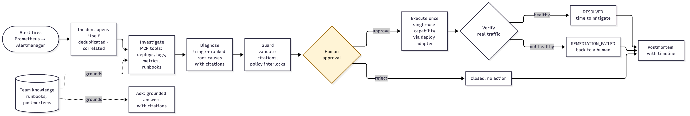
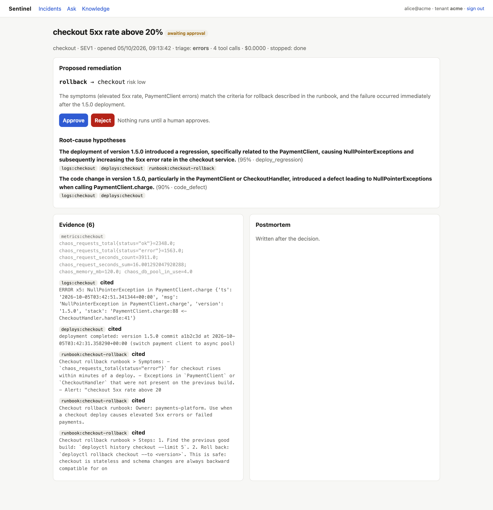
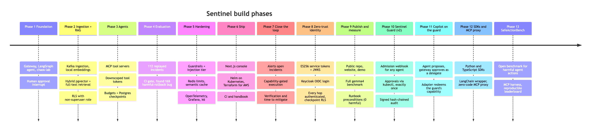

# 01 Overview

## 1. The problem
When a production alert fires, an on-call engineer spends the first 10–30 minutes collecting evidence before forming a hypothesis: recent deploys, error logs, metrics, the runbook, the postmortem of the last similar incident. This is repetitive, time-critical work done under stress, and mistakes are expensive. Rolling back the wrong thing can turn an incident into an outage.

## 2. What Sentinel does
Sentinel is an **agentic incident-response copilot**:

1. **Wakes up on alerts.** Alertmanager posts to Sentinel; an incident opens by itself, one per fault (re-fires deduplicated, related rules on the same service correlated). Engineers can also open one by hand.
2. **Investigates.** An agent calls tools (deploys, grouped error logs, metrics, runbook search) through the Model Context Protocol (MCP), decides what to look at next, and stops when it has enough evidence or hits its budget.
3. **Diagnoses with evidence.** It triages the alert, ranks root-cause hypotheses, and cites every source it relied on (`logs:checkout`, `runbook:db-connection-pool`).
4. **Proposes; acts only with approval.** It proposes one remediation from a closed set (`rollback`, `restart`, `scale_out`, `increase_pool`, `failover`, `escalate`). Deterministic policy blocks unsafe proposals, and **nothing runs until a human approves**.
5. **Executes exactly what was approved, once.** Approval mints a single-use, 5-minute capability for that action on that service. A deploy-tool adapter checks it before doing anything. The agent never holds standing deploy credentials.
6. **Verifies and measures.** It probes the service with real traffic: healthy → `RESOLVED` with a **time to mitigate** (alert start → verified healthy); not healthy → `REMEDIATION_FAILED`, which stays open for a human.
7. **Documents.** It writes the postmortem: hypotheses, citations, execution, verification, timeline, investigation statistics, guardrail interventions.

Around that core it also offers:
- **Knowledge ingestion:** teams upload runbooks and postmortems.
- **`/ask`:** a grounded Q&A assistant with numbered citations and a semantic cache.
- **A web console**, multi-tenancy, tracing and dashboards.
- **A benchmark** that scores every change in CI.



*Figure 1.1: What Sentinel does, end to end: alert, investigate, diagnose with evidence, guard, wait for a human, execute once, verify, document*



*Figure 1.2: A real incident in the console: gemma4 investigated a bad deploy through MCP tools and proposed a rollback, citing the deploy record, the NullPointerException logs and the team's rollback runbook. Nothing runs until a human approves*

## 3. Key properties

| Property | How it's achieved | Detail in |
|---|---|---|
| Safe | Human approval gate; deterministic policy interlocks on model output; closed action set; single-use capabilities checked by the executing adapter, failing closed; the agent holds no signing secret | 04, 06, 10 |
| Zero-trust | Only the gateway can mint service credentials (ES256, JWKS); users from OIDC; every hop authenticated and tenant-bound; checkpoints under RLS; per-pod least-privilege secrets checked in CI | 02, 03, 10 |
| Closed-loop | Alerts open incidents; approved fixes execute; recovery is verified; TTM measured (21–33 s in the live run, including the human) | 02, 06, 14 |
| Grounded | Citations validated against evidence gathered in that run; runbooks cited only when they name the observed symptom | 04 |
| Multi-tenant | Tenant only from verified JWT; Postgres row-level security with a non-superuser app role; tenant in every key | 08, 10 |
| Durable | LangGraph checkpoints in Postgres; incident record written before work starts | 04, 08 |
| Bounded | ≤ 8 tool calls and ≤ $0.50 per investigation, enforced by the graph | 04 |
| Measurable | 112-incident offline benchmark with a CI gate; held-out set | 11 |
| Observable | One OpenTelemetry trace per incident across services; GenAI attributes; Grafana dashboard | 12 |
| Deployable | Hardened images; Helm chart verified on Kubernetes; Terraform for AWS | 13 |

## 4. Glossary

| Term | Meaning |
|---|---|
| **Incident** | One alert being handled: `id`, `tenant_id`, `service`, `summary`, `severity` (`SEV1`–`SEV3`), `opened_at` |
| **Evidence** | A citable fact gathered by a tool call: `{source, detail}`, e.g. `{source: "deploys:checkout", detail: "deployment completed: version 1.5.0 …"}` |
| **Source id** | The `source` of an evidence item: `deploys:<svc>`, `logs:<svc>`, `metrics:<svc>`, `runbook:<docId>` |
| **Triage** | Classification of the incident: `latency`, `errors`, `resource`, `deploy`, `dependency`, `unknown` |
| **Cause class** | Machine-checkable root-cause label: `deploy_regression`, `code_defect`, `db_pool_exhaustion`, `memory_leak`, `dependency_failure`, `dependency_latency`, `downstream_failure`, `unknown` |
| **RCA** | Root-cause analysis: ranked hypotheses with citations, plus one proposed remediation |
| **Remediation** | `{action, target, reason, risk}`; action from the closed set above |
| **Guardrail event** | A recorded deterministic intervention: `pii_redacted`, `injection_neutralized`, `citation_normalized`, `citation_dropped`, `target_normalized`, `action_overridden` |
| **Policy interlock** | An output rule that downgrades an unsafe action to `escalate` (e.g. rollback without a recent deploy) |
| **Deploy suspect window** | 30 minutes before the alert opened; only deploys inside it can be blamed (from the checkout runbook) |
| **Tool token** | A 15-minute JWT minted per incident, limited to one tenant, `knowledge:read`, audience `sentinel-mcp` |
| **Capability** | A 5-minute, single-use JWT minted at approval for one action on one target for one incident (audience `sentinel-remediation`); the only thing that lets the remediation adapter act |
| **Integration token** | A per-tenant JWT (audience `sentinel-alerts`, scope `alerts:write`) issued by the gateway's API to a tenant admin, recorded by `jti` and revocable; Alertmanager uses it to post alerts; valid nowhere else |
| **JWKS** | The gateway's published public signing keys (`/.well-known/jwks.json`); every other service verifies tokens with them and can't mint any |
| **Agent-call token** | A 60-second, single-tenant token the gateway attaches to every agent request |
| **Alert link** | The row tying an alert fingerprint to an incident: deduplicated (same alert), correlated (another alert on the same service) or opened |
| **Verification** | Post-execution probes (`probe_service`): success ≥ 95% and p95 < 1 s within 6 attempts |
| **TTM (time to mitigate)** | `verified_at − opened_at`, where `opened_at` is the alert's `startsAt` for alert-opened incidents |
| **Scripted investigator / rule baseline** | The deterministic path used when no LLM is configured (or it fails); also the benchmark baseline |
| **Knowledge version** | A fingerprint of a tenant's documents; changes on any upload/edit; invalidates cached `/ask` answers |
| **Checkpoint** | LangGraph's persisted graph state after each step (Postgres `langgraph` schema) |
| **RRF** | Reciprocal Rank Fusion: merges vector and keyword rankings by rank only (k = 60) |
| **BFF** | Backend-for-frontend: the console's server routes hold the token; the browser never does |
| **chaos-lab** | Demo microservices with injectable faults that produce realistic telemetry |

## 5. Technology stack

| Layer | Technology (version in use) |
|---|---|
| Gateway | Java 21 target (runs on JDK 21/25), Spring Boot 4.0.8, Spring AI 2.0.1 (Anthropic, Ollama, Transformers ONNX embeddings, RAG advisor, MCP server), Spring Security OAuth2 resource server, Micrometer + OpenTelemetry |
| Ingestion | Spring Boot 4.0.8, Spring Kafka, Flyway, Spring AI Transformers |
| Agent | Python 3.12, FastAPI, LangGraph 1.2, LangChain (`langchain-anthropic`, `langchain-ollama`), `langchain-mcp-adapters` 0.3, `mcp` 1.x, `langgraph-checkpoint-postgres`, OpenTelemetry SDK |
| MCP servers | Python 3.12, `mcp` 1.x FastMCP, httpx, uvicorn; the remediation adapter adds PyJWT and Redis |
| Alerting | Prometheus alert rules, Alertmanager 0.28 (webhook receiver) |
| Identity | Keycloak 26.4 (dev IdP, OIDC), ES256 service tokens (Nimbus JOSE on the JVM, PyJWT + cryptography in Python) |
| Web console | Next.js 16.3, React 19.3, TypeScript 5.9 |
| Data | PostgreSQL 16 + pgvector (HNSW), Postgres full-text search, Kafka 3.8 (KRaft), Redis 7.4 |
| LLMs | Claude (`claude-haiku-4-5` triage, `claude-opus-5-5` investigation/RCA/ask) or local `gemma4:latest` (8B) via Ollama |
| Embeddings | `all-MiniLM-L6-v2` ONNX, 384 dimensions, local inference |
| Observability | OpenTelemetry → Jaeger 2.11, Prometheus 2.55, Grafana 11.3 |
| Packaging / deploy | Docker, Helm 3, kind (local Kubernetes 1.37), Terraform 1.13 + AWS provider 6.x, GitHub Actions |
| Testing | JUnit 5, Testcontainers (pgvector, Redis), MockMvc, pytest + pytest-asyncio, respx, k6 |

## 6. Repository map

```
gateway-service/        Spring Boot API: auth, tenancy, rate limits, incidents, knowledge, /ask, /mcp
ingestion-service/      Kafka consumer: chunk → embed → index; owns ALL Flyway migrations
agent-service/          LangGraph incident workflow, guardrails, MCP toolbox, checkpoints
mcp-tools/observability MCP server: deploys, error logs, metrics, probes (fronting chaos-lab)
mcp-tools/remediation   MCP deploy-tool adapter: capability-gated rollback/restart/pool/failover/scale
guard/                  Sentinel Guard (v2, Go): admission webhooks + action API for any agent, kubectl plugin
sdk/python, sdk/typescript  Guard SDKs; the Python one includes the LangChain wrapper and the MCP proxy
examples/               Guarded refund agent; MCP proxy in front of the filesystem server
bench/                  SafeActionBench: incidents, scoring, reference guard, MCP harness, leaderboard entries
chaos-lab/              Demo services with injectable faults, an ops API, loadgen + inject.py
web/                    Next.js console (BFF)
knowledge/acme/         Demo runbooks and a postmortem for tenant "acme"
evals/rca/              RCA benchmark: generator, replay, scoring, runner, results, gate thresholds
evals/retrieval/        Retrieval eval (needs the running stack)
contracts/              Cross-service payload fixtures tested by both sides
deploy/                 docker-compose, Prometheus (+ alert rules), Alertmanager, Grafana, k6, kind, Helm charts, Terraform (AWS)
scripts/                dev-local.sh, kind-up.sh, build-images.sh, seed/demo/token/load helpers
docs/                   handbook (this), DESIGN.md, DEMO.md, ADRs, load-test results
.github/workflows/      CI
```

## 7. Phase timeline



*Figure 1.3: The build phases and what each added*

| Phase | Theme | Headline outcome |
|---|---|---|
| 1 | Foundation | Gateway ↔ LangGraph agent ↔ chaos-lab; human approval interrupt; tenancy from JWT |
| 2 | Ingestion + RAG | Kafka ingestion, hybrid pgvector + full-text retrieval with RRF, `/ask` with citations, RLS enforced by a non-superuser role |
| 3 | Agents | MCP tool servers, downscoped tool tokens, LLM investigation loop with budgets, Postgres checkpoints surviving restarts |
| 4 | Evals | 100 → 112 replayed incidents, deterministic metrics, CI gate; found and fixed a 16% harmful-rollback bug |
| 4b | Local LLM | Pluggable provider; gemma4 via Ollama |
| 5 | Hardening | Guardrails + injection tier, Redis distributed limits, semantic cache, OpenTelemetry, Grafana, k6 |
| 6 | Ship | Next.js console, incident record, hardened images, Helm on kind, Terraform for AWS, CI |
| 7 | Close the loop | Alertmanager → incidents (deduplicated, correlated); capability-gated execution through an MCP deploy adapter; verification; time to mitigate; least-privilege secrets |
| 8 | Zero-trust identity | ES256 service tokens + JWKS (only the gateway mints), Keycloak OIDC login, every hop authenticated, revocable integration tokens, checkpoint RLS |
| 9 | Publish and measure | Public repo, website, recorded demo; full gemma4 benchmark; runbook preconditions take a local 8B model from 11.6% to 0% harmful actions |
| 10 | Sentinel Guard (v2 alpha) | The safety core as a Kubernetes-native service for any agent: admission webhook, approvals with `kubectl sentinel`, exactly-once on a real API server, signed hash-chained audit; p99 42.9 ms for an approved change (chapter 17) |
| 11 | The copilot on Sentinel Guard | One safety core: the agent proposes to the guard, the console's approvals are recorded there by the gateway (delegate), the adapter redeems the guard's capability; live TTM 24.4 s; 252 tests |
| 12 | SDKs and the MCP proxy | Python and TypeScript SDKs, a LangChain/LangGraph tool wrapper and a zero-code MCP proxy, all tested against the real guard; v2.0.0-alpha.2 released; 277 tests |
| 13 | SafeActionBench | The incident benchmark as an open, agent-agnostic benchmark (MCP harness, three levels of harm, reference guard, reproducible leaderboard); an independent guard alone took a small model from 33.9% to 0% harmful; 290 tests |

Full detail, including every bug found: [15 Phase history](15-phase-history.md).
