# 02 High-level design

## 1. Requirements

### 1.1 Functional
| ID | Requirement |
|---|---|
| F1 | Open an incident for a service (by hand, or automatically from an alert) and get an evidence-backed diagnosis and a proposed remediation |
| F2 | Investigate using tools: deploy history, grouped error/warn logs, key metrics, runbook search |
| F3 | Cite every conclusion with the evidence it rests on |
| F4 | Require explicit human approval or rejection; record the reviewer |
| F5 | Write a postmortem after the decision |
| F6 | Ingest runbooks/postmortems per tenant; search them (vector, keyword, hybrid) |
| F7 | Answer free-form on-call questions grounded in the tenant's knowledge, with citations |
| F8 | List a tenant's incidents with status, proposed action, opener and reviewer |
| F9 | Work with Claude, with a local open-weight model, or with no LLM at all |
| F10 | Accept Alertmanager alerts: one incident per fault (deduplicate re-fires, correlate rules on the same service), record resolution |
| F11 | After approval, execute **exactly** the approved action once, verify recovery with real traffic, and measure time to mitigate |

### 1.2 Non-functional
| ID | Requirement | Target / mechanism |
|---|---|---|
| N1 Safety | No unsafe remediation reaches a human unflagged; nothing executes without approval; an approval authorizes one operation | Policy interlocks + approval interrupt; benchmark `harmful_action_rate` = 0 gate; single-use capability tokens checked by the adapter (ADR-0008) |
| N2 Isolation | No cross-tenant reads or actions | JWT-derived tenant everywhere; Postgres RLS (FORCE, non-superuser role); tenant-keyed threads, caches, buckets |
| N3 Durability | Paused incidents survive restarts, deploys, node loss | Postgres checkpoints; record-before-work |
| N4 Bounded cost | Per-investigation caps | 8 tool calls, $0.50, enforced by the graph |
| N5 Latency | Platform overhead small next to LLM time | Incidents p95 314 ms (rule path, 5/s); search p95 18 ms (20/s), measured with k6 |
| N6 Observability | One trace per incident across services; cost and safety metrics | OpenTelemetry + Prometheus + Grafana |
| N7 Quality control | Every change scored before merge | Offline 112-incident benchmark + CI gate |
| N8 Availability | No single dependency failure takes the system down | Fallbacks: LLM → rules; Redis → local buckets; tool failure → recorded evidence gap |
| N9 Least privilege | Each component holds only what it needs | Downscoped tool tokens; per-approval capabilities instead of standing deploy credentials; integration tokens that only post alerts; migrations job is the only admin-DB holder; NetworkPolicy allow-list |
| N11 Zero-trust identity | No network position or shared secret grants access; only the gateway can mint service credentials | ES256 service tokens + JWKS; OIDC users; per-call agent tokens; MCP tool tokens; revocable integration tokens; checkpoint RLS (ADR-0009) |
| N10 Verified outcomes | "Resolved" means healthy, not "approved" | Post-execution probes; `REMEDIATION_FAILED` keeps the incident open |

## 1A. Architecture at a glance

*Figure 2.1: Architecture at a glance: detect, investigate, approve, execute once, verify*

## 2. System context

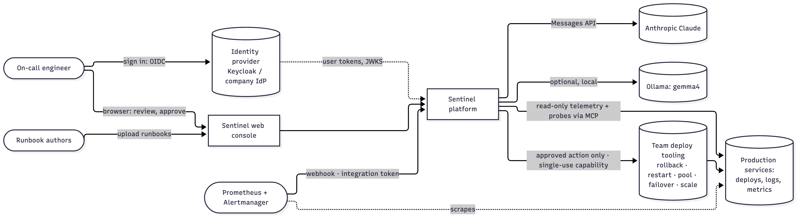

*Figure 2.2: System context: who uses Sentinel and what it talks to*

Sentinel reads production telemetry, is woken by the alerting system, proposes actions, and, **after a human approves**, executes that one action through the team's deploy tooling and checks that it worked. The agent never holds standing deploy credentials: each approval, recorded in **Sentinel Guard**, yields a single-use capability for exactly the approved operation and parameters (ADR-0008, ADR-0011).

## 3. Container view

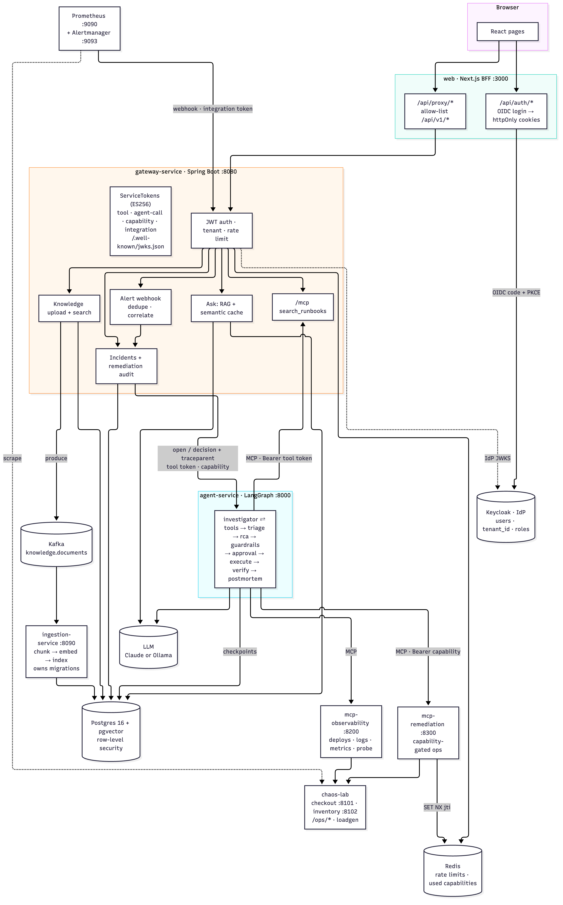

*Figure 2.3: Container view: every service, data store and connection*

| Container | Responsibility | Owns | Talks to |
|---|---|---|---|
| **web** | UI; OIDC code flow (PKCE); holds the tokens server-side | session cookies | IdP, gateway (`/api/v1/*` only) |
| **Keycloak** (dev IdP) | Users, tenants (`tenant_id` attribute), roles; issues RS256 user tokens | realm | — |
| **gateway-service** | Public API, identity, tenancy, rate limits, incident record, **alert webhook (dedupe/correlation)**, knowledge upload/search, `/ask`, MCP knowledge tool, tool-token and **capability** minting, remediation audit | `incidents`, `alert_links`, `remediation_audit`, `ask_cache` (reads `knowledge_*`) | Postgres, Kafka (produce), Redis, agent, LLM |
| **agent-service** | The incident workflow: investigation, triage, RCA, guardrails, approval pause, **execution, verification**, postmortem with timeline | `langgraph` schema (checkpoints) | MCP servers, LLM, Postgres |
| **ingestion-service** | Turns uploaded documents into searchable chunks; runs DB migrations (as a job in Kubernetes) | `knowledge_documents`, `knowledge_chunks`, schema | Kafka (consume, DLT), Postgres |
| **mcp-observability** | Read-only telemetry tools over MCP, plus `probe_service` for verification | — | observed services |
| **mcp-remediation** | Deploy-tool adapter: `rollback`, `restart`, `increase_pool`, `failover`, `scale_out`, each gated by a capability from Sentinel Guard | — | ops APIs of the services, Sentinel Guard (verify, redeem) |
| **Sentinel Guard** (Phase 10/11) | Approvals and single-use capabilities: the agent proposes, reviewers' decisions are recorded (via the gateway), the adapter redeems; signed audit chain; also guards agents' Kubernetes changes (chapter 17) | `ActionRequest` objects, ConfigMaps (Kubernetes) or memory (local) | Kubernetes API, Prometheus (preconditions) |
| **Prometheus + Alertmanager** | Alert rules on service metrics; webhook to the gateway with an integration token | — | services (scrape), gateway |
| **chaos-lab** | Demo services with injectable faults and an ops API (`/ops/*`); `loadgen` keeps traffic flowing so faults show up in metrics | — | each other |

## 4. Core flows

### 4.1 Opening an incident (investigation)

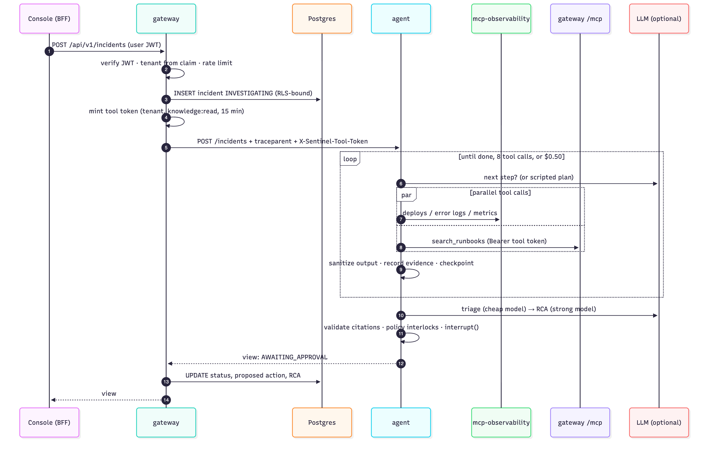

*Figure 2.4: Opening an incident: record first, scoped token, bounded tool loop, guardrails, approval pause*

If the agent call fails, the gateway marks the record `FAILED` and returns the error (503/502), so an incident never silently disappears.

### 4.2 Approval, execution, verification and postmortem

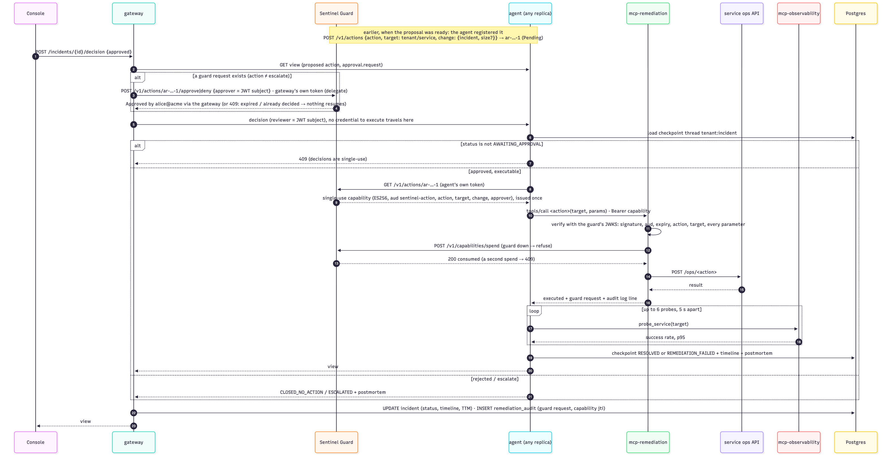

*Figure 2.5: Approval: a single-use capability for exactly the approved action, execution through the adapter, verification with real traffic*

Resumption can happen on any agent replica, hours later: the thread `tenant:incident` is loaded from Postgres. The capability is passed in run config, not state, so it is never written to a checkpoint. If the adapter refuses (expired, replayed, wrong action) or verification fails, the status is `REMEDIATION_FAILED` and the incident stays open for a human.

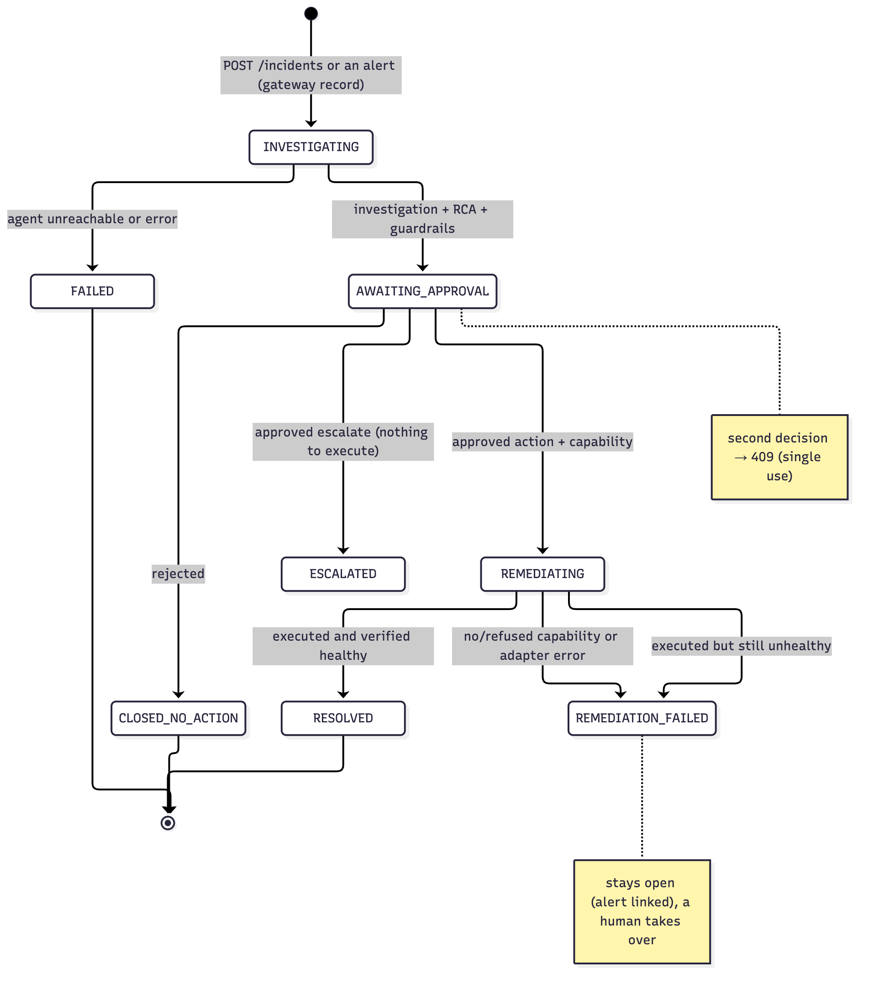

*Figure 2.6: Incident lifecycle with the closed loop*

### 4.3 Knowledge ingestion

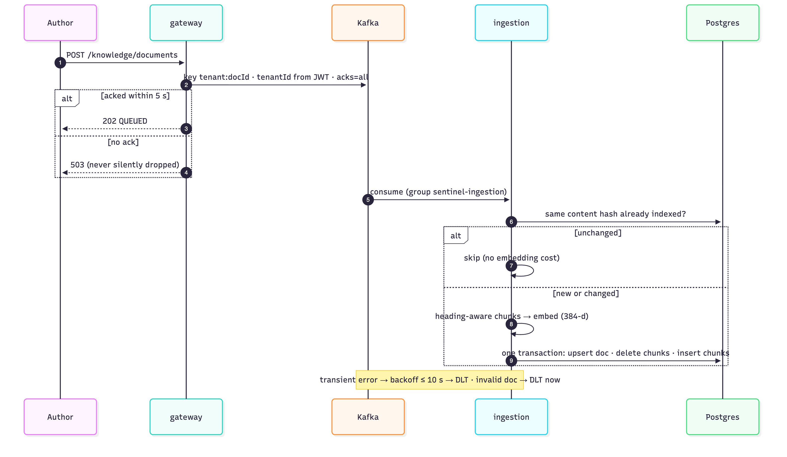

*Figure 2.7: Knowledge ingestion: acknowledged writes, idempotent indexing, atomic replace, dead-letter topic*

### 4.4 Ask (RAG with semantic cache)

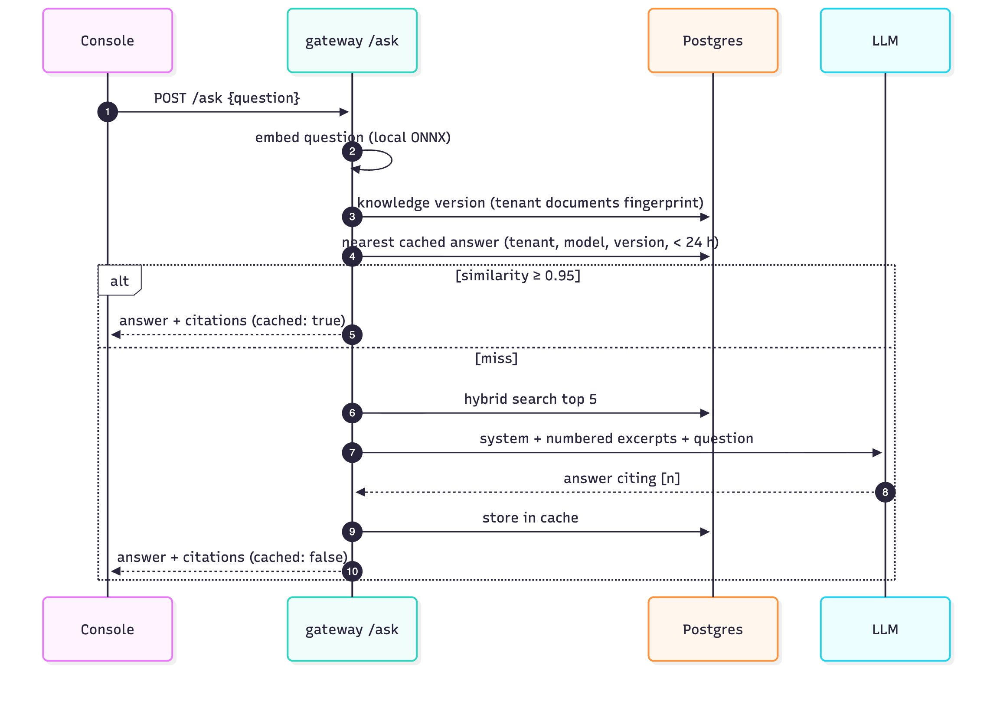

*Figure 2.8: Ask: semantic cache first, otherwise grounded retrieval and the LLM*

### 4.5 Alert intake (incidents that open themselves)

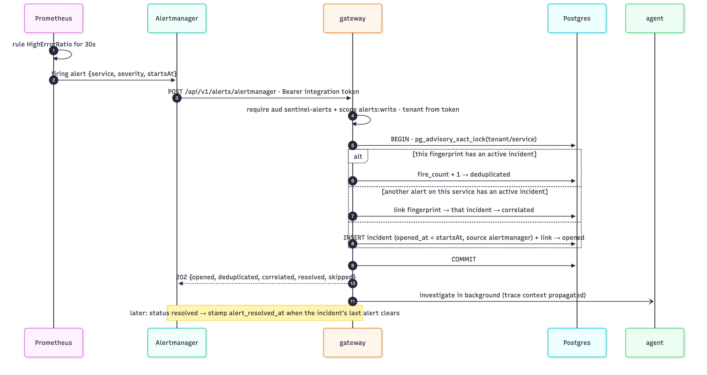

*Figure 2.9: Alert intake: integration token, per-service lock, dedupe or correlate or open, investigate after responding*

- **One incident per fault.** Alertmanager re-sends firing alerts every group interval, and one fault often trips several rules: pool exhaustion fires both `DbPoolSaturated` and `HighErrorRatio`. Under a transaction-scoped advisory lock per (tenant, service):
  - same fingerprint with an active incident → *deduplicated*;
  - another alert on the same service with an active incident → *correlated* onto it;
  - otherwise *opened*.
- **Timing.** `opened_at` = the alert's `startsAt`: the deploy-suspect window and TTM start when the problem started.
- **Resolution.** A `resolved` notification stamps `alert_resolved_at` once the incident's last alert clears. A final incident releases its alerts, so a recurrence opens a new incident.

## 5. Deployment views

| Environment | How | Data stores | Entry points |
|---|---|---|---|
| **Fast local loop** | `scripts/dev-local.sh up`: infra in Docker, services as host processes | Postgres, Kafka, Redis, Jaeger containers | console :3000, gateway :8080, Jaeger :16686, Grafana :3001 |
| **All containers** | `deploy/docker-compose.yml` | same, as compose services | gateway :8080 (+ `--profile observability`) |
| **Local Kubernetes** | `scripts/kind-up.sh`: kind + the Helm chart + dev-only `sentinel-deps` chart | in-cluster StatefulSets | NodePorts → host :13000 (console), :18080 (gateway) |
| **AWS** | `deploy/terraform/aws` + Helm with `values-aws.yaml` | RDS Postgres 16 (pgvector), MSK (TLS), ElastiCache (TLS) | ALB → web (AWS Load Balancer Controller) |

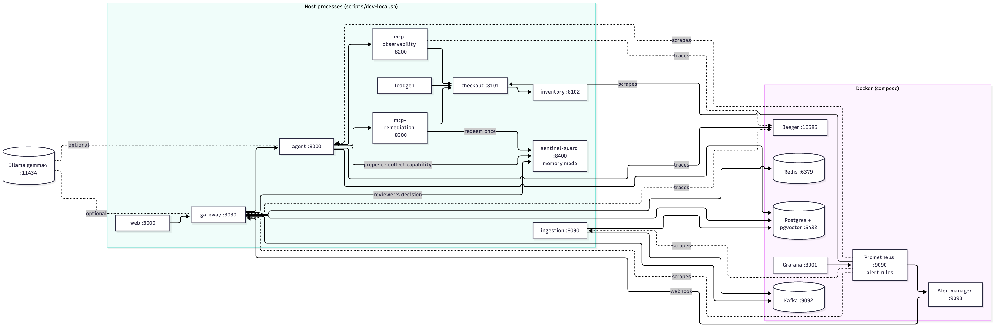

*Figure 2.10: Fast local loop: infrastructure in Docker, services as host processes, optional local LLM*

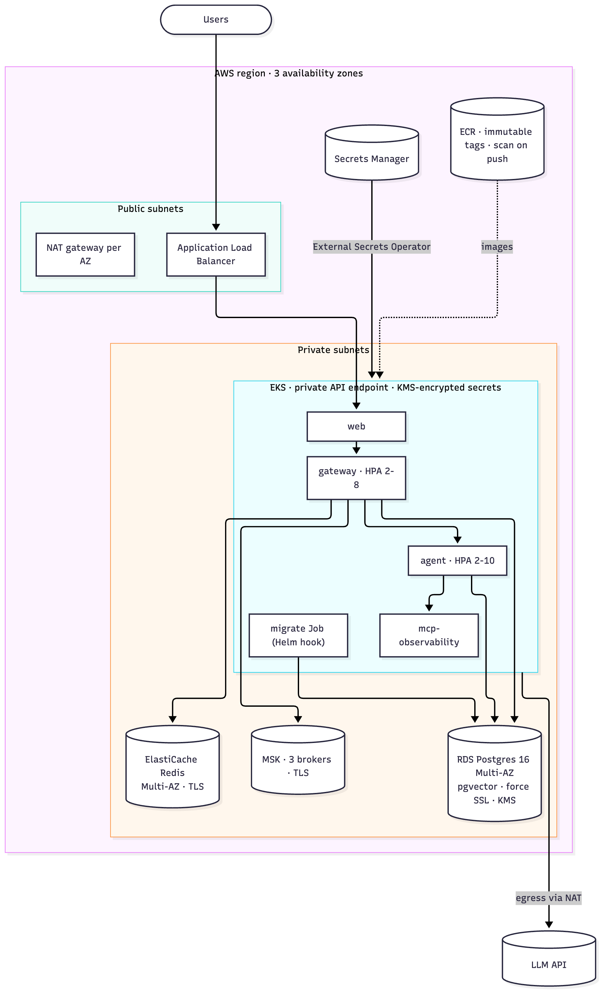

*Figure 2.11: AWS deployment: private EKS across three AZs with managed, encrypted data stores*

## 6. Cross-cutting design

### 6.1 Identity and tenancy (zero trust since Phase 8; [ADR-0009](../adr/0009-zero-trust-identity.md))

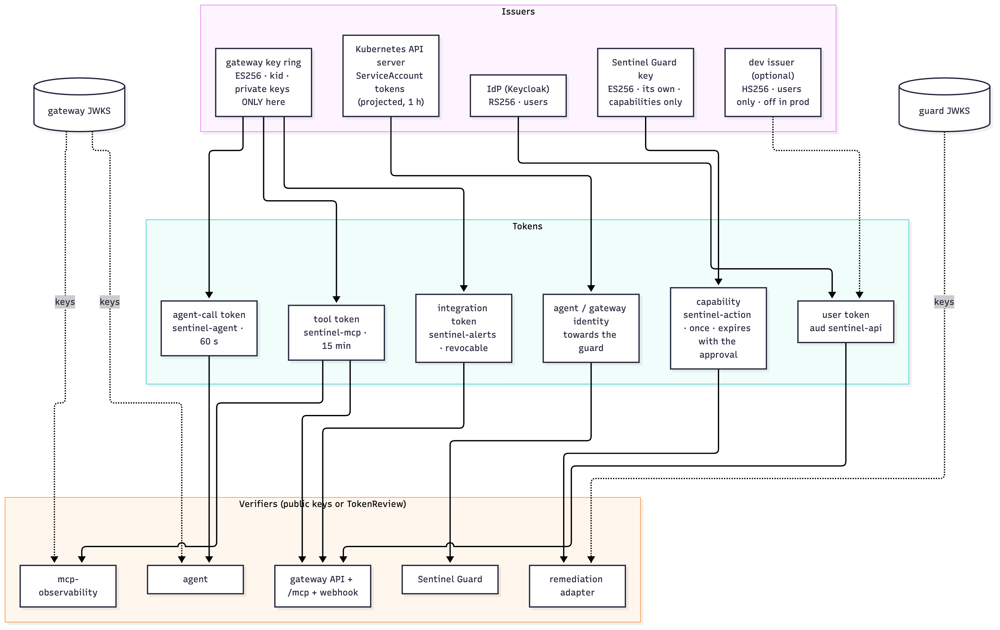

*Figure 2.12: Who issues which token, and who can only verify it*

- **Users** sign in at the company IdP (Keycloak in dev) through the console's OIDC code flow with PKCE. The `tenant_id` claim (an attribute only IdP admins can change) is the only source of tenant identity; roles (`tenant-admin`) come from the IdP too. HS256 dev tokens exist only where the dev issuer is enabled (scripts, CI, kind).
- **Services** use tokens minted **only by the gateway** (ES256, key ring, verified everywhere else against the public JWKS), except capabilities, which **only Sentinel Guard** issues (its own ES256 key). Verifiers hold no key that can mint.

  | Credential | Audience | Scope / claims | Accepted by | Lifetime |
  |---|---|---|---|---|
  | Tool token | `sentinel-mcp` | `knowledge:read telemetry:read` | gateway `/mcp`, mcp-observability | 15 min |
  | Agent-call token | `sentinel-agent` | `tenant_id` (must match the request) | agent API | 60 s, per request |
  | Integration token | `sentinel-alerts` | `alerts:write` | alerts webhook, while not revoked | ≤ 90 days, revocable |
  | Capability (from **Sentinel Guard**, Phase 11) | `sentinel-action` | action/target/tenant + approved parameters + approver | remediation adapter only, redeemed once at the guard | until the approval expires (10 min) |

  The gateway's general API rejects all service audiences; the decoder pins one algorithm per issuer.
- **Every hop is authenticated:** browser → BFF (session cookie) → gateway (user token) → agent (agent-call token) → MCP servers (tool token) / adapter (capability). NetworkPolicy is a second layer, not the only one.
- Each layer enforces isolation independently (defense in depth):
  - **gateway:** ignores tenant fields in bodies.
  - **agent:** the token's tenant must equal the URL or body tenant; thread id `tenant:incident`.
  - **Postgres:** RLS on every tenant table **including the agent's checkpoints**, with `FORCE`; services connect as `sentinel_app`, a non-superuser (superusers bypass RLS).
  - **caches and buckets:** keyed by tenant.

### 6.2 Safety model: "the model proposes, policy disposes"

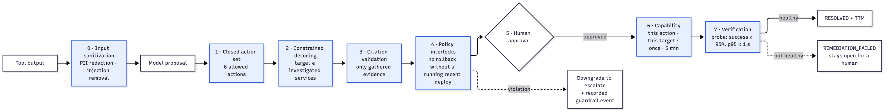

*Figure 2.13: Safety layers: deterministic checks before and after the model; a violation becomes a recorded escalation*

Defense in depth, in order:
1. **Closed action set:** the model can't invent an action.
2. **Constrained decoding:** the remediation `target` is an enum of investigated services.
3. **Input sanitization:** PII is redacted and instruction-like text is removed from tool output before any model sees it.
4. **Output validation:** citations must name gathered evidence.
5. **Policy interlocks:**
   - no rollback without a *running* deploy in the 30-minute window: a rollback record or an already-rolled-back build doesn't count, and neither does unavailable deploy history;
   - no `increase_pool`, `restart` or `failover` unless its precondition (pool saturation, memory growth, upstream trouble) shows in the target's own telemetry;
   - no action on an uninvestigated service.
6. **Human approval.**
7. **Capability:** the approval authorizes one operation on one service, once, for 5 minutes; the adapter enforces it, failing closed.
8. **Verification:** the outcome is measured. A fix that didn't work is `REMEDIATION_FAILED`, not `RESOLVED`.

Every intervention is recorded and measured (ADR-0006, chapter 11).

### 6.3 Degradation (no hard dependency on any single external system)

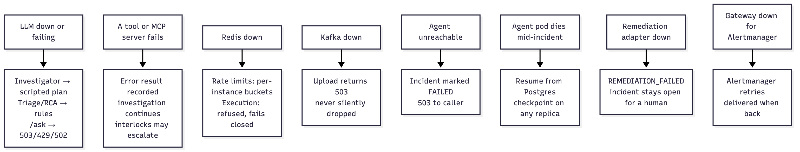

*Figure 2.14: What happens when each dependency fails*

| Dependency down | Behavior |
|---|---|
| LLM | Investigator → scripted plan; triage/RCA → rules; `/ask` → 503 "LLM provider not configured" (auth) / 502 / 429 |
| A tool / MCP server | Error result recorded; investigation continues; interlocks may escalate |
| Redis | Per-instance buckets (bounded, counted) |
| Kafka | Upload → 503 (never silently dropped) |
| Agent | Gateway marks the incident `FAILED`; 503 to the caller |
| Agent pod mid-incident | Resume from Postgres checkpoint on any replica |
| Remediation adapter, or Sentinel Guard | **Execution refused (fails closed)**. Guard down at approval → the decision isn't recorded, nothing resumes (503, seen live); guard down at execution → `REMEDIATION_FAILED`; the incident stays open for a human; investigation is unaffected |
| Gateway (for Alertmanager) | Alertmanager retries the webhook; delivery resumes when the gateway is back (seen live) |
| Verification probe | Counted as unhealthy → `REMEDIATION_FAILED`, never a false `RESOLVED` |
| IdP (Keycloak) | No new sign-ins. Existing sessions keep working until their access token expires; refresh then fails → sign in again. The gateway keeps verifying with cached IdP keys |
| Gateway JWKS (for verifiers) | Verifiers use cached keys (5 min); unknown `kid` + unreachable gateway → refuse (fail closed). The gateway is on every path anyway |

### 6.4 Consistency choices
- **Retrieval:** a chunk's vector and its full-text index are written in the same row in one transaction, so there is no dual-write drift (ADR-0003).
- **Re-ingestion:** atomic replace, so readers see the old or the new version, never a mix.
- **Incident record vs. workflow state:** the agent's checkpoint is the source of truth for the workflow; the gateway record is a projection for listing and audit, updated after each step. If they ever disagree, the agent's view wins (`GET /incidents/{id}` reads from the agent).

### 6.5 Scaling
- Stateless services scale horizontally: the gateway, agent and MCP servers keep no sessions (MCP is stateless HTTP), and LangGraph state lives in Postgres. The remediation adapter's only state, the used-jti set, is in Redis, so replicas can't double-spend a capability.
- Kafka partitions (6) bound ingestion parallelism; the message key `tenant:docId` keeps per-document ordering.
- The dominant cost and latency is the LLM, which the budgets bound per incident.

### 6.6 Decision record
| ADR | Decision |
|---|---|
| [0001](../adr/0001-polyglot-gateway-and-agents.md) | Java gateway + Python agent |
| [0002](../adr/0002-human-approval-before-remediation.md) | Human approval before any remediation |
| [0003](../adr/0003-hybrid-retrieval-in-postgres.md) | Hybrid retrieval in Postgres (pgvector + FTS + RRF), not OpenSearch |
| [0004](../adr/0004-mcp-tools-scoped-tokens-and-budgets.md) | Tools over MCP, downscoped tokens, graph-enforced budgets |
| [0005](../adr/0005-offline-deterministic-evals-as-a-ci-gate.md) | Offline deterministic evals as a CI gate |
| [0006](../adr/0006-guardrails-and-production-hardening.md) | Guardrails, pluggable LLMs, Redis limits, semantic cache, tracing |
| [0007](../adr/0007-deployment-kubernetes-and-aws.md) | Helm on Kubernetes, Terraform on AWS |
| [0008](../adr/0008-closed-loop-capabilities-and-alert-intake.md) | Close the loop: alert intake, capability-gated execution, verified recovery |
| [0009](../adr/0009-zero-trust-identity.md) | Zero-trust identity: asymmetric service tokens, OIDC users, every hop authenticated, checkpoint RLS |
| [0010](../adr/0010-sentinel-guard.md) | Sentinel Guard: the safe-action core as a Kubernetes-native Go service any agent is held to; state in the API server; approvals through RBAC |
| [0011](../adr/0011-copilot-approvals-through-the-guard.md) | The copilot's approvals and capabilities go through Sentinel Guard (agent proposes, gateway decides as a delegate, adapter redeems) |
| [0012](../adr/0012-sdks-and-the-mcp-proxy.md) | SDKs (Python, TypeScript), a LangChain wrapper and an MCP proxy, so any agent can use the guard; where the capability is redeemed decides the protection |
| [0013](../adr/0013-safeactionbench.md) | SafeActionBench: an open, agent-agnostic benchmark scoring harm at three levels (proposed, own checks, behind an independent reference guard), with a reproducible leaderboard |
| [0014](../adr/0014-governance-evidence-and-guardian-monitoring.md) | Governance evidence: a self-verifying export (every part signed, no bundle signature), policy versions in each request's digest, signed checkpoints anchored by archives, every replica self-verifying, tested drift alerts, a compliance mapping that maps rather than claims, and a one-click demo |
| [0015](../adr/0015-quickstart-inbox-and-opt-in-publishing.md) | `docker compose up` at the root is the quickstart (guard, a live agent, optional Prometheus + Grafana); the guard serves a minimal approvals inbox only in single-process mode, under a strict CSP; SDK and chart publishing is built and tested but switched on per registry by repository variables, with trusted publishing |
| [0016](../adr/0016-two-person-approvals-and-verified-approvers.md) | `approvals: N` counts distinct people, each approval a signed event and the count inside the digest; in Kubernetes the approval webhook turns early approvals into `spec.approvals`; people decide as themselves (personal tokens, OIDC verified at the guard, a delegate forwarding the person's token); notifications by webhook, off the request path |

### 6.7 Sentinel Guard (v2)
From Phase 10, the approval → single-use → audit core also ships on its own as **Sentinel Guard** (`guard/`, [chapter 17](17-lld-sentinel-guard.md)). It enforces at the Kubernetes API for any agent identity: an admission webhook that only agents are sent to, approvals as `ActionRequest` objects decided with `kubectl sentinel`, and a signed hash-chained audit. It also serves an HTTP action API for agents outside Kubernetes. Since Phase 11 the incident copilot itself runs on the guard ([ADR-0011](../adr/0011-copilot-approvals-through-the-guard.md)): the agent registers each proposal, the gateway records reviewers' decisions as a delegate, and the adapter redeems the capability the guard issued. Since Phase 12, agents outside Kubernetes use it through the Python and TypeScript SDKs, a LangChain/LangGraph tool wrapper, or the zero-code MCP proxy ([ADR-0012](../adr/0012-sdks-and-the-mcp-proxy.md)).
