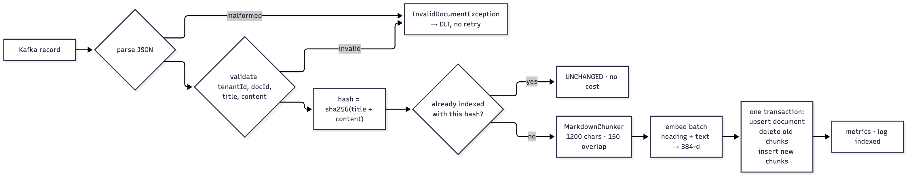
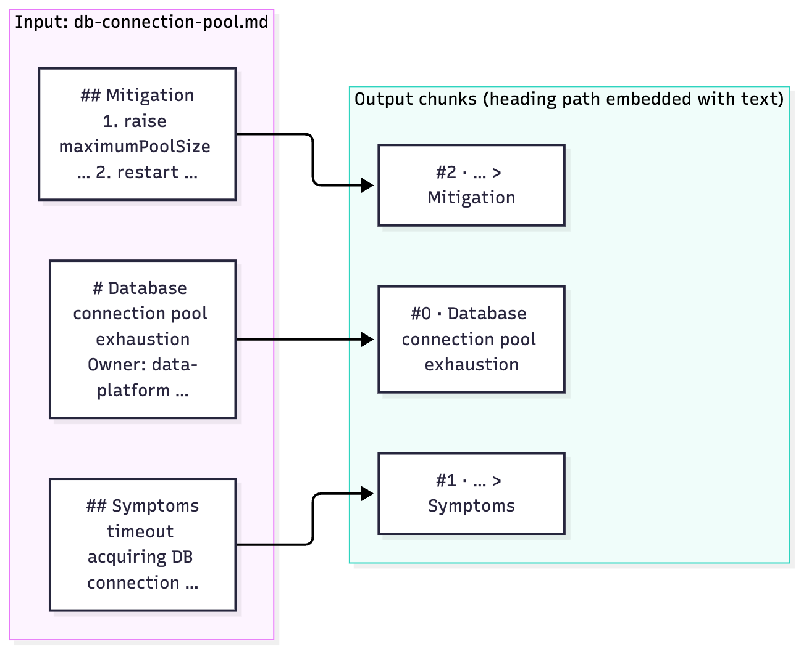
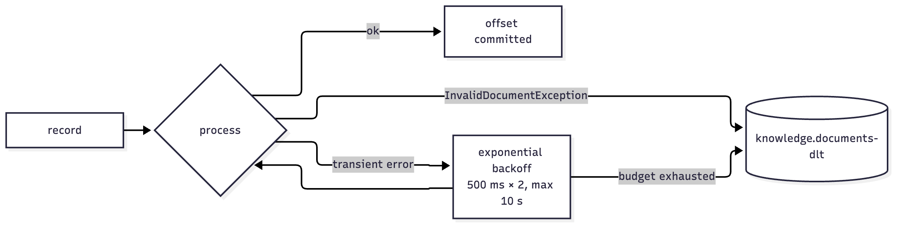
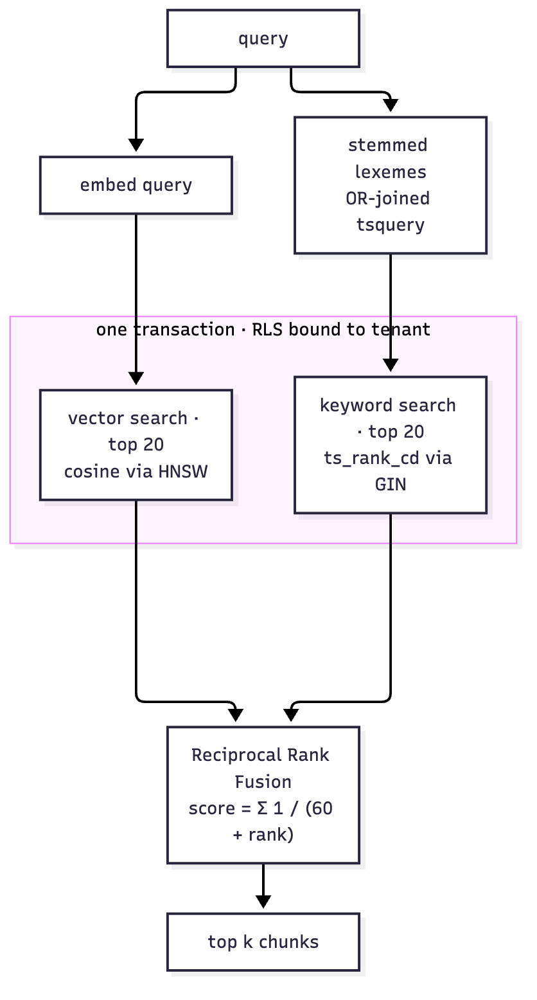
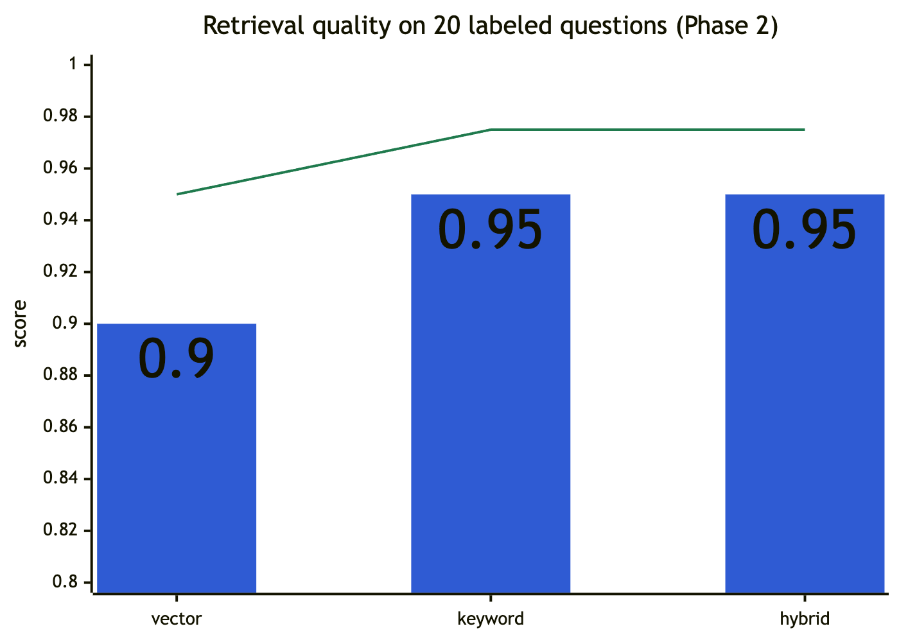

# 05 Low-level design: ingestion-service and the knowledge pipeline

Spring Boot 4.0.8. Package `ingestion-service/src/main/java/dev/sentinel/ingestion`. Port **8090** (actuator only: health and Prometheus). The service turns uploaded documents into searchable chunks, and **owns every database migration** for the whole system.

## 1. Classes

| Class | Role |
|---|---|
| `IngestionApplication` | Boot entry point |
| `KnowledgeDocument` | Event record `{tenantId, docId, source, title, content}` + `validate()`; `InvalidDocumentException` (not retryable) |
| `KnowledgeListener` | `@KafkaListener(topics = "knowledge.documents", groupId = "sentinel-ingestion")`; JSON → document → pipeline; error handler config |
| `IngestionPipeline` | Validate → hash → skip-if-unchanged → chunk → embed (batch) → atomic replace; metrics |
| `MarkdownChunker` | Heading-aware chunking with overlap |
| `KnowledgeRepository` | RLS-bound SQL: `isCurrent`, `replace` |
| `MigrateOnly` | Profile `migrate`: run Flyway, then exit (the Kubernetes hook Job) |

`KnowledgeListener` and `IngestionPipeline` are `@Profile("!migrate")`, so a migrate-only run needs neither Kafka nor the embedding model.

## 2. Event contract
- Topic **`knowledge.documents`**, 6 partitions (compose). Key `"<tenantId>:<docId>"`: all versions of a document land on one partition, in order.
- Value (JSON, UTF-8), fixture `contracts/knowledge-document.event.json`:
  ```json
  {"tenantId":"acme","docId":"db-connection-pool","source":"knowledge/acme/db-connection-pool.md",
   "title":"Database connection pool exhaustion","content":"# Database connection pool exhaustion\n..."}
  ```
- The producer is the gateway, which sets `tenantId` from the JWT. Clients can't choose the tenant.

## 3. Pipeline



*Figure 5.1: Ingestion pipeline: validate, skip unchanged, chunk, embed, atomic replace*

- **Idempotency:** replaying the topic, or re-uploading unchanged content, costs nothing (verified: re-seeding all 8 runbooks produced no new `indexed` lines).
- **Contextual chunk header:** the heading path is embedded together with the text, so a chunk that only says "run step 3" still lands near queries about its procedure.
- **Atomic replace:** readers see the old version or the new version of a document, never a mix.

### 3.1 `MarkdownChunker(maxChars = 1200, overlapChars = 150)`



*Figure 5.2: Heading-aware chunking: each chunk keeps its heading path*

1. Scan lines. A heading is `#`×n (1–6) **followed by a space** (`#hashtag` isn't a heading). On a heading, emit the current section, then update the heading path: setting level n clears levels > n.
2. Heading path = `title > h(level 1..6, skipping a level equal to the title)`, e.g. `Checkout rollback runbook > Mitigation > Rollback`.
3. Each section's body is split into paragraphs (blank lines) and packed into chunks ≤ `maxChars`. When a paragraph doesn't fit, emit the chunk and start the next with the previous chunk's last `overlapChars` characters, trimmed to a word boundary.
4. A single paragraph longer than `maxChars` is hard-split with the same overlap.
5. Empty sections produce nothing; chunk indexes are sequential per document.
6. The constructor rejects `overlap ≥ max`.

Seven unit tests pin these rules (`MarkdownChunkerTest`).

### 3.2 `KnowledgeRepository`
Every method first binds the tenant in its transaction (`set_config('app.tenant_id', ?, true)`); RLS does the rest.
- `isCurrent`: `count(*) WHERE tenant_id, doc_id, content_hash` > 0.
- `replace`:
  1. `INSERT … ON CONFLICT (tenant_id, doc_id) DO UPDATE SET source, title, content_hash, updated_at = now()`;
  2. `DELETE FROM knowledge_chunks WHERE tenant_id AND doc_id`;
  3. `INSERT` each chunk with `embedding = ?::vector` (literal `[f1,f2,…]`).

  The `tsv` column is generated by Postgres.

## 4. Error handling



*Figure 5.3: Retry and dead-letter handling*

`DefaultErrorHandler(DeadLetterPublishingRecoverer(kafkaTemplate), ExponentialBackOff(500 ms, ×2, max elapsed 10 s))`:
- **Transient** failures (DB, embedding) retry with backoff, then go to **`knowledge.documents-dlt`**, so a poison message can't block its partition.
- `InvalidDocumentException` (malformed JSON or missing fields) is **not retryable** and goes to the DLT immediately.

## 5. Embeddings
- Model: `all-MiniLM-L6-v2` ONNX, 384 dimensions, via Spring AI Transformers. Local inference: no API key, no per-call cost, private.
- **The gateway must use the same model** (`spring.ai.model.embedding: transformers` in both), or vectors land in different spaces.
- Model location:
  - Container images: baked at `/models/all-MiniLM-L6-v2/model.onnx` (`SENTINEL_EMBEDDING_MODEL_URI=file:…`).
  - Local dev: `.models/` (downloaded once by `scripts/dev-local.sh`).
  - Otherwise: Hugging Face.

  Runtime download is avoided on purpose: in Phase 2 a slow link (~700 KB/s) made startup look hung.
- Changing the model means re-embedding everything (the dimension is fixed in the schema); replaying the topic does it.

## 6. Migrations (the schema owner)
- Flyway scripts live in `src/main/resources/db/migration` (`V1`–`V5`; see [08](08-data-model.md)). Gateway integration tests migrate throwaway databases from the same files (`filesystem:../ingestion-service/...`).
- Flyway connects as the **admin** role (`SENTINEL_DB_ADMIN_USER/PASSWORD`). The service itself uses `sentinel_app`. Placeholder `${app_password}` sets that role's password in `V1`.
- Profile **`migrate`**: no web server, no embedding model, Kafka listener off. `MigrateOnly` exits the JVM after Flyway finishes. In Kubernetes this runs as a `pre-install,pre-upgrade` Helm hook Job, the only workload with admin credentials; serving pods run with `SPRING_FLYWAY_ENABLED=false`.

## 7. Metrics
`sentinel.ingestion.documents{outcome=indexed|unchanged}`, `sentinel.ingestion.chunks` (exposed as `sentinel_ingestion_*_total`).

## 8. Hybrid retrieval (read side, in the gateway)



*Figure 5.4: Hybrid retrieval: two rankings in one RLS-bound transaction, fused by rank*

Covered in [03 §5.2](03-lld-gateway.md#52-knowledgesearch): vector top 20 + keyword top 20 (OR-lexeme `tsquery`), fused with RRF (k = 60), all inside one RLS-bound transaction. Measured on 20 labeled questions (Phase 2):

| Mode | recall@1 | recall@5 | MRR |
|---|---|---|---|
| vector | 0.90 | 1.00 | 0.950 |
| keyword | 0.95 | 1.00 | 0.975 |
| hybrid | 0.95 | 1.00 | 0.975 |



*Figure 5.5: Retrieval quality per mode: recall@1 (bars) and MRR (line)*


*Figure 5.6: The console's knowledge page runs one query in all three modes side by side*

With 8 documents and 20 questions the differences are one question, so not significant. Hybrid fixed vector's miss on "checkout slow but CPU looks fine"; "pods keep getting OOMKilled" still ranks second (a reranker case).

## 9. Configuration
`SPRING_DATASOURCE_URL`, `SENTINEL_DB_APP_PASSWORD`, `SENTINEL_DB_ADMIN_USER`, `SENTINEL_DB_ADMIN_PASSWORD`, `SPRING_KAFKA_BOOTSTRAP_SERVERS` (consumer `auto-offset-reset: earliest`), `SENTINEL_EMBEDDING_MODEL_URI`, `SENTINEL_MODEL_CACHE`, `SPRING_FLYWAY_ENABLED` (false in Kubernetes serving pods), `SPRING_FLYWAY_CONNECT_RETRIES` (30 in the hook Job).

## 10. Tests (10)
`MarkdownChunkerTest` (7) and `IngestionPipelineIT` (3, Testcontainers pgvector): index → unchanged → replace; RLS hides other tenants **and** unscoped reads; invalid documents rejected. Details in [14](14-testing-and-ci.md#ingestion-service).
