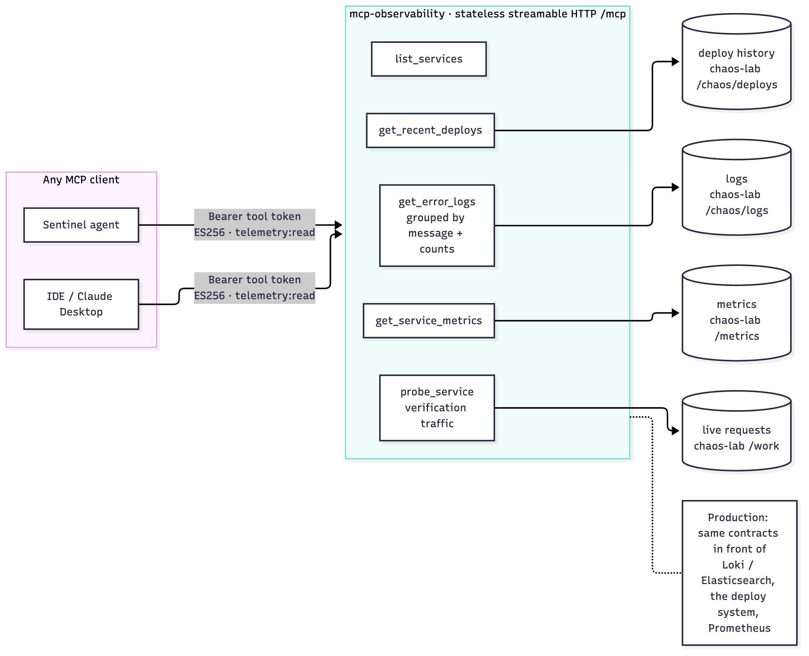
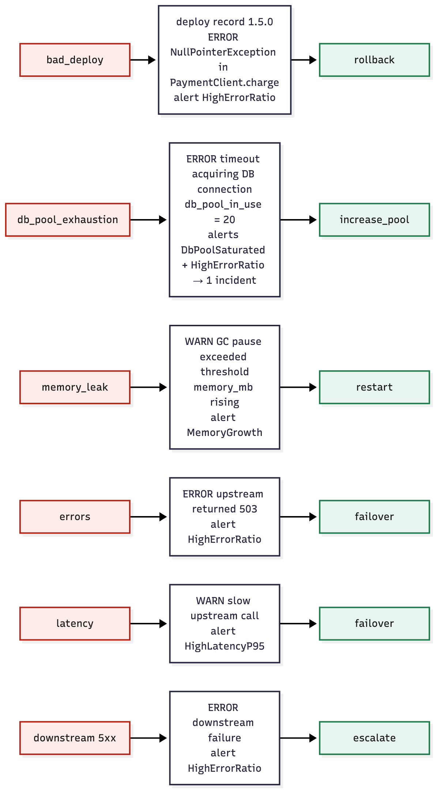
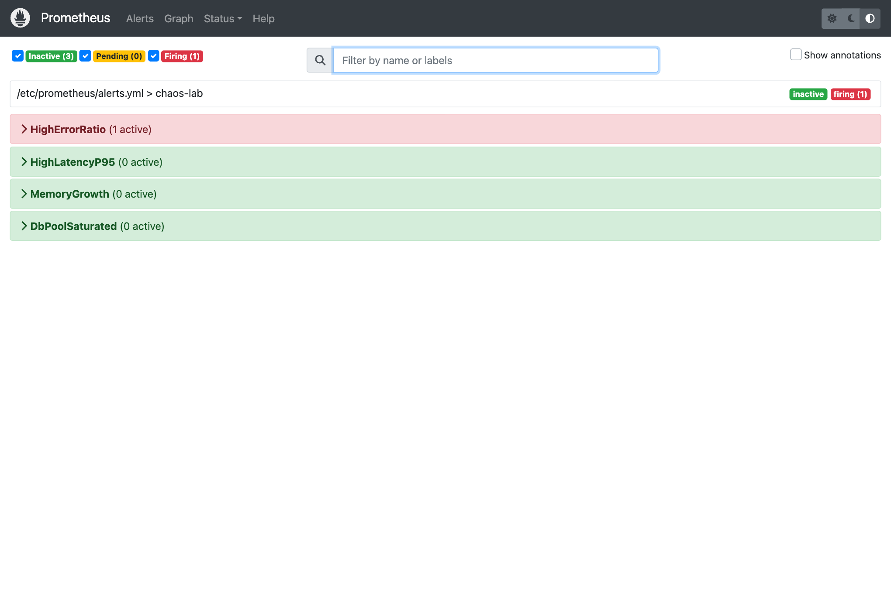
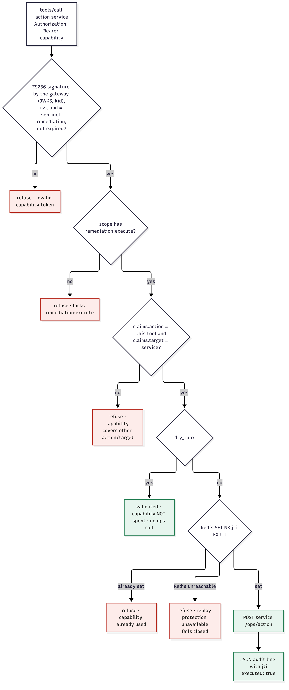

# 06 Low-level design: MCP servers (observability, remediation) and chaos-lab

## Part A: `mcp-tools/observability`

*Figure 6.1: The observability MCP server: read-only telemetry tools any MCP client can use*

A standalone MCP server (Python 3.12, `mcp` 1.x `FastMCP`) exposing **read-only telemetry tools**. Any MCP client can use it: Sentinel's agent, an IDE, Claude Desktop. In production the same tool contracts would front Loki/Elasticsearch, the deploy system and Prometheus; the agent wouldn't change.

### A.1 Transport and runtime
- Streamable HTTP at **`/mcp`**, port **8200** (`HOST`, `PORT`), `stateless_http=True`, `json_response=True`. No MCP sessions, so replicas need no sticky routing.
- `GET /healthz` (custom route).
- Server `instructions` tell clients that log messages are untrusted data.
- Backend mapping from `OBSERVED_SERVICES="checkout=http://checkout:8000,inventory=http://inventory:8000"`. Unknown service → tool error (`isError: true`), not a crash.
- Outbound HTTP timeout 3 s.
- **Authentication (Phase 8):** `RequireToolToken`, an ASGI middleware, guards `/mcp`. It needs a gateway tool token: ES256 via the gateway's JWKS, `aud=sentinel-mcp`, scope `telemetry:read`. Otherwise it answers **401** with `WWW-Authenticate: Bearer`. Verification runs off the event loop (a JWKS fetch may block). `/healthz` stays open. `SENTINEL_MCP_AUTH=disabled` turns it off for local experiments.
- Tracing (when `OTEL_EXPORTER_OTLP_ENDPOINT` is set): the ASGI app is wrapped in `OpenTelemetryMiddleware` (one server span per request; per-chunk send/receive spans excluded) and httpx is instrumented, so the agent's trace continues into chaos-lab.
- Runtime: `python server.py` → `uvicorn.run(app())`. The container runs `/app/.venv/bin/python server.py` directly; `uv run` needs a writable cache and broke under a read-only root filesystem (Phase 6).

### A.2 Tools and wire shapes
**Contract: every tool returns exactly one JSON object (one text content block).** FastMCP sends a list-returning tool as one block per item, which made one-item results ambiguous and broke parsing live in Phase 3. `test_server.py` asserts the single-object shape.

| Tool | Input | Output |
|---|---|---|
| `list_services` | — | `{"services": ["checkout", "inventory"]}` |
| `get_recent_deploys` | `service` | `{"service": s, "deploys": [{version, commit, ts, change}, …]}` (oldest first; `[]` = nothing recent) |
| `get_error_logs` | `service`, `level` = `ERROR`\|`WARN` (default ERROR), `limit` (default 200, max 500) | `{"service", "level", "logs": [{"message", "count", "latest": {ts, version, …fields}}]}`, grouped by message, most frequent first |
| `get_service_metrics` | `service` | `{"service", "metrics": {name: value}}` for `chaos_requests_total{status=…}`, `chaos_request_seconds_sum/count`, `chaos_memory_mb`, `chaos_db_pool_in_use` (the `service` label is stripped) |
| `probe_service` (Phase 7) | `service`, `requests` (default 20, max 50) | `{"service", "requests", "ok", "errors", "success_rate", "p95_ms"}` from real `GET /work` calls made now |

Grouping logs (`count`, `latest`) keeps output small when one error repeats thousands of times, and gives the model frequency.

**`probe_service`** is how the agent verifies a remediation. Counters say what happened over the last minute; a probe measures the service *now*.
- Requests are sent **concurrently** (at most 10 in flight), each capped at `PROBE_TIMEOUT_S` (3 s). A timeout or 5xx counts as a failure.
- So one probe is bounded at about two rounds × 3 s even when the service is still slow.
- *Why concurrent:* the first version was sequential. Under the latency fault one probe took about 45 s, and verification would have outrun the gateway's 120 s read timeout. Found by reviewing worst cases before the live run.

### A.3 Tests (12)
Tool discovery over a real in-memory MCP client session; log grouping/counts; metric parsing without label noise; unknown service → tool error; invalid level rejected; a single deploy is still one unambiguous object; probe success rate and p95; probe timeouts count as failures and requests are capped at 50; probe of an unknown service → tool error; `/mcp` without a token → 401, with a valid tool token → 200; wrong audience, missing `telemetry:read` or a forged key → 401; health stays open.

---

## Part B: `chaos-lab`

Demo microservices (FastAPI, one image run as `checkout` and `inventory`) whose faults produce **realistic, distinguishable telemetry**. They're the agent's world in the live demo and the template for the benchmark's scenarios.

### B.1 Endpoints (port 8000 in the container; 8101/8102 on the host)

| Endpoint | Purpose |
|---|---|
| `GET /work` | A unit of work; applies the active fault; calls `DOWNSTREAM_URL/work` if set (checkout → inventory) |
| `POST /chaos/fault {type}` | Set the fault: `none`, `latency`, `errors`, `memory_leak`, `db_pool_exhaustion`, `bad_deploy` |
| `POST /ops/rollback` | Restore baseline `1.4.2`; appends a `rollback` deploy record (`commit: rollback`, "rollback from 1.5.0") |
| `POST /ops/restart` | Clear the leak, reset the pool |
| `POST /ops/pool {size}` | Raise the pool limit (resets in-use connections) |
| `POST /ops/failover` | Serve from the degraded path (e.g. cached prices) |
| `POST /ops/scale {replicas}` | Scale out (fixes none of the lab's faults: verification catches that) |
| `GET /chaos/logs?level=&limit=` | Recent structured log lines (ring buffer, 500) |
| `GET /chaos/deploys` | Deploys since the baseline build |
| `GET /metrics` | Prometheus |
| `GET /healthz` | Liveness |

### B.2 Faults and the signals they produce

*Figure 6.2: Each injectable fault, the signals it produces, and the remediation the agent should propose*

| Fault | Behavior per request | Log signature (level) | Metric signal |
|---|---|---|---|
| `latency` | sleep 1.5–3 s | `slow upstream call` (WARN, `upstream=pricing-api`) | latency sum up |
| `errors` | 60% → HTTP 503 | `upstream returned 503` (ERROR) | `status="error"` up |
| `memory_leak` | +256 KB retained; every 20th request logs | `GC pause exceeded threshold` (WARN, `gc_pause_ms`, `heap_mb`) | `chaos_memory_mb` rises |
| `db_pool_exhaustion` | pool +1 per request up to 20; at 20 → HTTP 500 | `timeout acquiring DB connection` (ERROR, `pool_max=20`, `wait_ms=30000`) | `chaos_db_pool_in_use` = 20 |
| `bad_deploy` | deploy record `1.5.0` (`a1b2c3d`, "switch payment client to async pool") added once; 40% → HTTP 500 | `deployment completed` (INFO); `NullPointerException in PaymentClient.charge` (ERROR, stack) | errors up; `chaos_deploy_version` |
| downstream 5xx | (from `DOWNSTREAM_URL`) → HTTP 502 | `downstream failure` (ERROR) | errors up |
| `none` | **full heal:** version back to 1.4.2, deploys cleared, leak and pool reset, log buffer cleared | — | — |

Design rules learned in Phase 1:
- The "fault injected" message goes to **stdout only**, never into the log buffer the agent reads. Otherwise the agent would read the answer as evidence.
- Re-injecting `bad_deploy` doesn't duplicate the deploy record.

### B.3 The ops API (Phase 7): what a deploy tool would do
`/ops/*` is the lab's stand-in for the team's deploy tooling. Each operation:
- fixes the active fault **only if it is the right fix**:

  | Operation | Fixes |
  |---|---|
  | rollback | `bad_deploy` |
  | restart | `memory_leak` |
  | increase_pool | `db_pool_exhaustion` |
  | failover | `errors`, `latency` |
  | scale_out | nothing in the lab |

- logs `remediation applied: <op>` with `fixed_active_fault`;
- returns `{service, operation, fixed_active_fault, version, …details}`.

A wrong fix therefore really leaves the service broken, and verification has to catch it. That is exactly what `test_fix_that_doesnt_heal_is_caught_by_verification` models.

The rollback's deploy record matters. In the first live run, it made the *next* incident (a pool fault minutes later) look deploy-correlated, and the agent proposed rollback again. Evidence now labels it `rollback completed` and the earlier build `rolled back, no longer running`; neither counts as a suspect (chapter 04 §8).

### B.4 Traffic and alerts
- `chaos-lab/service/loadgen.py` sends steady traffic to `LOADGEN_TARGETS` (default `http://localhost:8101`) every `LOADGEN_INTERVAL_S` (0.2 s). Checkout calls inventory, so both get traffic. Without it, a fault produces no metrics and no alert fires.
- Prometheus rules in `deploy/prometheus/alerts.yml` (validated with `promtool check rules`). Every rule carries `service` (required by Sentinel) and `severity`:

  | Alert | Expression | For | Severity | Faults it catches |
  |---|---|---|---|---|
  | `HighErrorRatio` | error rate / total rate (1 m) > 0.2 | 30 s | critical | `bad_deploy`, `errors`, `db_pool_exhaustion`, downstream 5xx |
  | `HighLatencyP95` | p95 of `chaos_request_seconds` (1 m) > 1 s | 30 s | warning | `latency` |
  | `MemoryGrowth` | `chaos_memory_mb` > 300 | 15 s | warning | `memory_leak` |
  | `DbPoolSaturated` | `chaos_db_pool_in_use` ≥ 20 | 15 s | critical | `db_pool_exhaustion` |

  

  *Figure 6.3: Prometheus alerts during the live run: HighErrorRatio firing for checkout after a bad deploy (this alert opened the incident in figure 7.12)*

  Demo-fast `for:` windows; production would use minutes. Pool exhaustion trips two rules: the gateway correlates them into one incident (chapter 03 §4A).

### B.5 `chaos-lab/inject.py`
`python3 chaos-lab/inject.py <checkout|inventory> <fault>` sets the fault on host ports 8101/8102, then generates 20 s of traffic so the signals exist.

---

## Part C: `mcp-tools/remediation` (Phase 7)

*Figure 6.4: The remediation adapter: every check passes before any side effect; the jti is spent atomically; Redis down means refuse*

A deploy-tool adapter over MCP (port **8300**, stateless streamable HTTP, same runtime conventions as Part A). It is the only component that changes production, and it trusts nothing except a capability.

### C.1 Tools

| Tool | Args | Ops call |
|---|---|---|
| `rollback` | `service`, `dry_run` | `POST /ops/rollback` |
| `restart` | `service`, `dry_run` | `POST /ops/restart` |
| `increase_pool` | `service`, `size` (1–60, runbook cap), `dry_run` | `POST /ops/pool` |
| `failover` | `service`, `dry_run` | `POST /ops/failover` |
| `scale_out` | `service`, `replicas` (1–10; more needs a capacity review), `dry_run` | `POST /ops/scale` |

Targets come from `OPS_SERVICES="checkout=http://…,inventory=http://…"`. Unknown service → tool error.

### C.2 `authorize(token, action, service, dry_run)`
The bearer comes from the MCP request's `Authorization` header (via the request context).
1. `GATEWAY.verify(token, "sentinel-remediation")` (`gateway_keys.py`, Phase 8):
   - **ES256 only** (anything else → "only ES256 gateway tokens are accepted");
   - the key is chosen by `kid` from the gateway's JWKS (`SENTINEL_ISSUER` / `SENTINEL_JWKS_URL`; cached, refetched on an unknown `kid`);
   - `iss`, `aud`, `exp` and `iat` required; `jti` required.

   Failure → "invalid capability token". **The adapter holds no secret**: it can verify capabilities but never mint one. Phase 7 used a shared HS256 secret, which anything holding it could have forged with.
2. `scope` must contain `remediation:execute`.
3. `claims.action == <this tool>` and `claims.target == service`, else "capability covers X on Y, not A on S".
4. **Not dry run:** `STORE.claim(jti, ttl = exp − now)`, which is Redis `SET NX EX` (`SENTINEL_REPLAY_STORE`, default `redis://localhost:6379/0`; `memory` for tests).
   - Already present → "capability already used".
   - **Redis unreachable → "replay protection unavailable, refusing to execute"** (fail closed).

Only then the ops call. Output: one JSON audit line (`audit: remediation`, action, service, dry_run, incident_id, tenant_id, approved_by, jti, result) and `{"executed": not dry_run, "dry_run", "action", "service", "incident_id", "result"}`.

### C.3 Why the checks live here
Defense in depth:
- the gateway decides *whether* to mint;
- the adapter decides *whether a token permits this exact call*.

A bug or injection in the agent can't widen the approval. A leaked capability is worth one operation for at most 5 minutes, and nothing at all once spent.

### C.4 Tests (14)
See [14 Testing & CI](14-testing-and-ci.md#mcp-remediation-14): execute-once with the replay refused before the service is reached; five not-exactly-approved variants; missing or forged token (attacker EC key with the same `kid`); **a capability forged with the old shared HS256 secret is refused**; a capability from another issuer is refused; dry run doesn't consume; Redis outage fails closed; pool and scale-out bounds.
