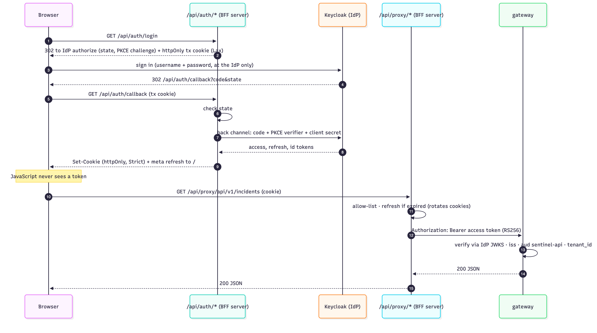
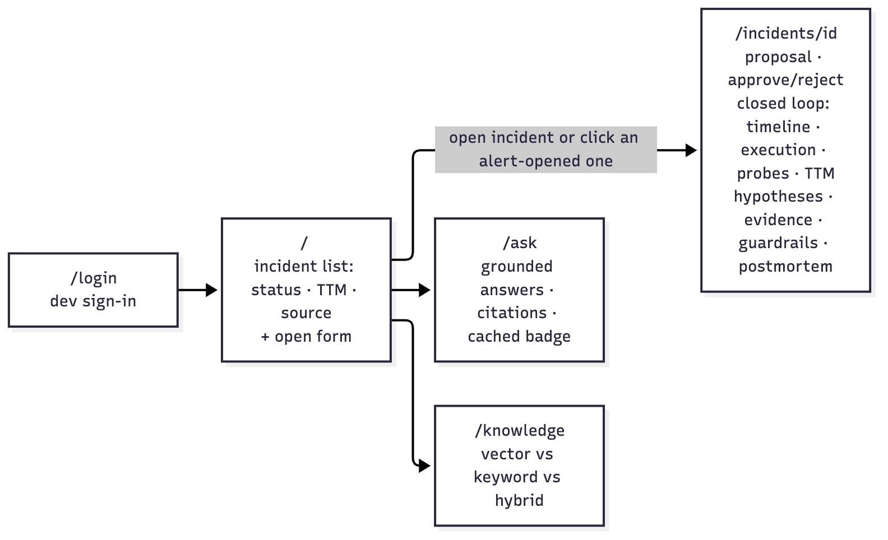
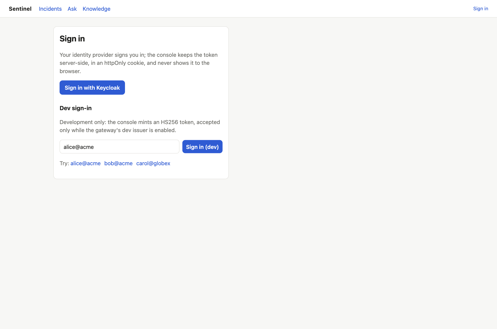
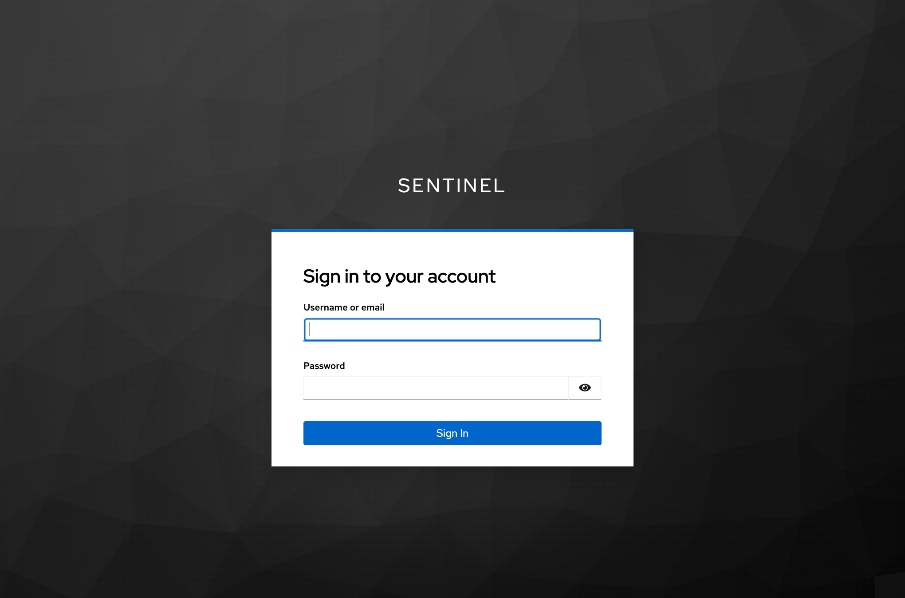
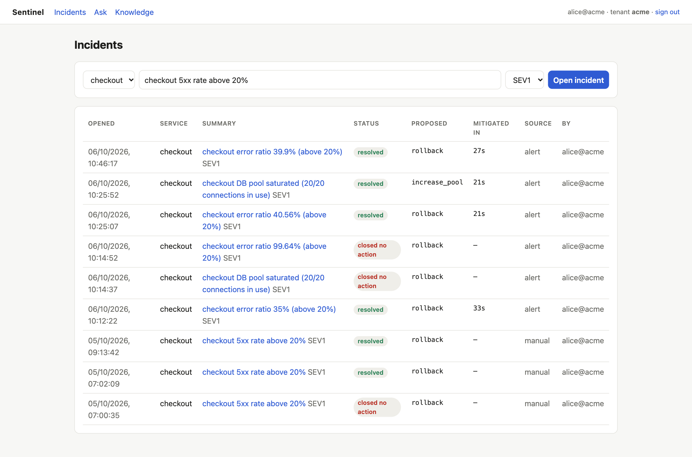
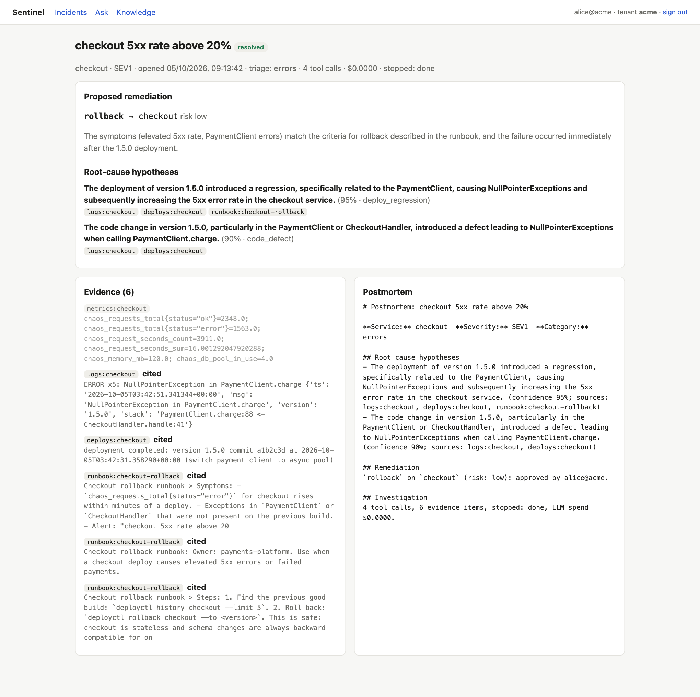
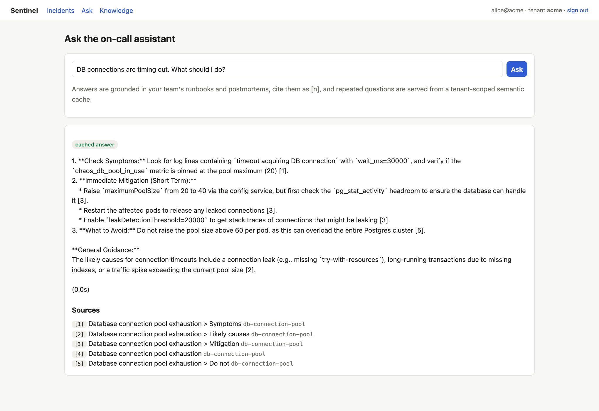
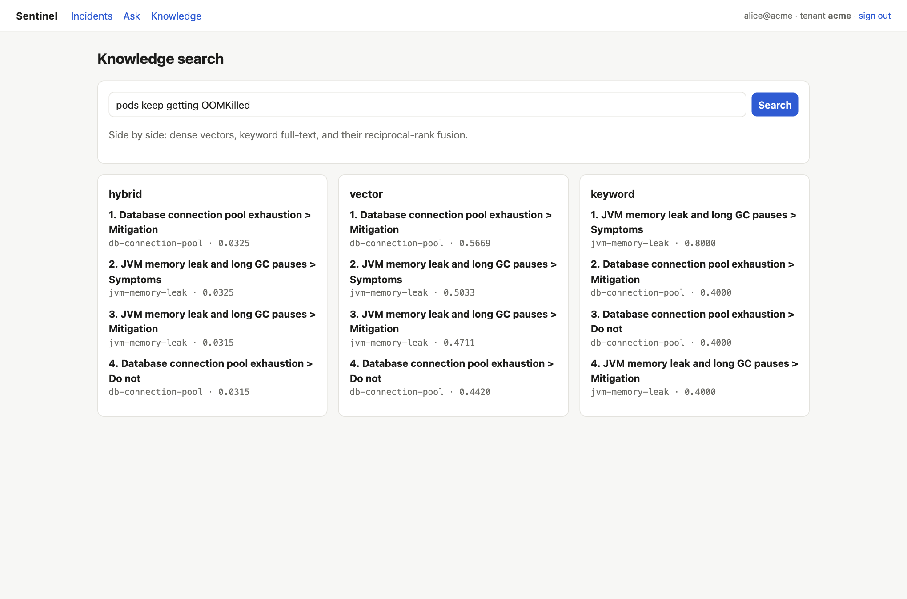

# 07 Low-level design: web console

Next.js 16.3 (App Router), React 19.3, TypeScript 5.9. Directory `web/`. Port **3000**. `output: "standalone"` for a small container.

## 1. Architecture: backend-for-frontend (BFF)

*Figure 7.1: Backend-for-frontend: the token lives in an httpOnly cookie; the proxy enforces an allow-list*

**Why:** the user's token (from the IdP since Phase 8, or the dev login) lives only in an **httpOnly** cookie, so JavaScript (including injected script after an XSS) can't read or exfiltrate it. `SameSite=Strict` blocks cross-site request forgery for this same-origin app. The browser never talks to the gateway directly.

## 2. Server modules
- **`lib/oidc.ts`** (`server-only`, Phase 8): the OIDC authorization code flow with **PKCE**.
  - **Discovery:** `OIDC_ISSUER/.well-known/openid-configuration`, cached 5 min. Server-to-server calls use `OIDC_INTERNAL_ISSUER` when the IdP's public URL isn't reachable from the server (containers).
  - `authorizeUrl()`: random `state` + PKCE `verifier` (S256 `code_challenge`), scope `openid profile email`.
  - `exchangeCode(code, verifier)` and `refresh(token)`: token endpoint over the back channel, with the client secret.
  - `logoutUrl()`: the IdP's end-session endpoint with `post_logout_redirect_uri` and `id_token_hint`.
- **Auth routes:**
  - `GET /api/auth/login`: stores `{state, verifier}` in a short-lived httpOnly cookie, then redirects to the IdP. The cookie is **SameSite=Lax**, because it must survive the IdP's cross-site redirect back.
  - `GET /api/auth/callback`: checks `state` (CSRF), exchanges the code with the verifier, and sets httpOnly cookies: access token, refresh token, and the id token (only as the logout hint). It answers with a small HTML `meta refresh` to `/` instead of a 302: a redirect chain that started on the IdP's site wouldn't send the `SameSite=Strict` session cookie.
  - `GET /api/auth/logout`: clears the cookies and, for OIDC sessions, ends the IdP session too.
- **`lib/session.ts`** (`server-only`):
  - `describe(token)`: display info (`preferred_username`/`sub`, `tenant_id`, roles from `roles` or `realm_access.roles`, kind `oidc`/`dev`, expired). **Not a security check**: the gateway verifies every token.
  - `getSession()`: an expired OIDC access token still counts as a session if a refresh token exists.
  - `mintDevToken(user, tenant, roles)`: the dev login (HS256, the same format as `scripts/dev_token.py`). Enabled only outside production or with `SENTINEL_DEV_LOGIN=true`, and accepted only while the gateway's dev issuer is on. Dev admins (`alice@acme`, `carol@globex`) get `tenant-admin`, mirroring the Keycloak realm.
  - Cookies: `httpOnly`, `sameSite: strict`, `secure` in production (unless `SENTINEL_INSECURE_COOKIES=true` for plain-HTTP kind), `path: /`.
- **`app/api/session/route.ts`:** dev login: `POST {user}` (`name@tenant`) sets the cookie; `DELETE` clears it.
- **`app/api/proxy/[...path]/route.ts`:** `GET`, `POST`, `DELETE`.
  - Path allow-list: `^api/v1/(incidents|ask|knowledge|integrations)(/|$)`; `..` rejected. `/mcp`, the alerts webhook, actuator and anything else return **404**.
  - **Transparent refresh:** if the OIDC access token has expired, it uses the refresh token, forwards the request with the new token, and rotates both cookies on the response. A failed refresh → 401 ("session expired").
  - No session → 401. Gateway unreachable → 502. `GATEWAY_URL` (default `http://localhost:8080`).
- **`next.config.ts`:** `X-Frame-Options: DENY`, `X-Content-Type-Options: nosniff`, `Referrer-Policy: same-origin`; `poweredByHeader: false`.

## 3. Pages

*Figure 7.2: Console navigation*

| Route | Type | Behavior |
|---|---|---|
| `/login` | server + client | **"Sign in with Keycloak"** when OIDC is configured; the dev sign-in (free text or presets `alice@acme`, `bob@acme`, `carol@globex`) when the dev login is enabled |
| `/` | client | Incident list (auto-refresh 5 s) from `GET /api/v1/incidents`: opened, service, summary, status, proposed action, **mitigated in** (TTM), **source** (`alert` / `manual`), reviewer or opener. "Open incident" form (service, summary, severity) → navigates to the detail page |
| `/incidents/[id]` | client | Live view from `GET /api/v1/incidents/{id}`: status pill; triage, tool calls, spend, stop reason; **proposed remediation** with **Approve / Reject** (only while `AWAITING_APPROVAL`; while the approval executes and verifies, the button reads "Executing and verifying…"); hypotheses with citation chips; **Closed loop** panel once decided (timeline: alert opened, +proposal, +decision, +execution, +verification; "mitigated in" pill; execution result or error; each verification probe; healthy/unhealthy verdict); **Guardrails** panel; evidence (cited items highlighted); postmortem |
| `/settings/integrations` | client | Tenant admins only (the nav link appears for the `tenant-admin` role; the gateway enforces it): issue an Alertmanager token (shown once), list tokens with state (active / revoked / expired), issuer, last use; **Revoke** |
| `/ask` | client | Question → answer, sources `[n]`, "cached answer" badge, elapsed time |
| `/knowledge` | client | One query run in **vector, keyword and hybrid** side by side (doc id, heading, score) |

Shared:
- `lib/api.ts` (`api<T>(path, {method, body})`): goes through the proxy; 401 → redirect to `/login`; surfaces `ProblemDetail.detail`.
- `app/layout.tsx` (server component): navigation and the signed-in user/tenant.
- `lib/api.ts` `duration(s)`: `33s`, `4m`, `1.5h`, or `—`.
- Styling: `app/globals.css` tokens, with light and dark themes via `prefers-color-scheme`. Status pills: `RESOLVED` ok; `AWAITING_APPROVAL` and `ESCALATED` warn; `INVESTIGATING` and `REMEDIATING` accent; `FAILED`, `CLOSED_NO_ACTION`, `REJECTED` and `REMEDIATION_FAILED` bad.

## 4. Build and run
- `npm ci && npm run build` (includes the type check). `npm run start` → port 3000.
- Container: multi-stage `node:24-alpine`; runtime `node server.js` as user `node`.
- In `scripts/dev-local.sh` it starts automatically if `web/node_modules` exists, with `SENTINEL_DEV_LOGIN=true`.

## 5. Verified flows (Phase 6, browser; sign-in re-captured in Phase 8)

*Figure 7.3: Sign-in: "Sign in with Keycloak" (OIDC, the production path) and, in development only, the dev sign-in*

*Figure 7.4: Keycloak's sign-in page for the sentinel realm, reached by the console's authorization request (code + PKCE)*

*Figure 7.5: Integrations (tenant admins): Alertmanager tokens issued by the gateway, their state, issuer, last use, and Revoke*

*Figure 7.6: Incident list for tenant acme (Phase 7): alert-opened incidents with time to mitigate; the two "closed no action" rows are the duplicate/pre-fix incidents found in the live run*

*Figure 7.7: Incident detail awaiting approval: proposal, hypotheses with citation chips, evidence with cited items highlighted*

*Figure 7.8: After approval: resolved, with the generated postmortem*

![Ask: an answer from gemma4 grounded in the db-connection-pool runbook, citing sections [1]-[5]](images/screens/console-ask.png)

*Figure 7.9: Ask: an answer from gemma4 grounded in the db-connection-pool runbook, citing sections [1]-[5]*

*Figure 7.10: The same question again, served from the semantic cache in 0.0 s (cached answer badge)*

*Figure 7.11: Knowledge search: the same query in vector, keyword and hybrid modes*

Sign in → open incident → evidence, citations and rollback proposal shown → Approve → `resolved` with postmortem → the list shows the record. The same walk-through exposed the PII false positive on a metric float (fixed; see 04 §7.1).

### 5.1 Phase 7: an alert-opened incident, approved in the console

*Figure 7.12: An incident opened by Alertmanager, approved in the console: rollback executed, verified healthy, mitigated in seconds*

`inject.py checkout bad_deploy` → the `HighErrorRatio` alert opens the incident by itself (summary from the alert annotation, "opened" = the alert's `startsAt`) → Approve (as `alice@acme`) → the panel shows:
- the rollback result (`from_version=1.5.0 · to_version=1.4.2 · fixed_active_fault=true`);
- one healthy probe (100%, p95 93 ms);
- **mitigated in 33 s**.

The list shows the incident's source as `alert` and its TTM.

### 5.2 Phase 8: OIDC sign-in and integrations
"Sign in with Keycloak" → the Keycloak page (figure 7.4) → back to the console as `alice@acme · tenant acme` (no "(dev)" marker), with the admin-only **Integrations** link. The Alertmanager token provisioned by `dev-local.sh` is listed, issued by `provisioner@acme`, with its last use. The same session approved an alert-opened incident end to end (mitigated in 41 s; chapter 15).
