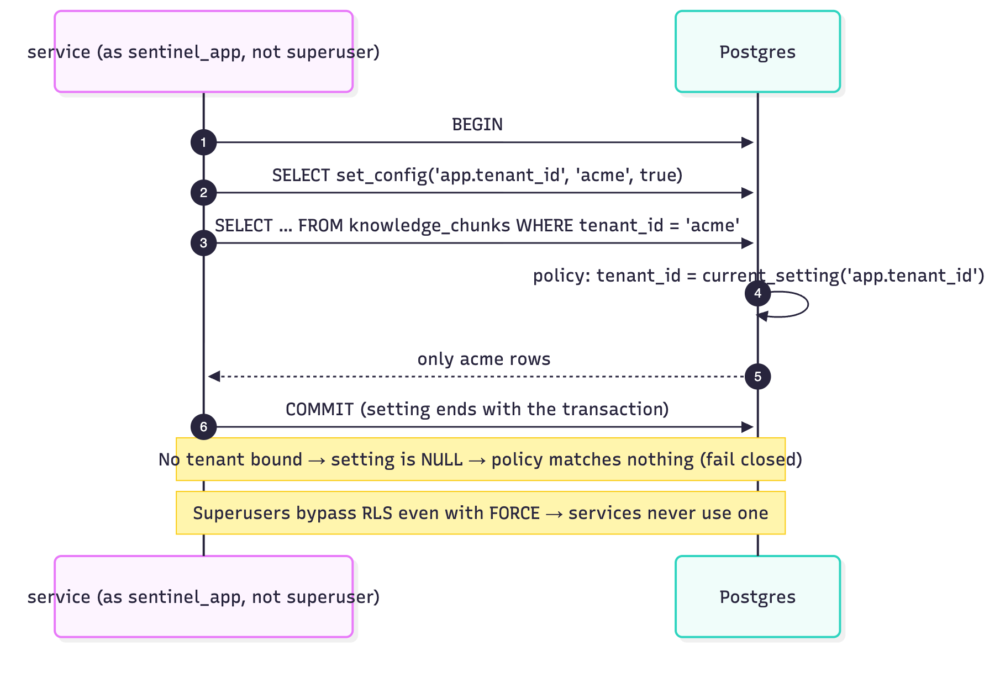
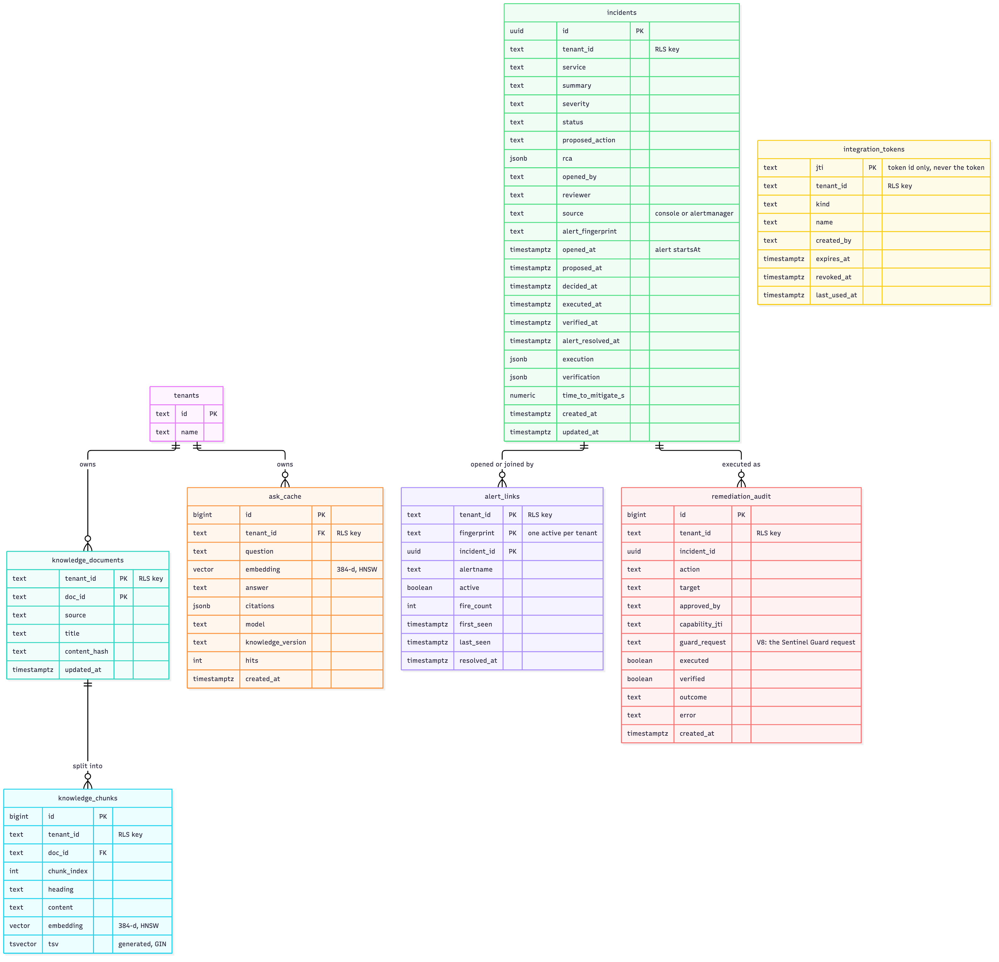
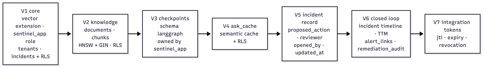

# 08 Data model

One PostgreSQL 16 database (`sentinel`) with the `vector` extension. All tenant data is protected by **row-level security**. Migrations: `ingestion-service/src/main/resources/db/migration`.

## 1. Roles and how RLS is enforced

| Role | Used by | Privileges |
|---|---|---|
| `sentinel` (admin / owner) | Flyway only (migrate Job; dev compose) | Owns the tables; creates the app role |
| `sentinel_app` | gateway, ingestion, agent (checkpoints) | `SELECT, INSERT, UPDATE, DELETE` on tables, `USAGE, SELECT` on sequences (default privileges); owns schema `langgraph` |

How isolation is guaranteed:



*Figure 8.1: How row-level security is enforced on every transaction*

1. Every tenant table has `ENABLE` **and `FORCE` ROW LEVEL SECURITY**, plus a policy `tenant_isolation … USING (tenant_id = current_setting('app.tenant_id', true))`. With no `WITH CHECK`, `USING` also applies to inserted/updated rows.
2. Services connect as **`sentinel_app`, a non-superuser**. Superusers bypass RLS even with `FORCE`; this was discovered while writing the Phase 2 tests and is why the role exists.
3. Each unit of work runs in a transaction that first executes `SELECT set_config('app.tenant_id', <tenant>, true)` (transaction-local).
4. **Fail closed:** with no tenant bound, `current_setting(..., true)` is `NULL`, so the policy matches nothing (tested: unscoped reads return zero rows).
5. Queries also filter `tenant_id = ?` explicitly. That's belt and braces, and it lets the planner use indexes.

## 2. Entity-relationship diagram



*Figure 8.2: Entity-relationship diagram*

## 3. Tables

### `tenants` (V1)
Seeded with `acme` and `globex`. Referenced by `knowledge_documents` and `ask_cache`. `incidents` no longer references it (V5): tenants come from the identity provider, so creating an incident for a tenant the IdP knows mustn't require a row here first.

### `incidents` (V1, extended in V5 and V6): system of record for incidents
| Column | Notes |
|---|---|
| `id uuid PK` | Generated by the gateway |
| `tenant_id text` | RLS key |
| `service, summary, severity` | From the open request |
| `status text` | `INVESTIGATING`, `AWAITING_APPROVAL`, `REMEDIATING`, `RESOLVED`, `REMEDIATION_FAILED`, `ESCALATED`, `CLOSED_NO_ACTION`, `FAILED` (default in V1: `OPEN`, never used since V5) |
| `proposed_action text` | From the agent's RCA; preserved across later updates |
| `rca jsonb` | Full RCA after guardrails (audit) |
| `opened_by`, `reviewer` | JWT subjects (`alertmanager:<alertname>` for alert-opened incidents) |
| `created_at`, `updated_at` | |
| `source text` (V6) | `console` (default) or `alertmanager` |
| `alert_fingerprint text` (V6) | The alert that opened it |
| `opened_at timestamptz` (V6) | When the problem began: the alert's `startsAt`, or the console request time. TTM is measured from here |
| `proposed_at`, `decided_at`, `executed_at`, `verified_at` (V6) | The timeline, mirrored from the agent |
| `alert_resolved_at` (V6) | When the incident's last linked alert resolved |
| `execution jsonb`, `verification jsonb` (V6) | Adapter result / probe samples |
| `time_to_mitigate_s numeric` (V6) | `verified_at − opened_at` when verified healthy, else null |

Index `incidents_tenant_created_idx (tenant_id, created_at DESC)` serves the list view. The workflow's source of truth is the agent's checkpoint; this table is its projection for listing and audit.

### `alert_links` (V6): which alert belongs to which incident
| Column | Notes |
|---|---|
| `tenant_id`, `fingerprint`, `incident_id` | PK `(tenant_id, fingerprint, incident_id)`; FK → `incidents` |
| `alertname` | For display and correlation |
| `active` | True until the incident is final or the alert resolves |
| `fire_count`, `first_seen`, `last_seen` | Re-deliveries counted (deduplicated) |
| `resolved_at` | From Alertmanager's `resolved` notification |

- `alert_links_one_active` is a **partial unique index** on `(tenant_id, fingerprint) WHERE active`: at most one active incident per alert. It is the backstop.
- The primary serialization is a per-(tenant, service) advisory lock in `AlertLinkRepository.link`, which also covers correlation across different fingerprints (chapter 03 §4A.3).
- The comment inside `V6__closed_loop.sql` still describes the first design (the index as the lock via `ON CONFLICT DO NOTHING`). It is left as is because applied migrations are never edited (their checksum is verified).
- RLS `FORCE`.

### `remediation_audit` (V6, extended in V8): append-only
`id bigserial`, `tenant_id`, `incident_id`, `action`, `target`, `approved_by`, `capability_jti`, `guard_request` (V8), `executed`, `verified` (null if never verified), `outcome` (final status), `error`, `created_at`. Index `(tenant_id, incident_id)`. RLS `FORCE`.
- Joined with the remediation adapter's JSON audit log by `capability_jti`.
- Since Phase 11, `guard_request` links to the Sentinel Guard request whose signed audit chain records who approved it (via the gateway) and when it ran.

Every operation has an approval, and every approval at most one operation.

### `integration_tokens` (V7): issued, revocable integration credentials
`jti` (PK), `tenant_id`, `kind` (`alertmanager`), `name`, `created_by`, `created_at`, `expires_at`, `revoked_at`, `revoked_by`, `last_used_at`. Index `(tenant_id, created_at DESC)`. RLS `FORCE`.

- **Only the token's id is stored, never the token.** A database leak can't be replayed against the webhook.
- The alerts webhook accepts an integration token only while its row is active (not revoked, not expired), and stamps `last_used_at`. Revocation is effective on the next delivery.

### Schema `langgraph`: row-level security (Phase 8)
The agent's checkpoint tables (`checkpoints`, `checkpoint_blobs`, `checkpoint_writes`) are created by LangGraph's `setup()`. The agent then enables and FORCEs RLS on them, with policy `tenant_isolation`:

```sql
USING (split_part(thread_id, ':', 1) = current_setting('app.tenant_id', true))
```

- Each checkpoint cursor sets `app.tenant_id` from the tenant that the gateway's per-call token proved (`app/checkpoint.py`, `app/tenancy.py`).
- No tenant means nothing is visible.
- FORCE is lifted only while `setup()` runs LangGraph's own migrations.
- `test_postgres_checkpointer.py` proves cross-tenant reads return nothing, cross-tenant writes fail, and the tables force RLS for their owner.

### `knowledge_documents` (V2)
PK `(tenant_id, doc_id)`. `content_hash` = SHA-256 of `title + "\n" + content`; it powers the skip-if-unchanged check and the `/ask` knowledge version.

### `knowledge_chunks` (V2)
| Column | Notes |
|---|---|
| `embedding vector(384) NOT NULL` | `all-MiniLM-L6-v2` |
| `tsv tsvector GENERATED ALWAYS AS (setweight(to_tsvector('english', heading), 'A') \|\| setweight(to_tsvector('english', content), 'B')) STORED` | The heading weighs more than the body |

- Unique `(tenant_id, doc_id, chunk_index)`; FK `(tenant_id, doc_id)` → documents `ON DELETE CASCADE`.
- Indexes: **HNSW** `embedding vector_cosine_ops`; **GIN** `tsv`; btree `tenant_id`.
- The vector and the text index live in the **same row**: one write, and no consistency drift between them (ADR-0003).

### `ask_cache` (V4)
Semantic cache for `/ask`; see [03 §6.2](03-lld-gateway.md#62-semanticcache). Indexes: HNSW on `embedding`; btree `(tenant_id, knowledge_version)`. RLS forced.

### Schema `langgraph` (V3 creates it; the agent creates its tables, then applies RLS: see above)
`CREATE SCHEMA langgraph AUTHORIZATION sentinel_app`. `AsyncPostgresSaver.setup()` then creates and migrates its own tables (`checkpoints`, `checkpoint_blobs`, `checkpoint_writes`, `checkpoint_migrations`) as `sentinel_app`. Isolation here is by **thread key** (`tenant:incident`), enforced in the agent, not by RLS. A known trade-off; see [16](16-limitations-and-roadmap.md).

## 4. Migration history



*Figure 8.3: Flyway migration chain*

| Version | File | Change |
|---|---|---|
| V1 | `V1__core.sql` | `vector` extension; role `sentinel_app` (password from Flyway placeholder `app_password`); default privileges; `tenants`, `incidents` + RLS (FORCE); seed tenants |
| V2 | `V2__knowledge.sql` | `knowledge_documents`, `knowledge_chunks` (vector + generated tsvector), HNSW/GIN indexes, RLS (FORCE) |
| V3 | `V3__agent_checkpoints.sql` | Schema `langgraph` owned by `sentinel_app` |
| V4 | `V4__ask_semantic_cache.sql` | `ask_cache` + indexes + RLS (FORCE) |
| V5 | `V5__incident_record.sql` | `incidents`: `proposed_action`, `reviewer`, `opened_by`, `updated_at`; drop FK to `tenants`; list index |
| V6 | `V6__closed_loop.sql` | `incidents`: `source`, `alert_fingerprint`, `opened_at`, timeline columns, `alert_resolved_at`, `execution`, `verification`, `time_to_mitigate_s`; new `alert_links` (partial unique index on active links) and `remediation_audit`, both RLS (FORCE) |
| V7 | `V7__integration_tokens.sql` | `integration_tokens` (jti only, expiry, revocation, last use) + RLS (FORCE) |
| V8 | `V8__guard_requests.sql` | `remediation_audit.guard_request`: the Sentinel Guard request that authorized the remediation (Phase 11) |

Rules for new migrations:
- Never edit an applied migration; add `V<n+1>__description.sql`.
- New tenant tables must `ENABLE` + `FORCE` RLS with the `tenant_isolation` policy.
- Update this chapter, and add or extend a Testcontainers IT that proves isolation.

## 5. Kafka and Redis data
- **Kafka:** `knowledge.documents` (key `tenant:docId`, JSON value), `knowledge.documents-dlt` (failed records with Spring Kafka exception headers). Retention is Kafka's default; the topic is replayable to rebuild the index (e.g. after an embedding-model change).
- **Redis:** `ratelimit:<bucket>` hashes `{tokens, ts}` with `PEXPIRE` ≈ a full refill + 1 s. Buckets are `<tenant>` (humans), `<tenant>:agent` (tool traffic) and `<tenant>:alerts` (Alertmanager).
- **Redis (Phases 7–10, removed in Phase 11):** the remediation adapter's used-capability set (`capability:<jti>`, `SET NX EX`). Single use is now enforced by Sentinel Guard (the adapter redeems each capability there), so Redis holds only rate-limit buckets.

## 6. Sentinel Guard state (Kubernetes objects, no database)
Sentinel Guard keeps all of its state in the API server of the cluster it protects ([ADR-0010](../adr/0010-sentinel-guard.md); the v2 plan's `V8__action_log` migration was not needed):

| Object (namespace `sentinel-system`) | Written by | Content |
|---|---|---|
| `ActionRequest` (`actionrequests.sentinel.dev/v1alpha1`, CRD in `deploy/helm/sentinel-guard/crds/`) | the guard (create, status); approvers (`spec.decision`, `spec.decisionNote` only, enforced by the guard's webhook) | `spec`: key, source, agent, action, target `{group, resource, namespace, name}`, change, fingerprint, intent, risk, autonomy, createdAt, decision, decidedBy, decisionNote, decidedAt. `status`: phase, reasons, preconditions, expiresAt, executedAt, exact, execGeneration, capabilityJti, audit (this request's chain events). Label `sentinel.dev/key` (indexed) |
| ConfigMap `sentinel-guard-audit-head` | the guard | `seq`, `hash`, `voids` (JSON: signed voided places) |
| ConfigMap `sentinel-guard-jwks` | the guard | `jwks.json`: the public key that verifies events and capabilities |
| Secret `sentinel-guard-signing` | the guard, on first start | `key.pem` (EC P-256) |
| Secret `sentinel-guard-tls` | the guard, on first start | `ca.crt`, `tls.crt`, `tls.key` |
| Lease `sentinel-guard-housekeeping` | the guard | which replica does housekeeping |

Every write uses the object's `resourceVersion` (compare-and-swap). Nobody but the guard can delete an `ActionRequest` (webhook); there is no retention yet (chapter 16).

