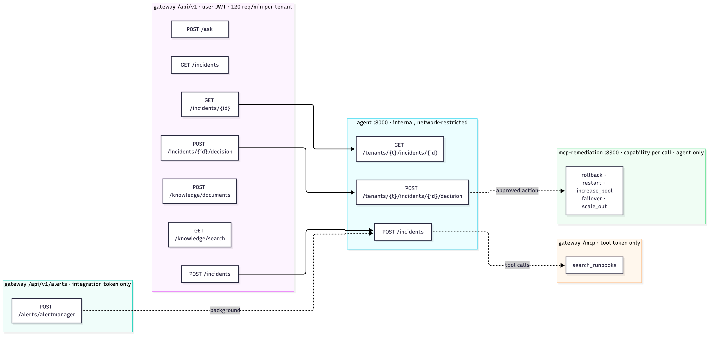
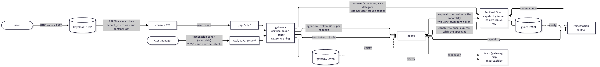

# 09 APIs and contracts

## 1. Conventions
- **Public API:** gateway `/api/v1/*`, JSON, `Authorization: Bearer <JWT>` with a `tenant_id` claim. Errors are RFC 7807 `ProblemDetail` (`{type, title, status, detail, instance}`).
- **Rate limit:** 120 requests/min per tenant (token bucket). Over the limit → `429` with `Retry-After: 1`.
- **Tenant:** always from the token. Any `tenantId`/`tenant_id` in a request body is ignored (tested).
- The **agent API** is internal (gateway only; NetworkPolicy-enforced) **and authenticated** (Phase 8): every call carries a gateway-minted, 60-second token for one tenant.

## 2. Gateway public API



*Figure 9.1: API surface: public, MCP and internal endpoints*

### `GET /api/v1/incidents?limit=50`
`limit` 1–200. **200** → array of:
```json
{"id":"62fb03de-...","service":"checkout","summary":"checkout error ratio 35% (above 20%)","severity":"SEV1",
 "status":"RESOLVED","proposedAction":"rollback","openedBy":"alertmanager:HighErrorRatio","reviewer":"alice@acme",
 "source":"alertmanager","openedAt":"2026-10-06T04:42:17.189Z","createdAt":"…","updatedAt":"…",
 "timeToMitigateS":32.9,"alertResolvedAt":"2026-10-06T04:56:52.189Z"}
```

### `POST /api/v1/incidents`
```json
{"service":"checkout","summary":"checkout 5xx rate above 20%","severity":"SEV1"}
```
`service` ~ `[a-z0-9-]{1,63}`; `summary` non-blank ≤ 500; `severity` `SEV1|SEV2|SEV3` (default `SEV2`).

**200** → the agent view (see §3.4) with `status: "AWAITING_APPROVAL"`. **400** validation · **403** no tenant claim / tool token · **429** rate limited · **503** agent unreachable (the record is marked `FAILED`) · other agent 4xx passed through.

### `GET /api/v1/incidents/{id}`
**200** agent view · **404** unknown, or another tenant's (indistinguishable by design).

### `POST /api/v1/incidents/{id}/decision`


*Figure 9.2: Incident status lifecycle*

```json
{"approved":true,"note":"optional, ≤1000 chars"}
```
The reviewer is the JWT `sub`, never taken from the body. The gateway first records the decision in **Sentinel Guard** on the request the agent registered for the **proposed** action (read from the agent, not the request; [ADR-0011](../adr/0011-copilot-approvals-through-the-guard.md)). Then it resumes the agent, which collects its single-use capability from the guard, executes and verifies. If the guard refuses (expired, already decided: **409**; unreachable: **503**), nothing is resumed and `detail` starts "Sentinel Guard: …". The call is synchronous: up to about a minute when verification needs retries.

| Response | When |
|---|---|
| **200** with `RESOLVED` (+ `execution`, `verification`, `timeline`) | executed and verified healthy |
| **200** with `REMEDIATION_FAILED` | refused, adapter error, or still unhealthy |
| **200** with `ESCALATED` | approved `escalate` |
| **200** with `CLOSED_NO_ACTION` | rejected |
| **409** | not awaiting approval (decisions are single-use) |
| **404** | unknown or another tenant's |

Every 200 includes the `postmortem`.

### `POST /api/v1/alerts/alertmanager` (Phase 7)
Auth: **integration token only** (`aud` contains `sentinel-alerts` **and** scope `alerts:write`); the tenant comes from it. Body: Alertmanager webhook v4.
```json
{"version":"4","status":"firing","receiver":"sentinel","alerts":[
  {"status":"firing","labels":{"alertname":"HighErrorRatio","service":"checkout","severity":"critical"},
   "annotations":{"summary":"checkout error ratio 35% (above 20%)"},
   "startsAt":"2026-10-06T04:42:17.189Z","fingerprint":"e0df2298e7…"}]}
```
**202** (always before any investigation runs):
```json
{"opened":["62fb03de-…"],"deduplicated":0,"correlated":0,"resolved":0,"skipped":[]}
```
- **401** without a token.
- **403** for user tokens, tool tokens, capabilities, or a token that claims the scope without the audience.
- A required label (`service`, `[a-z0-9-]{1,63}`) that is missing or invalid → listed in `skipped` with the reason, not an error. Alertmanager would otherwise retry a request that can never succeed.

### `POST /api/v1/knowledge/documents`
```json
{"docId":"db-connection-pool","source":"knowledge/acme/db-connection-pool.md","title":"Database connection pool exhaustion","content":"# ..."}
```
`docId` ~ `[a-z0-9][a-z0-9._-]{0,127}`, `source` ≤ 500, `title` ≤ 300, `content` ≤ 200 000. **202** `{"docId":"db-connection-pool","status":"QUEUED"}` once Kafka acks · **503** if no ack within 5 s.

### `GET /api/v1/knowledge/search?q=…&mode=hybrid&k=5`
`q` ≤ 1000; `mode` `vector|keyword|hybrid`; `k` 1–50. **200** →
```json
[{"chunkId":12,"docId":"db-connection-pool","title":"...","source":"...","heading":"... > Mitigation","content":"...","score":0.0325}]
```
The score's meaning depends on the mode: cosine similarity, `ts_rank_cd`, or the RRF sum.

### `POST /api/v1/ask`
```json
{"question":"DB connections are timing out. What should I do?"}
```
**200** →
```json
{"answer":"Raise maximumPoolSize to 40 ... [1]","cached":false,
 "citations":[{"n":1,"docId":"db-connection-pool","title":"...","heading":"... > Mitigation","source":"knowledge/acme/db-connection-pool.md"}]}
```
**503** LLM provider not configured · **429** provider rate limit · **502** other provider error.

### `/api/v1/integrations` (Phase 8; users with role `tenant-admin`)

| Call | Result |
|---|---|
| `POST /api/v1/integrations/alertmanager` `{"name":"prod alertmanager","ttlDays":30}` (`name` `[A-Za-z0-9 ._-]{1,64}`, `ttlDays` 1–90) | **201** `{"jti","token","expiresAt"}`: the token is shown **once**; only the `jti` is stored |
| `GET /api/v1/integrations` | **200** `[{jti, kind, name, createdBy, createdAt, expiresAt, revokedAt, revokedBy, lastUsedAt}]` for the caller's tenant |
| `DELETE /api/v1/integrations/{jti}` | **204**, effective on the next webhook delivery; **404** if not an active token of this tenant (other tenants' tokens don't exist under RLS) |

Errors: **403** without the role or with a service token.

### Operational endpoints (no auth)
- `GET /actuator/health` (and `/liveness`, `/readiness`), `GET /actuator/prometheus`.
- `GET /.well-known/jwks.json`: the gateway's public signing keys `{"keys":[{"kty":"EC","crv":"P-256","kid",…,"x","y"}]}` (no private parts; `Cache-Control: max-age=300`).
- `GET /.well-known/sentinel-issuer`: `{issuer, jwks_uri, id_token_signing_alg_values_supported:["ES256"]}`.

## 3. Agent API (internal, port 8000)

All agent endpoints except `/healthz` and `/metrics` require `Authorization: Bearer <agent-call token>`:
- **401** without it, or if it is forged, expired, has the wrong audience, or uses HS256;
- **403** if its tenant ≠ the tenant in the path or body.

### 3.1 `POST /incidents`
Headers:
- `Authorization`: agent-call token for `tenant_id`;
- `X-Sentinel-Tool-Token`: the downscoped token (optional; without it there are no tools);
- `traceparent`: W3C trace context (set automatically by the gateway).

Body, pinned by `contracts/agent-open-incident.request.json` and tested on **both** sides:
```json
{"id":"7f9c2c4e-1a2b-4c3d-9e8f-0a1b2c3d4e5f","tenant_id":"acme","service":"checkout",
 "summary":"checkout 5xx rate above 20%","severity":"SEV1","opened_at":"2026-10-05T10:30:00Z"}
```
**200** view · **409** the `tenant:id` thread exists (makes gateway retries safe).

### 3.2 `GET /tenants/{tenant}/incidents/{id}`
**200** view · **404**.

### 3.3 `POST /tenants/{tenant}/incidents/{id}/decision`
```json
{"approved":true,"reviewer":"alice@acme","note":null}
```
Optional header `X-Sentinel-Tool-Token` (verification probes); config-only, never checkpointed. No capability travels here (Phase 11): the agent collects it from Sentinel Guard. **200** · **404** · **409** if not `AWAITING_APPROVAL`.

### 3.4 The incident view (all agent responses)
```json
{
  "incident": {"id":"…","tenant_id":"acme","service":"checkout","summary":"…","severity":"SEV1","opened_at":"…"},
  "status": "AWAITING_APPROVAL",
  "evidence": [{"source":"deploys:checkout","detail":"deployment completed: version 1.5.0 commit a1b2c3d at … (…)"}],
  "budget": {"tool_calls":5,"cost_usd":0.0,"stop_reason":"done"},
  "triage": {"category":"deploy","blast_radius":"checkout","rationale":"…"},
  "rca": {
    "root_causes": [{"cause":"code_defect","hypothesis":"…","confidence":0.6,
                     "citations":["logs:checkout","runbook:postmortem-2026-08-14-checkout-npe"]}],
    "remediation": {"action":"rollback","target":"checkout","reason":"…","risk":"low"}
  },
  "llm_calls": [{"step":"rca","model":"…","latency_ms":1200,"input_tokens":…,"output_tokens":…,"cost_usd":…}],
  "guardrail_events": [{"type":"action_overridden","from":"rollback","target":"checkout","reason":"…"}],
  "approval": {"request":"ar-11c9451b-1","verdict":"pending","message":"Sentinel Guard: rollback of checkout needs human approval (request ar-11c9451b-1)."},
                                                                         // Phase 11: the guard request; {request:null, error} if the guard was down
  "decision": {"approved":true,"reviewer":"alice@acme","note":null},   // after decision
  "execution": {"executed":true,"dry_run":false,"action":"rollback","service":"checkout","incident_id":"…",
                "guard_request":"ar-11c9451b-1","capability_jti":"cap-39a0d2ac02c8b85c",
                "result":{"operation":"rollback","fixed_active_fault":true,"from_version":"1.5.0","to_version":"1.4.2"}},
  "verification": {"healthy":true,"attempts":[{"service":"checkout","requests":20,"ok":20,"errors":0,
                                                "success_rate":1.0,"p95_ms":92.9}]},
  "timeline": {"proposed_at":"…","decided_at":"…","executed_at":"…","verified_at":"…","time_to_mitigate_s":32.9},
  "postmortem": "# Postmortem: …"                                       // after decision
}
```
`messages` (the raw investigator transcript) is never returned.

## 4. MCP tools

| Server | Endpoint | Auth | Tools |
|---|---|---|---|
| mcp-observability | `:8200/mcp` (stateless streamable HTTP, JSON responses) | **tool token** (`aud=sentinel-mcp`, `telemetry:read`, ES256 via JWKS); 401 otherwise; NetworkPolicy: agent only | `list_services`, `get_recent_deploys`, `get_error_logs`, `get_service_metrics`; shapes in [06](06-lld-mcp-tools-and-chaos-lab.md#a2-tools-and-wire-shapes) |
| gateway knowledge | `:8080/mcp` (stateless) | tool token: `SCOPE_knowledge:read`, `aud=sentinel-mcp` | `search_runbooks{query, limit 1–8}` → JSON array `[{docId,title,heading,text}]` |
| mcp-observability (Phase 7 tool) | `:8200/mcp` | network-restricted | `probe_service{service, requests ≤ 50}` → `{service, requests, ok, errors, success_rate, p95_ms}` |
| mcp-remediation | `:8300/mcp` (stateless) | **capability** per call, issued by Sentinel Guard: `aud=sentinel-action`, `action`/`target` and every parameter must match the call, redeemed once at the guard | `rollback`, `restart`, `increase_pool{size ≤ 60}`, `failover`, `scale_out{replicas ≤ 10}`, each with `{service, dry_run}` → `{executed, dry_run, action, service, incident_id, guard_request, result}`; [06 Part C](06-lld-mcp-tools-and-chaos-lab.md#part-c-mcp-toolsremediation-phase-7) |

Example JSON-RPC call (any MCP client sends these):
```json
{"jsonrpc":"2.0","id":1,"method":"tools/call",
 "params":{"name":"search_runbooks","arguments":{"query":"timeout acquiring DB connection","limit":2}}}
```

## 5. Tokens



*Figure 9.3: Who holds which token, and where each is accepted or rejected*

| Token | Issuer | Claims | Lifetime | Accepted at |
|---|---|---|---|---|
| User (OIDC) | the IdP (Keycloak in dev), via the console's code flow | `iss` = IdP, `aud` ∋ `sentinel-api`, `preferred_username`, `tenant_id`, `realm_access.roles` | IdP policy (dev realm: 15 min, refreshed by the BFF) | `/api/v1/*` (RS256, IdP JWKS) |
| User (dev) | console dev login / `scripts/dev_token.py` | `sub`, `tenant_id`, `roles`, `iat`, `exp`; **no `iss`** | 8 h (BFF), 1 h (script) | `/api/v1/*`, only while the gateway's dev issuer is enabled (HS256) |
| Tool token | gateway `ToolTokens` | `iss`=gateway, `sub=agent:<incident>`, `tenant_id`, `scope=knowledge:read telemetry:read`, `aud=[sentinel-mcp]`, `jti` | 15 min | gateway `/mcp`, mcp-observability `/mcp` |
| Integration token | gateway, `POST /api/v1/integrations/alertmanager` (tenant admin) | `iss`=gateway, `sub=integration:alertmanager:<name>`, `tenant_id`, `aud=sentinel-alerts`, `scope=alerts:write`, `jti` (recorded) | 1–90 days (default 30), **revocable** | `/api/v1/alerts/**` only, while its `jti` is active |
| **Capability** (Phase 11) | **Sentinel Guard**, issued once to the requesting agent after a human approved (§8.1) | `iss`=`sentinel-guard`, `sub`=the agent's identity, `aud=[sentinel-action]`, `jti`, `request_id`, `action`, `target`, `namespace` (the tenant), `change` (`incident`, `size`/`replicas`), `fingerprint`, `approved_by` | until the approval expires (10 min), **single use** (redeemed at the guard) | remediation adapter, for that action, target and parameters only |
| Agent-call token (Phase 8) | gateway `AgentTokens`, per request | `iss`=gateway, `sub=gateway`, `aud=[sentinel-agent]`, `tenant_id`, `jti` | 60 s | agent API, for that tenant only |

**Signing (Phase 8):** every service token above except the capability is **ES256**, signed by the gateway with a `kid` from its key ring. Verifiers (the gateway itself, the agent, the observability MCP server) use the public keys at `/.well-known/jwks.json` and hold no secret. Capabilities are ES256 from Sentinel Guard's own key (Phase 11); the remediation adapter verifies them against the guard's JWKS. User tokens come from the IdP (RS256), or are HS256 dev tokens. The gateway picks the verifier by issuer, with the algorithm pinned per issuer ([ADR-0009](../adr/0009-zero-trust-identity.md)). The gateway's general API rejects every service audience.

## 6. Kafka
`knowledge.documents`: see [05 §2](05-lld-ingestion-and-knowledge.md#2-event-contract). DLT: `knowledge.documents-dlt`.

## 7. Contract fixtures (`contracts/`)

| Fixture | Producer → consumer | Checked by |
|---|---|---|
| `agent-open-incident.request.json` | gateway → agent `POST /incidents` | `IncidentControllerTest.agentPayloadMatchesSharedContract` (payload keys must equal the fixture's); `test_contracts.py` (fixture parses into `Incident` and keys equal the model's fields) |
| `knowledge-document.event.json` | gateway → Kafka → ingestion | `KnowledgeControllerTest` (event shape) |
| MCP observability results | mcp-observability → agent | `test_server.py` (one block, one JSON object); agent `FakeToolBox` emits identical shapes |
| MCP remediation results | mcp-remediation → agent | `test_capabilities.py` (`executed` JSON or error text); `FakeToolBox.remediation_tools` emits the same, including the refused-capability error text |
| Alertmanager webhook v4 | Alertmanager → gateway | `AlertSecurityTest` (real JSON body through the full filter chain); `amtool check-config` for the sender side |

**Changing a contract:** update the fixture first, then both sides; both test suites must pass in the same change.

## 8. Sentinel Guard
Design: [chapter 17](17-lld-sentinel-guard.md). Port 8443 (TLS) in Kubernetes, 8080 in single-process mode; metrics on 9090.

### 8.1 Action API
| Method and path | Auth | Request → response |
|---|---|---|
| `POST /v1/actions` | agent: ServiceAccount token (TokenReview) in Kubernetes; `SENTINEL_GUARD_AGENT_TOKENS` in memory mode | `{action, target: {name, namespace?, group?, resource?}, change?: {k: v}, intent?, dryRun?}` (unknown fields → 400) → `200 {verdict: "allow", request, capability, message}` · `202 {verdict: "pending", request, reasons, message}` · `403 {verdict: "block", …}`. The fingerprint is a digest of `change` |
| `GET /v1/actions/{id}` | the requesting agent (others get 404) | as above; once approved, the capability is returned **once** |
| `POST /v1/capabilities/spend` | none (the capability is the credential) | `{capability, executor?}` → `200 {request, claims}` · `409` already used / no longer valid · `403` invalid (signature, `alg`, issuer, audience, expiry) |
| `GET /v1/actions` | the admin token, or an approver's own token (personal token or OIDC; Phase 16) | `{requests: [...]}` |
| `GET /v1/whoami` | any token | who the guard takes the caller for: `{role: "admin"}` · `{user, role: "approver"}` · `{user, role: "agent" \| "delegate" \| "auditor" \| "caller"}`; 401 for an unknown token (Phase 16) |
| `POST /v1/actions/{id}/approve`, `/deny` | **a person's own token** (Phase 16): a personal approver token (`SENTINEL_GUARD_APPROVER_TOKENS`) or an OIDC token of someone in the policy's `approvers`; the shared admin token (memory mode); or a **delegate** (policy `delegates`; Phase 11), optionally forwarding the person's OIDC token in `X-Sentinel-Person-Token`. In Kubernetes there is no admin token: people approve with `kubectl sentinel` | `{approver?, note?}` → the request. When the guard authenticated the person (their token, or the forwarded one), that person decides and a different `approver` is a 400; otherwise `approver` is required and recorded as given. `decidedVia` = the delegate. For an action with `approvals: N`, each approval before the last returns the request still `Pending` with `approvals[]` grown; the same person again is a 403. 403 if the decider or the delegate is the requester; 409 if decided or expired; 401 for an invalid person token |
| `GET /v1/audit/verify` | admin token, or an **auditor** (policy `auditors`; Phase 14) | `{ok, events, requests, headSeq, voided, policies, problems[], warnings[]}` |
| `GET /v1/audit/export` | admin token, or an auditor (Phase 14) | the evidence bundle (below), with `Content-Disposition: attachment; filename="sentinel-guard-evidence-<UTC time>.json"` |
| `GET /.well-known/jwks.json` | none | ES256 public key (`kid` = thumbprint) |
| `GET /healthz`, `/readyz` | none | readiness waits for the watch cache and bootstrap. `sentinel-guard -healthcheck` probes `/readyz` on `SENTINEL_GUARD_ADDR` and exits 0 or 1, for health checks in the shell-less image (Phase 15) |
| `GET /` → `302 /inbox/`; `GET /inbox/`, `/inbox/inbox.js`, `/inbox/inbox.css` | none to load; the page then calls the API above with the admin token | the approvals inbox (Phase 15), **only when an admin token is set** (single-process mode; 404 in Kubernetes). Served with `Content-Security-Policy: default-src 'none'; script-src 'self'; style-src 'self'; connect-src 'self'; img-src 'self' data:; base-uri 'none'; form-action 'none'; frame-ancestors 'none'`, `X-Content-Type-Options: nosniff`, `Referrer-Policy: no-referrer` |

**The change map** binds the approval: the guard fingerprints `change` exactly as sent. The SDKs send a canonical form (strings as they are, anything else compact JSON with sorted keys), identical in Python and TypeScript, so an approval matches either SDK (Phase 12).

**Capability** (ES256 JWT, `kid`):
- `iss`: `SENTINEL_GUARD_ISSUER`;
- `aud`: `sentinel-action`;
- `sub`: the agent;
- `jti`, `iat`, `exp` (= the approval's expiry);
- `request_id`, `action`, `target`, `fingerprint`, `approved_by`;
- `approvers`: everyone who approved, in order, when the action needed more than one person (Phase 16).

**Notification** (`POST` to `SENTINEL_GUARD_NOTIFY_URL`, JSON; Phase 16): `{text, content, event: {kind, requestId, agent, action, target, change, intent, risk, approvalsNeeded, approvedBy[], expiresAt, url}}`. `text` (Slack) and `content` (Discord) carry the same sentence. `kind` is `approval_needed` (a new request, or one approval of several) or `expired_undecided`. A 2xx answer counts as delivered; errors and 5xx are retried twice.

**Evidence bundle** (`format: sentinel-guard-evidence/v1`; Phase 14):
- `generatedAt`, `generatedBy`;
- `jwks`;
- `head`: `{seq, hash, voids[], at, kid, sig}`, the signature over `sha256("head|seq|hash|at")`;
- `policies[]`: `{version, text, loadedAt, kid, sig}`, where `version` = SHA-256 of `text` and the signature is over `sha256("policy|version|loadedAt")`;
- `requests[]`: as stored, each with its `audit` events, in chain order;
- `summary`: `{requests, from, to, outcomes, byAgent, deciders, expiredUndecided, multiPersonApproved, decisionSecondsMedian, decisionSecondsMax}`. Every approver, early ones included, is counted under `deciders`.

The bundle carries no signature of its own: every part is signed, and verifiers recompute the summary. Each request's `policyVersion` is part of its digest when present, and so is `requiredApprovals` when above 1 (Phase 16).

### 8.2 Admission webhooks
| Webhook | Path | Sees | Answers |
|---|---|---|---|
| `workloads.guard.sentinel.dev` (validating, fail closed) | `/admission/workloads` | agents' (by `matchConditions`) UPDATE/DELETE of workloads and scale subresources; DELETE of common objects; opt-in CREATE | allowed (approved/readmitted/observe/auto, or a dry run, with a warning) or 403 with the request id and the approve command. Audit annotations: `verdict`, `action`, `request` |
| `approvals.guard.sentinel.dev` (mutating, fail closed) | `/admission/approvals` | every ActionRequest CREATE/UPDATE/DELETE | the guard's own SA: allowed; others: only `spec.decision` (`approve`/`deny`) once, plus `decisionNote`, patched with `decidedBy`/`decidedAt` from the authenticated user. When more approvals are needed (Phase 16), an `approve` is patched into `spec.approvals` (`{by, at, note}`, the authenticated user) and `spec.decision` is removed, with a warning "approval k of N recorded …"; the same user twice is refused; `spec.approvals` can't be written directly |

### 8.3 kubectl plugin
`kubectl sentinel requests [--all] [-o json]` · `describe <id>` · `approve <id> [-m note]` · `deny <id> [-m note]` · `audit verify` (exit 2 on any problem) · `audit export` (the evidence bundle to stdout; Phase 14) · `audit verify --bundle <file> [--jwks <keys>] [--previous <older bundle>]` (offline, no cluster access; `--previous` also requires the bundle to extend the older one) · `version`. Flags: `--guard-namespace`, `--context`, `--kubeconfig`.

### 8.4 Objects the guard keeps (Phase 14 additions)
- `ActionRequest.spec.policyVersion`: the effective policy's SHA-256.
- `ActionRequest.spec.decidedVia`: the delegate, now in the CRD schema. Before, the API server pruned it, so Kubernetes-mode delegated decisions kept the delegate only in the event detail.
- ConfigMap `sentinel-guard-policies`: one key `<version>.json` per policy version, a signed `PolicyRecord`.
- ConfigMap `sentinel-guard-audit-head`: now also `at`, `kid`, `sig` (the signed checkpoint).

### 8.5 Two-person approvals (Phase 16)
- Policy: `approvals: N` per action or in `defaults` (1 to 5; unset means 1 and leaves the policy version as it was). `approvers: {users, groups}`: who may decide over HTTP with an OIDC identity.
- `ActionRequest.spec.requiredApprovals` (set only when N > 1) and `spec.approvals[]` (`{by, via?, at, note?}`, the approvals before the last).
- Audit event `approval-added` (actor: the person; detail: the note, plus `[via delegate]`). The request stays `Pending`; the last approval is the usual `approved` event.

