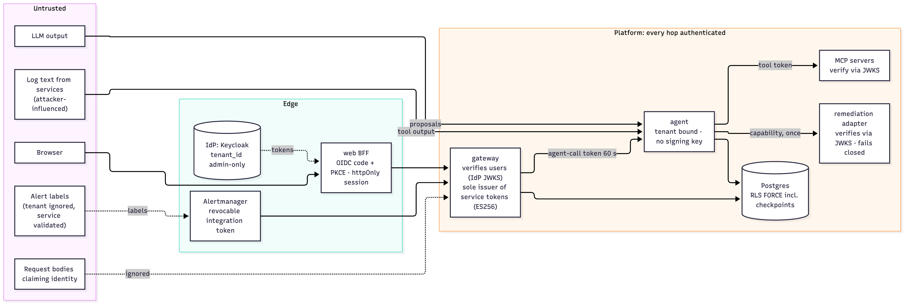

# 10 Security

## 1. Assets
1. **Production safety:** since Phase 7 Sentinel *executes* approved rollbacks, restarts, pool changes, failovers and scale-outs. The ability to cause one is the most valuable asset in the system.
2. **Tenant data:** runbooks, postmortems, incident records, cached answers.
3. **Credentials:** the gateway's ES256 private signing keys (the crown jewels: they mint every service token), user tokens, tool tokens, integration tokens, remediation capabilities, agent-call tokens, the OIDC client secret, DB passwords, the LLM API key, and the dev HS256 secret (dev only).
4. **Telemetry content:** logs can contain PII and secrets.

## 2. Trust boundaries



*Figure 10.1: Trust boundaries: what is untrusted even inside the platform*

Treat three things as untrusted even inside the platform:
- **log text:** services, and through them attackers, write it;
- **LLM output:** it can be wrong, manipulated or malformed;
- **anything in a request body** that claims identity;
- **alert labels:** a `tenant_id` label is ignored (the tenant comes from the integration token), and the `service` label is validated before it becomes a tool argument.

## 3. Threats and controls

| # | Threat | Controls | Verified by |
|---|---|---|---|
| T1 | A tenant reads or acts on another tenant's data | Tenant only from JWT; RLS FORCE on every tenant table; non-superuser `sentinel_app`; fail-closed when unbound; tenant-keyed agent threads, caches and rate buckets; the RAG retriever fails closed without a tenant | `IngestionPipelineIT`, `KnowledgeSearchIT`, `SemanticCacheIT`, `IncidentRepositoryIT`, agent `test_tenants_cannot_see…`, `IncidentControllerTest` (body tenant ignored) |
| T2 | Prompt injection via logs drives a harmful action | Injection neutralization (first layer); spotlighting (`<untrusted_tool_output>`); prompts say logs are data; **policy interlocks** (no rollback without a recent deploy; no pool/restart/failover action without its precondition observed in telemetry; investigated targets only); closed action set; human approval | Benchmark `injection` tier: `attack_success_rate` gate = 0 (including a filter-evading attack); live: gemma4 complied with the evasive attack and the interlock blocked it |
| T3 | The model fabricates evidence or citations | Citation validation against gathered evidence; drops are counted; runbooks cited only if they contain the observed signature | `citation_faithfulness` and `runbook_citation_precision` gates; `test_guardrails.py` |
| T4 | Unsafe or wrong remediation reaches production | Closed enum; constrained target; interlocks; **approval required**; decisions single-use; reviewer from JWT | `harmful_action_rate` gate = 0; `test_decision_is_not_replayable` |
| T5 | PII/secrets leak to the LLM provider or into storage | Redaction (email, Luhn-valid cards, JWTs, API keys) before the model, checkpoints and evidence | `pii_leak_rate` gate = 0; regression test for metric floats |
| T6 | A compromised agent misuses the user's identity | The agent never receives user tokens; it gets a 15-min, single-tenant, `knowledge:read`, MCP-only token; the token is never checkpointed | `ToolTokensTest`, `McpEndpointTest` (tool tokens rejected on `/api/*`, user tokens rejected on `/mcp`), agent `test_tool_token…never_persisted` |
| T7 | Token theft from the browser | httpOnly + SameSite=Strict cookie; proxy allow-list; security headers; `server-only` modules | Design (chapter 07) |
| T8 | Lateral movement inside the cluster | Default-deny NetworkPolicy with an allow-list; agent/MCP not reachable from web | Live on kind: web → agent/MCP blocked; CI `kind-e2e` asserts it |
| T9 | Container breakout / tampering | Non-root uid 10001, read-only root FS, `drop: [ALL]`, no privilege escalation, seccomp `RuntimeDefault`; immutable, scanned images | Verified on kind (`runAsUser`, `readOnlyRootFilesystem`) |
| T10 | Excess privilege for DB schema changes | Migrations in a hook Job, the only admin-credential holder; serving pods use `sentinel_app` with Flyway disabled | Chart (`migrations.yaml`, `SPRING_FLYWAY_ENABLED=false`) |
| T11 | Resource exhaustion / cost blow-up | Per-tenant rate limits (Redis, separate agent bucket); tool and spend caps per investigation; recursion limit | `RedisRateLimiterIT`, k6 burst (exactly 120 admitted), `test_investigation_budget.py` |
| T13 | **A compromised or prompt-injected agent executes something nobody approved**, or repeats an approved action | The agent holds **no standing deploy credentials**. Since Phase 11 the agent registers its proposal in **Sentinel Guard**, a human's decision is recorded there (by the gateway, as a delegate), and only then does the guard issue a capability bound to tenant, incident, action, target, **parameters** and approver, usable once until the approval expires. The adapter verifies it with the guard's public key and redeems it at the guard before any side effect (fails closed). Resuming the agent is not authority; the capability is kept out of checkpoints. NetworkPolicy: only the agent reaches the adapter | `test_capabilities.py` (replay refused at the guard before the service is called; wrong action/target/audience/expiry/signature/parameter refused before redeeming; guard outage refuses); agent `test_without_an_approval_in_the_guard_nothing_executes`, `test_guard_down_fails_closed`, `test_capability_is_never_checkpointed`; `IncidentControllerTest` (decision recorded in the guard before resuming; a refusal resumes nothing); live: guard stopped → approval 503, nothing ran; CI `kind-e2e` (console → adapter blocked) |
| T14 | Forged or replayed alerts open incidents (cost, noise) or pick another tenant | Integration token required (audience **and** scope); tenant from the token; per-tenant `alerts` rate bucket; dedupe and correlation under a per-service lock; investigations are read-only, and nothing executes without a human | `AlertSecurityTest`, `AlertServiceTest`, `ClosedLoopRepositoryIT` |
| T15 | "Resolved" without being fixed (a false sense of safety) | Post-execution verification with real traffic; failure → `REMEDIATION_FAILED`, the alert stays linked; probes that error count as unhealthy | `test_fix_that_doesnt_heal_is_caught_by_verification`; live run |
| T16 | Repudiation: who executed what? | `remediation_audit` (approver, capability jti, **guard request**, outcome) joined with the adapter's JSON audit line by jti; the guard request's **signed, hash-chained** events (requested by the agent, approved by the person via the gateway, capability issued, executed by the adapter) | `IncidentControllerTest` (audit row), `ClosedLoopRepositoryIT` (V8 column), live check (the same request id and jti in all three records; guard audit verifies) |
| T17 | A compromised pod uses secrets it doesn't need | **Per-component secret lists** in the chart: gateway (signing secret, DB, LLM key), ingestion (DB), agent (LLM key, checkpoint DSN: **no signing secret**), mcp-remediation (signing secret, to verify), web (signing secret, dev login only), mcp-observability and chaos-lab (none) | CI `deploy-config` asserts the agent has no signing secret (and was checked to fail when it does) |
| T18 | Forged service token (holder of some secret mints a capability or integration token) | Service tokens are ES256; only the gateway holds its private keys, and only Sentinel Guard holds the capability key; verifiers pin ES256 + issuer + audience; the gateway routes by issuer with pinned algorithms (no HS/ES confusion, no `none`) and doesn't trust the guard's issuer at all | `RoutingJwtDecoderTest` (other key with our issuer and kid, HS256 claiming our issuer, unsigned, unknown issuer, wrong OIDC audience); adapter/agent/observability forged-key and shared-secret tests |
| T19 | A pod on the cluster network calls internal services directly | Every hop authenticated: gateway → agent (60 s token bound to the tenant; mismatch → 403); agent → MCP (tool token); agent → adapter (capability). Health and metrics stay open | `test_auth.py` (agent), `test_server.py` (observability 401s), live probes (401 without tokens) |
| T20 | A user moves themselves into another tenant at the IdP | `tenant_id` is a managed Keycloak profile attribute, editable by realm admins only | Live: an account-API update of `tenant_id` returned `error-user-attribute-read-only`; the next token still had the old tenant |
| T21 | Stolen integration token | Recorded by `jti`, revocable by tenant admins (immediate), ≤ 90-day expiry, last use visible; usable only on the webhook | `IntegrationTokensIT` (revoked → 403, cross-tenant revoke → 404) |
| T22 | A bug addresses another tenant's checkpoint | Postgres RLS on checkpoint tables bound to the token-proven tenant; unbound → nothing visible | `test_postgres_checkpointer.py` (cross-tenant read empty, write refused, FORCE on) |
| T23 | An agent changes the cluster with no approval, or calls the API directly to avoid an in-process check | **Sentinel Guard** enforces at the API server (admission). Only agent identities are sent to it (`matchConditions`) and it fails closed for them; dry runs are previews | `guard-e2e.sh` (agent scale denied; guard down → agent refused, human unaffected) |
| T24 | One approval used for more than was approved | Approval bound to agent + action + target + change fingerprint; consumed by compare-and-swap; API-server retries re-admitted only for the identical object at the same generation, within 10 s, ≤ 5 times | Engine tests (50 concurrent attempts → 1); e2e (different change, second restart, change after a revert all denied); load test asserts per round |
| T25 | An agent approves its own action, or a client forges who approved | The approvals webhook refuses agent identities and the requester; `decidedBy` is stamped from the API server's authenticated user; approve rights are RBAC (`sentinel-guard-approver`) | `server_test.go`; e2e (agent with approver RBAC still refused; `decidedBy` = authenticated admin) |
| T26 | The audit record is edited or deleted to hide an action | Only the guard may create or delete ActionRequests (even cluster-admin is refused); every event is in a signed hash chain committing to the request's content; `kubectl sentinel audit verify` checks it from the published public key; voids are signed | Engine tests (edit, deletion, forged void detected); e2e (delete and edit refused; verify OK) |
| T27 | A target name rewrites a precondition query to fake "observed" | Target values are validated before templating (`[A-Za-z0-9._:/-]`); unreachable Prometheus means `unknown`, never observed | `precondition_test.go` |
| T29 | A service records approvals it shouldn't, or the console's approval is forged (Phase 11) | Only identities in the guard's `delegates` may decide over HTTP (the gateway's own ServiceAccount, authenticated by TokenReview); the decision is recorded as the person's, *via* the delegate, so the trust is visible in the audit; a delegate can't approve for the requesting agent; the gateway only acts on the tenant-scoped request the agent registered for that incident | guard `TestDelegatedDecisions` (non-delegate 401/403, approval on behalf of the requester 403, `decidedVia` recorded); gateway `IncidentControllerTest` |
| T28 | Flooding approvers or the audit log | Concurrent identical attempts collapse into one request (deterministic ids); refused attempts write nothing (checked before claiming a chain place) | Engine tests |
| T12 | Secrets in Git / images | Secrets via Kubernetes Secret (dev) or External Secrets from AWS Secrets Manager (prod); KMS encryption for EKS secrets, RDS, MSK, ElastiCache, ECR | Terraform + chart |

## 4. Defense-in-depth for actions


*Figure 10.2: Defense in depth for actions*

```
 model proposal ─▶ closed enum ─▶ target ∈ investigated services (constrained decoding)
                ─▶ citations validated ─▶ runbook policy interlocks ─▶ human approval
                ─▶ capability from Sentinel Guard (this action, target, parameters, once) ─▶ adapter checks + redeem ─▶ execution
                ─▶ verification (real traffic) ─▶ RESOLVED or REMEDIATION_FAILED
```
Each layer is deterministic except the model itself; each intervention is recorded as a guardrail event (UI, postmortem, span event, metric).

### 4.1 The capability, attacked
What an attacker who fully controls the agent process can do:

| Attempt | Result |
|---|---|
| Execute without an approval | No capability exists → nothing to present → refused |
| Use a rollback capability to restart | `action` claim mismatch → refused |
| Roll back a different service | `target` claim mismatch → refused |
| Use it twice | jti already spent → refused, before the service is called |
| Use it after 5 minutes | expired → refused |
| Mint one | needs **Sentinel Guard's private ES256 key** (Phase 11), which only the guard holds (it creates it on first start; no other pod mounts it). Every verifier holds only public keys. A capability forged with the old HS256 dev secret, or minted by the gateway, is refused |
| Run it with different parameters (pool size 60 instead of the approved 40) | the `change` claim doesn't match → refused before redeeming |
| Approve its own proposal | it isn't a delegate, and the requester can never decide its own request → refused (403) |
| Present it to the gateway API | the gateway doesn't trust the guard's issuer at all → 401 |
| Take the guard down to defeat single use | nothing can be redeemed → the adapter refuses all executions (fails closed); approvals can't be recorded either |

So the worst case is the single approved operation, executed early within its 5 minutes, or not at all.

## 5. Identity architecture (Phase 8)


*Figure 10.3: Who issues which token, and who can only verify it*

The principle is to **separate the power to verify from the power to mint.**
- The gateway's ES256 private keys are the only key material that can create a service credential. Every other component checks signatures with the public JWKS, so compromising a verifier yields no minting ability.
- The decoder at the gateway chooses a verifier by issuer, and each verifier pins its algorithm, so a token can't pick a weaker check.
- Tenancy is bound at each layer:

  | Layer | Bound by |
  |---|---|
  | gateway | JWT `tenant_id` |
  | agent | the per-call token's tenant, which must equal the URL or body tenant |
  | checkpoints | Postgres RLS, keyed by that same tenant |
  | adapter | capability claims |

Details: [ADR-0009](../adr/0009-zero-trust-identity.md); the decoder is described in chapter 03 §2A.

## 6. Known gaps
See [16](16-limitations-and-roadmap.md):
- The regex injection filter is bypassable by design (the output policy is the guarantee).
- No egress NetworkPolicy.
- No transport encryption between pods (no mTLS / service mesh); tokens authenticate, but traffic inside the cluster is plaintext.
- The gateway's private keys live in a Kubernetes Secret (from Secrets Manager), not an HSM/KMS signing key.
- The dev issuer (HS256 shared secret) still exists for scripts, CI and kind. It must stay disabled in production (`auth.devTokens: false`, checked by `check_chart_secrets.py --prod`).
- Sentinel Guard (chapter 16 §1): no retention or export of `ActionRequest` objects; the signing key lives in a Kubernetes Secret (no KMS); the audit chain's public key history isn't kept across a key rotation.
- *Closed in Phase 8:* shared-secret service tokens (now ES256 + JWKS), checkpoint isolation by key only (now RLS), the agent trusting the network (now per-call tokens), unrevocable integration tokens (now recorded and revocable).
