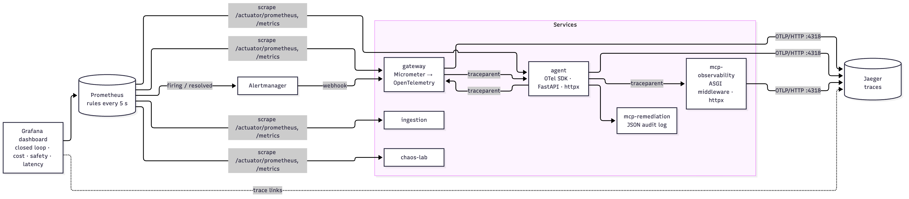
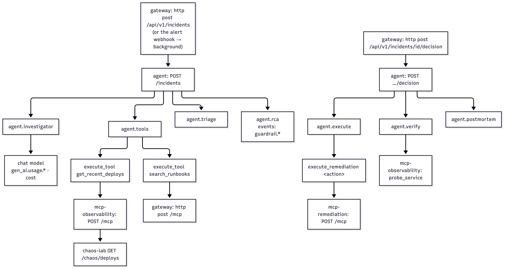
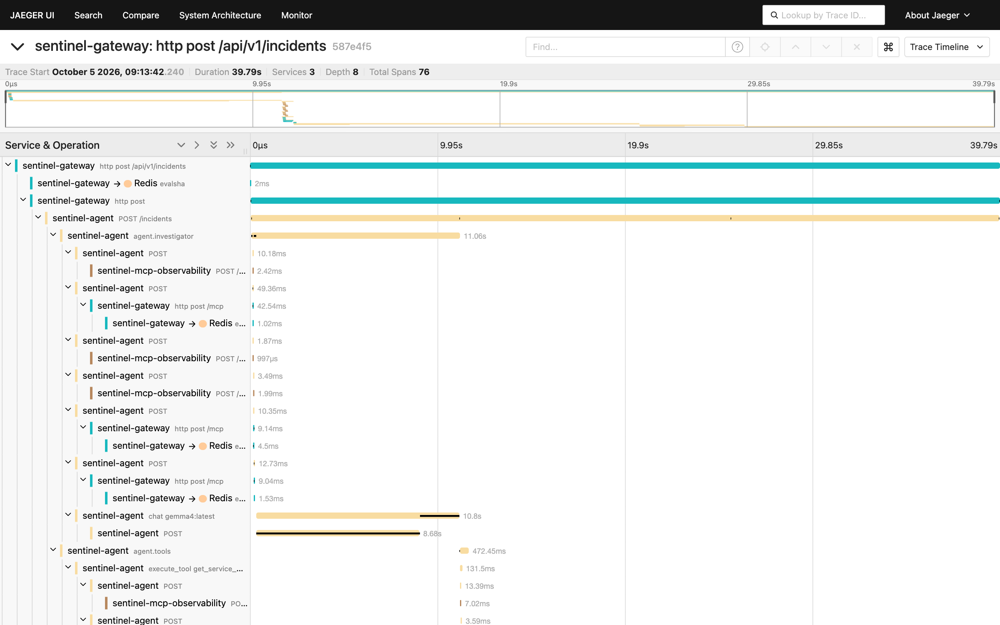
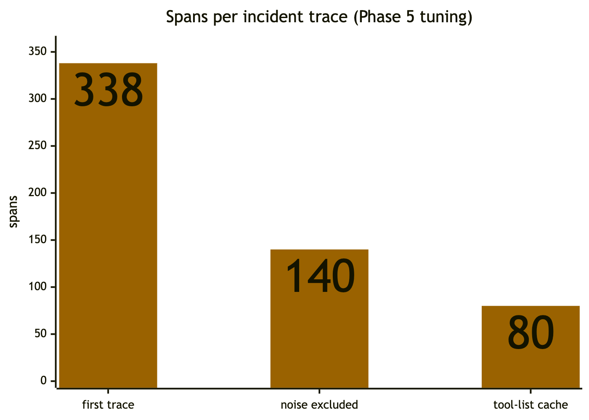
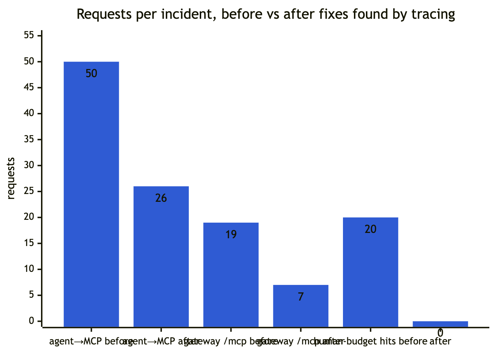
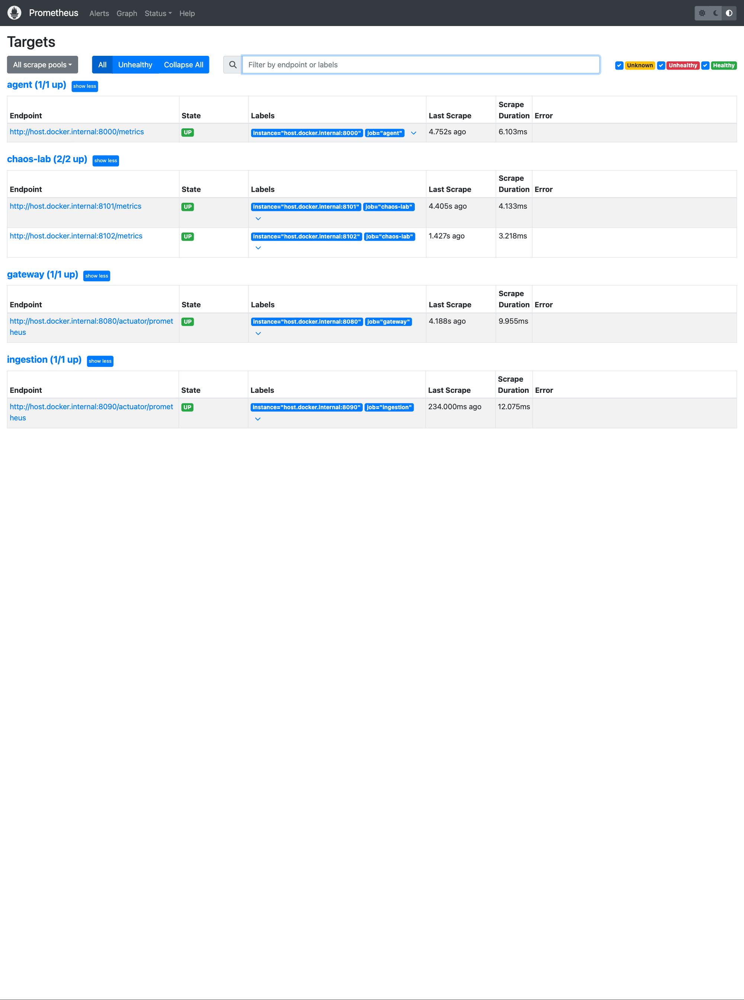
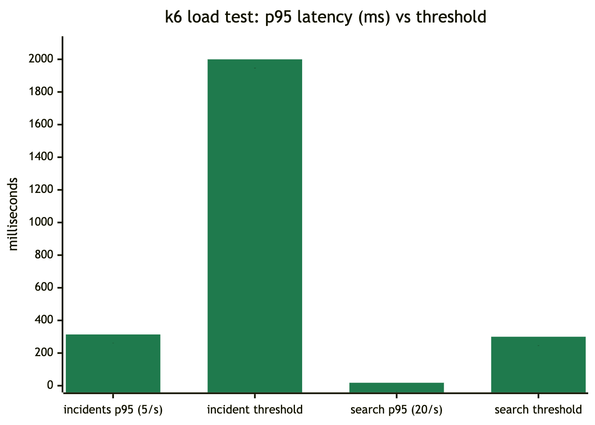

# 12 Observability

## 1. Traces (OpenTelemetry → Jaeger)

*Figure 12.1: Telemetry pipeline*

*Figure 12.2: Anatomy of one incident trace*

*Figure 12.3: A real trace in Jaeger: one incident across gateway, agent and MCP server, 76 spans; the gemma4 chat span, MCP calls and Redis rate-limit checks are all visible*

**One trace per incident** across gateway → agent → MCP servers (→ chaos-lab), propagated with W3C `traceparent`.

| Service | Instrumentation | Export config |
|---|---|---|
| gateway | `spring-boot-starter-opentelemetry` (Micrometer Tracing → OTel); `RestClient` and Spring MVC observations; sampling 1.0; Spring Security observations **off** | `MANAGEMENT_OPENTELEMETRY_TRACING_EXPORT_OTLP_ENDPOINT` (e.g. `http://jaeger:4318/v1/traces`); unset = no export |
| agent | `opentelemetry-sdk`, FastAPI (excluding `/healthz`, `/metrics`, and per-message `send`/`receive` spans), httpx (propagates into MCP calls), manual spans | `OTEL_EXPORTER_OTLP_ENDPOINT` (e.g. `http://jaeger:4318`) |
| mcp-observability | ASGI `OpenTelemetryMiddleware` (same exclusions), httpx | `OTEL_EXPORTER_OTLP_ENDPOINT` |
| mcp-remediation | none yet: its JSON audit log line (with the capability jti) is the record; the agent's `execute_remediation` span covers the call | — |
| ingestion | none yet (Kafka consumer; see 16) | — |

Agent span catalog:

| Span | Attributes / events |
|---|---|
| `agent.investigator`, `agent.tools`, `agent.triage`, `agent.rca`, `agent.postmortem` | `sentinel.incident_id`, `sentinel.tenant_id`, `sentinel.budget.tool_calls`, `sentinel.budget.cost_usd`, `sentinel.budget.stop_reason`; events `guardrail.<type>` |
| `chat <model>` | `gen_ai.operation.name=chat`, `gen_ai.system` (anthropic/ollama), `gen_ai.request.model`, `gen_ai.usage.input_tokens`, `gen_ai.usage.output_tokens`, `sentinel.llm.step`, `sentinel.llm.cost_usd`, `sentinel.tool_calls_requested` |
| `execute_tool <name>` | `gen_ai.operation.name=execute_tool`, `gen_ai.tool.name`, `error.type` on failure |
| `agent.execute`, `agent.verify` (Phase 7) | as for the other nodes |
| `execute_remediation <action>` (Phase 7) | `sentinel.remediation.action`, `sentinel.remediation.target`; child of `agent.execute` |

*Figure 12.4: A closed-loop decision in Jaeger: the gateway's decision request → agent.execute → execute_remediation rollback (MCP call to the adapter) → agent.verify with its probe calls through mcp-observability; 51 spans, 225 ms*

Alert-opened incidents keep one trace too: the webhook's request span continues into the background investigation, because the executor propagates the observation context. In the live Phase 7 run, the decision trace had 45 spans: `agent.execute` → `execute_remediation increase_pool` → `agent.verify` with its probe calls.

**Noise budget matters.** The first trace had 338 spans per incident; after the exclusions above it has ~80, and the readable trace exposed two real problems: tool re-discovery on every step, and agent traffic consuming the human rate budget (chapter 15, Phase 5).

*Figure 12.5: Spans per incident trace as the noise was removed*

*Figure 12.6: Requests per incident before and after the fixes the trace revealed*

## 2. Metrics catalog (Prometheus)

| Metric | Source | Type / labels | Meaning |
|---|---|---|---|
| `sentinel_agent_runs_total` | agent | counter `{status}` | Graph runs by resulting status |
| `sentinel_agent_incident_seconds` | agent | histogram | Open → proposed remediation |
| `sentinel_agent_tool_calls` | agent | histogram | Tool calls per investigation |
| `sentinel_agent_investigation_stops_total` | agent | counter `{reason}` | `done`, `step_cap`, `cost_cap` |
| `sentinel_agent_llm_tokens_total` | agent | counter `{model, step, direction}` | Tokens in/out |
| `sentinel_agent_llm_cost_usd_total` | agent | counter `{model, step}` | Spend |
| `sentinel_agent_guardrail_events_total` | agent | counter `{type}` | Interventions |
| `sentinel_agent_remediations_total` | agent | counter `{action, outcome}` | After an approved decision: `RESOLVED`, `REMEDIATION_FAILED`, `ESCALATED` |
| `sentinel_agent_time_to_mitigate_seconds` | agent | histogram (30 s … 2 h) | Alert start (`opened_at`) → verified healthy |
| `sentinel_alerts_total` | gateway | counter `{outcome}` | Alertmanager notifications: `opened`, `deduplicated`, `correlated`, `resolved`, `skipped` |
| `ALERTS` | Prometheus | built-in `{alertname, alertstate, service, severity}` | Pending/firing rules from `deploy/prometheus/alerts.yml` |
| `sentinel_ask_cache_total` | gateway | counter `{result}` | Semantic cache hit/miss |
| `sentinel_ratelimit_rejected_total` | gateway | counter `{tenant}` | 429s |
| `sentinel_ratelimit_fallback_total` | gateway | counter | Redis unavailable → local buckets |
| `sentinel_retrieval_latency_seconds` | gateway | timer `{mode}` + histogram | Search latency |
| `http_server_requests_seconds` | gateway | timer `{uri, status, …}` + histogram | API latency |
| `sentinel_ingestion_documents_total` | ingestion | counter `{outcome}` | `indexed`, `unchanged` |
| `sentinel_ingestion_chunks_total` | ingestion | counter | Chunks written |
| `chaos_*` | chaos-lab | various | Demo service signals |
| `sentinel_guard_verdicts_total` | sentinel-guard | counter `{source, action, verdict}` | Decisions on agent actions: `allow`, `pending`, `block` (source `admission` or `api`) |
| `sentinel_guard_admission_duration_seconds` | sentinel-guard | histogram `{webhook, allowed}` (1 ms … 2.5 s) | Time to answer an admission review (`workloads`, `approvals`) |
| `sentinel_guard_audit_events_total` | sentinel-guard | counter `{type}` | Events appended to the audit chain (`requested`, `approved`, `executed`, `readmitted`, …) |
| `sentinel_guard_agent_outcomes_total` | sentinel-guard | counter `{agent, action, outcome}` | What each agent's proposals came to: `proposed` (waiting for a person), `blocked`, `auto_approved`, `approved`, `denied`, `executed`, `expired`. Counted by the replica that recorded the event: sum across replicas (Phase 14) |
| `sentinel_guard_requests_open` | sentinel-guard | gauge `{phase}` | Requests that can still lead to an execution: `Pending`, `Approved` (every replica, from its watch cache) |
| `sentinel_guard_oldest_pending_seconds` | sentinel-guard | gauge | Age of the oldest request waiting for a human decision (0 if none) |
| `sentinel_guard_audit_chain_ok` | sentinel-guard | gauge | 1 if this replica's last self-verification of the whole chain passed, 0 if it found a problem |
| `sentinel_guard_audit_last_verified_timestamp_seconds` | sentinel-guard | gauge | When this replica last verified the chain (every `SENTINEL_GUARD_VERIFY_INTERVAL`, default 5 min) |
| `sentinel_guard_audit_head_seq` | sentinel-guard | gauge | The chain head's sequence. It only grows; `SentinelGuardAuditHeadWentBack` fires if it goes down |
| `sentinel_guard_policy_info` | sentinel-guard | gauge `{version}` | 1 for the policy version in force (first 12 hex characters) |

Scrape targets: gateway and ingestion `/actuator/prometheus`; agent `/metrics`; chaos-lab `/metrics`; sentinel-guard `:9090/metrics` (`serviceMonitor.enabled` in its chart). Rule evaluation every 5 s; alerts go to Alertmanager (`:9093`), which posts to the gateway (chapter 06 B.4, chapter 13).

*Figure 12.7: Prometheus scrape targets in the local stack, all up*

 Configs: `deploy/prometheus/prometheus.yml` (compose) and `prometheus-local.yml` (`dev-local.sh`, `host.docker.internal`). Kubernetes pods carry `prometheus.io/*` annotations.

### Guardian alerts (Sentinel Guard, Phase 14)
`deploy/helm/sentinel-guard/alerts/guard-alerts.yaml` holds 6 recording rules and 8 alerts. The chart renders it as a PrometheusRule with `prometheusRule.enabled=true`. `guard-alerts.test.yaml` unit-tests every alert with `promtool test rules`, in CI: each fires on the behaviour it is for and stays quiet on a steady agent.

| Alert | Expression (abridged) | Severity |
|---|---|---|
| `SentinelGuardAuditChainBroken` | `min(sentinel_guard_audit_chain_ok) == 0` for 1 m | critical |
| `SentinelGuardAuditNotVerified` | last verification older than 30 min, for 5 m | warning |
| `SentinelGuardAuditHeadWentBack` | head below its 1 h maximum, for 5 m | critical |
| `SentinelGuardApprovalBacklog` | oldest pending > 30 min, for 5 m | warning |
| `SentinelGuardAgentBlockedBurst` | ≥ 5 blocked in 10 min, per agent | warning |
| `SentinelGuardAgentRejectionDrift` | blocked + denied share (1 h) > 25 % and > 2 × its 7 d share, ≥ 5 attempts, for 10 m | warning |
| `SentinelGuardHumanOverrides` | denied / decided (24 h) > 50 %, ≥ 4 decisions | warning |
| `SentinelGuardAgentEscalationDrift` | share needing a person (1 h) > 50 % and > 2 × its 7 d share, ≥ 5 attempts, for 10 m | info |

Attempts are `proposed + blocked + auto_approved`: each proposal ends as exactly one of them. The thresholds are starting points, not tuned on real traffic.

## 3. Dashboard (`deploy/grafana/dashboards/sentinel.json`, provisioned)

*Figure 12.8: The provisioned Grafana dashboard after the Phase 7 live runs: incident outcomes, the Closed loop row (alert notifications, remediation outcomes, time to mitigate), latency. The LLM panels are empty because these runs used the rule baseline*

"Sentinel: incidents, LLM cost & safety", 18 panels in five rows:
1. **Incidents:** outcomes; time to remediation p50/p95; stop reasons.
2. **Closed loop (Phase 7):**
   - firing alerts (`ALERTS`) by name, service and severity;
   - alert notifications by outcome (opened / deduplicated / correlated / resolved);
   - remediation outcomes by action;
   - **time to mitigate** p50/p95/mean.
3. **LLM cost:** total spend; spend per incident; tokens/min by model and direction; spend by step; `/ask` cache hit ratio; tool calls p50/p95.
4. **Safety:** guardrail interventions by type; rate-limit rejections and fallbacks.
5. **Platform:** gateway p95 by endpoint; retrieval p95 by mode; ingestion docs and chunks.

Datasources: Prometheus (`uid prometheus`, default) and Jaeger (`uid jaeger`).

## 4. Logs
Structured app logs to stdout (Spring Boot default format; uvicorn). Notable lines:
- ingestion `indexed tenant=… doc=… chunks=N`;
- gateway `LLM provider rejected our credentials (is ANTHROPIC_API_KEY set?)`;
- agent `investigator LLM call failed; continuing with scripted investigation` (with traceback).

chaos-lab logs are JSON lines.

## 5. Where to look

*Figure 12.9: k6 load test: measured p95 latency against the thresholds*

| Symptom | Look at |
|---|---|
| An incident took long | Jaeger trace: which `chat`/`execute_tool` span dominates |
| Spend jumped | Dashboard "Spend by pipeline step" + `sentinel_agent_llm_tokens_total` |
| Many escalations | `sentinel_agent_guardrail_events_total{type="action_overridden"}`; the postmortem's Guardrails section |
| 429s | `sentinel_ratelimit_rejected_total{tenant}`; check that agent traffic uses `:agent` buckets |
| Searches slow | `sentinel_retrieval_latency_seconds{mode}` |
| An alert didn't open an incident | Alertmanager UI `:9093` (notification errors); `sentinel_alerts_total{outcome="skipped"}` (missing `service` label); `deduplicated`/`correlated` (it joined an existing incident) |
| A remediation "failed" | The incident's `execution.error` (refused capability? adapter down? Redis down → fail closed); the adapter's JSON audit line by jti; `sentinel_agent_remediations_total{outcome="REMEDIATION_FAILED"}` |
| TTM is high | The incident timeline: time to proposal (agent), time to human decision (people), execution → verified (the fix itself) |
