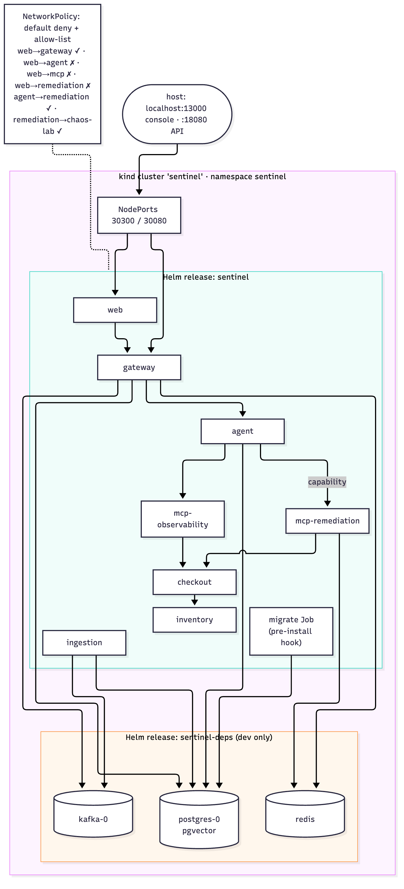
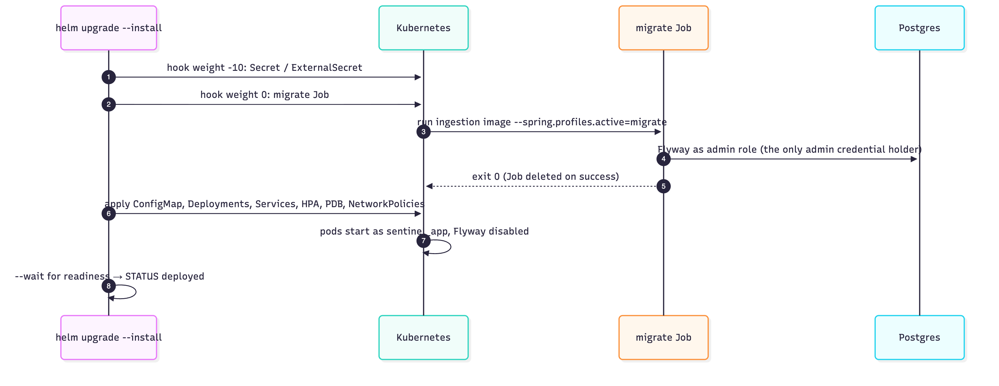

# 13 Deployment and operations

## 1. Prerequisites
Java 21+ (tested on 25), Maven, [uv](https://docs.astral.sh/uv/), Node 24, Docker. Optional: Ollama with `gemma4:latest` (local LLM).

Helm, kind, kubeconform and Terraform are installed **project-locally** in `.tools/` (gitignored), from official sources with checksums verified. The scripts put `.tools` on `PATH`.

## 2. Environments

### 2.1 Fast local loop: `scripts/dev-local.sh up|down`


*Figure 13.1: The fast local loop*

Infra in Docker; services as host processes; no image builds.

| Step | What happens |
|---|---|
| 1 | Download the embedding model once to `.models/all-MiniLM-L6-v2/model.onnx`; export `SENTINEL_EMBEDDING_MODEL_URI=file:…` |
| 2 | `docker compose up -d --wait postgres kafka redis jaeger keycloak` (Keycloak imports the dev realm `deploy/keycloak/sentinel-realm.json`; :8180) |
| 3 | Build Sentinel Guard (`go build`, the toolchain in `.tools/go` or `go` on the PATH); `mvn package` gateway and ingestion |
| 4 | Start **Sentinel Guard :8400** (memory mode, `deploy/guard/copilot-policy.yaml`, dev-only tokens for the agent and the gateway as a delegate; metrics :9095), chaos-lab inventory :8102, checkout :8101 (→ inventory), mcp-observability :8200, **mcp-remediation :8300** (`OPS_SERVICES`, `SENTINEL_GUARD_URL`), **loadgen** (→ checkout) |
| 5 | Start ingestion :8090 (runs Flyway); wait for health |
| 6 | Start the agent :8000 with the Postgres checkpointer, MCP URLs (including `SENTINEL_MCP_REMEDIATION_URL`) and `SENTINEL_GUARD_URL`/`SENTINEL_GUARD_TOKEN` |
| 7 | Start the gateway :8080 (dev tokens on, OIDC issuer = local Keycloak, ephemeral signing key). Then Prometheus (with `alerts.yml`), **Alertmanager** and Grafana via `docker-compose.local-observability.yml`. They start after the gateway because the one-shot `alertmanager-token` container asks the gateway's API for the integration token (`SENTINEL_ALERT_TENANT`, default `acme`). Then the console :3000 if `web/node_modules` exists (OIDC + dev login) |

Logs go to `.logs/<service>.log`. Every health wait times out after 120 tries with a 2 s curl timeout. The LLM provider comes from your shell (`SENTINEL_LLM_PROVIDER=ollama scripts/dev-local.sh up`). `down` stops local processes but leaves Docker infra running (`cd deploy && docker compose stop`).

Then:
- seed knowledge: `python3 scripts/seed_knowledge.py acme` (`GATEWAY_URL` overrides the target);
- break something: `python3 chaos-lab/inject.py checkout bad_deploy`. With loadgen and Alertmanager running, **the incident opens by itself** in about 40–50 s; approve it in the console and watch it resolve (Alertmanager UI: http://localhost:9093);
- run the demo: `scripts/guard-demo.sh`.

*Pitfall (Phase 7):* `mvn package` replaces the jar under a running `java -jar` process. Rebuilding while the gateway runs breaks it (class loading), so restart after any rebuild; `build-images.sh` rebuilds the jars too.

### 2.2 All containers: `deploy/docker-compose.yml`
Default services:
- postgres :5432, kafka :9092 (external) / 19092 (internal), redis :6379, jaeger :16686 / :4318;
- ingestion (internal 8090; owns migrations), gateway :8080, agent :8000, mcp-observability :8200, **mcp-remediation :8300**, checkout :8101, inventory :8102.
- **web :3000**, the console (BFF). Sign in through Keycloak (the browser uses `localhost:8180`; the server uses `keycloak:8080` via `OIDC_INTERNAL_ISSUER`) or the dev login; cookies aren't marked Secure on plain HTTP (`SENTINEL_INSECURE_COOKIES`).

Keycloak :8180 runs by default (dev realm imported; the gateway trusts it as the OIDC issuer). `--profile observability` adds Prometheus :9090 (with alert rules), **Alertmanager :9093** (+ the `alertmanager-token` one-shot), **loadgen**, and Grafana :3001. Without that profile no alerts fire, and incidents are opened by hand as before.

Java images package a pre-built jar, so run `scripts/build-images.sh` first (or `mvn package` + copy the model). Shared anchors: `x-java-env` (datasource, Kafka, app DB password, OTLP export) and `x-llm-env` (provider, key, Ollama URL `http://host.docker.internal:11434`, model).

### 2.3 Local Kubernetes: `scripts/kind-up.sh [--down]`



*Figure 13.2: The kind deployment: two Helm releases, NodePorts to the host, NetworkPolicy allow-list*

1. Create the kind cluster `sentinel` (`deploy/kind/cluster.yaml`): NodePort 30300 → host **13000** (console), 30080 → host **18080** (gateway).
2. `scripts/build-images.sh` if the images are missing (tags `sentinel/<component>:dev`).
3. `kind load docker-image` for **our** seven images only. Third-party images are pulled by the node: kind can't import multi-platform images from Docker Desktop's store ("content digest … not found").
4. `helm upgrade --install sentinel-deps deploy/helm/sentinel-deps` (dev-only Postgres + pgvector, Kafka, Redis).
5. `helm upgrade --install sentinel deploy/helm/sentinel -f values-kind.yaml --wait`. The migration hook Job runs first.
6. `kubectl rollout restart` of our deployments and wait. The tag is always `dev`, so without this, pods keep running the previously loaded image. Phase 7 found this: chaos-lab pods still lacked `/ops/*` after a rebuild.

Verified (Phase 6, re-verified in Phase 7):
- all pods Running as uid 10001 with read-only roots;
- seed → Kafka → ingestion inside the cluster;
- incident → approve → capability → `mcp-remediation` executes `increase_pool` → verified → `RESOLVED` (the CI smoke steps, run locally);
- NetworkPolicy blocks console → agent, MCP and the remediation adapter;
- each pod holds only its own secrets (the agent has no signing secret).

```text
$ kubectl -n sentinel get pods
NAME                                         READY  STATUS   RESTARTS  AGE
kafka-0                                      1/1    Running  0         129m
postgres-0                                   1/1    Running  0         129m
redis-646ddb9b59-7qbq7                       1/1    Running  0         129m
sentinel-agent-767979459d-6hqws              1/1    Running  0         108m
sentinel-checkout-5c8b89fc5b-qpbtq           1/1    Running  0         108m
sentinel-gateway-78f85d7fb8-w95mx            1/1    Running  0         108m
sentinel-ingestion-b9cc95b68-c4zwz           1/1    Running  0         108m
sentinel-inventory-6dc884588-4gkh9           1/1    Running  0         108m
sentinel-mcp-observability-5548b65fd4-cwx6v  1/1    Running  0         108m
sentinel-web-5999d4fd6f-2447n                1/1    Running  0         108m

$ helm list -n sentinel
NAME           REVISION  STATUS    CHART
sentinel       3         deployed  sentinel-0.6.0
sentinel-deps  2         deployed  sentinel-deps-0.1.0
```
*Live output from the local kind cluster (2026-10-05). The migrate hook Job isn't listed: it deletes itself after succeeding.*

### 2.4 AWS: `deploy/terraform/aws` + Helm (`values-aws.yaml`)


*Figure 13.3: AWS topology provisioned by Terraform*

1. `terraform init && terraform apply` (configure the S3 backend in `versions.tf` first). Resources:
   - **Network:** 3-AZ VPC; public/private subnets; one NAT gateway per AZ.
   - **EKS:** private endpoint, KMS-encrypted secrets, access entries; VPC CNI **with NetworkPolicy enabled**; managed Graviton node group (`m7g.large`, 2–8).
   - **RDS Postgres 16:** Multi-AZ, KMS, `rds.force_ssl`, managed master password, 14-day backups, deletion protection, Performance Insights.
   - **MSK** 3.8: 3 brokers, TLS client-broker and in-cluster, KMS.
   - **ElastiCache Redis 7.1:** 2 nodes, Multi-AZ, failover, TLS + at-rest encryption.
   - **ECR:** repositories with immutable tags, scan on push, KMS, keep-last-50 lifecycle.
   - **Secrets Manager** `sentinel/app` (generated JWT secret and app DB password; Anthropic key set out of band).
2. Cluster add-ons (assumed): External Secrets Operator (`ClusterSecretStore aws-secrets-manager`), AWS Load Balancer Controller, an OTel Collector.
3. Fill `values-aws.yaml` from `terraform output`: `rds_endpoint`, `msk_bootstrap_brokers_tls`, `redis_endpoint`, `rds_master_secret_arn`, ECR registry.
4. `helm upgrade --install sentinel deploy/helm/sentinel -f values-aws.yaml`. It applies:
   - TLS everywhere: `sslmode=require`, `SPRING_KAFKA_SECURITY_PROTOCOL=SSL`, `SPRING_DATA_REDIS_SSL_ENABLED=true`;
   - an `ExternalSecret` that composes the app Secret, including the agent's `checkpointDsn`;
   - no external NodePorts (traffic arrives via the ALB).

Status: `terraform validate` and `fmt` pass in CI; **not applied** (no AWS account was used).

## 3. Helm chart reference (`deploy/helm/sentinel`)



*Figure 13.4: Install order: secrets hook, migration hook Job, then the workloads*

| Value | Default | Notes |
|---|---|---|
| `image.registry` / `prefix` / `tag` / `pullPolicy` | `ghcr.io/your-org` / `sentinel-` / `0.6.0` / `IfNotPresent` | Image = `<registry>/<prefix><component>:<tag>`; kind: `sentinel`, `""`, `dev`, `Never` |
| `postgres.{host,port,database,sslmode}` | example host, 5432, `sentinel`, `""` | `sslmode: require` on RDS |
| `kafka.bootstrapServers`, `redis.host` | example hosts | |
| `llm.{provider, ollamaBaseUrl, ollamaModel}` | `anthropic`, `""`, `gemma4:latest` | Empty values are **omitted** from the ConfigMap (an empty `OLLAMA_BASE_URL` crashed Spring AI) |
| `tracing.otlpEndpoint` | `""` | Sets both OTLP env vars when present |
| `extraConfig` | `{}` | Extra ConfigMap keys (TLS switches) |
| `secrets.create` / `existingSecret` / `values.*` | `false` / `sentinel` | Dev creates the Secret (a pre-install hook, weight −10) with `jwtSecret`, `dbAppPassword`, `dbAdminPassword`, `anthropicApiKey`, `checkpointDsn` |
| `externalSecrets.*` | disabled | AWS: `ExternalSecret` (hook, weight −10) |
| `migrations.{enabled, dbAdminUser}` | `true`, `sentinel` | Hook Job `pre-install,pre-upgrade`, weight 0, `backoffLimit 3`, `activeDeadlineSeconds 600`, `--spring.profiles.active=migrate` |
| `networkPolicy.{enabled, ingressNamespaceLabel, monitoringNamespaceLabel, externalAccess}` | `true`, ingress-nginx, monitoring, `[]` | `externalAccess` adds an `ipBlock 0.0.0.0/0` allow per component (kind: `[web, gateway]`) |
| `podSecurity` | runAsNonRoot, uid 10001, seccomp RuntimeDefault | |
| `components.<name>.{port, replicas, probes, metricsPath, resources, autoscaling, service, env}` | see `values.yaml` | gateway/agent HPA (CPU 70%; 2–8 / 2–10); PDB minAvailable 1 when replicas > 1 or HPA on |
| `auth.devTokens` (Phase 8) | `false` (kind: `true`) | Dev HS256 user tokens; needs `secrets.values.jwtSecret` |
| `auth.signing.requireConfigured` | `true` (kind: `false`) | Production refuses an ephemeral key; `secrets.values.signingKeys` is then required at template time |
| `auth.oidc.{issuer, jwksUri, audience, clientId}`, `auth.publicUrl` | `""`, `""`, `sentinel-api`, `sentinel-console`, `""` | Users' IdP and the console's external URL (redirect base) |
| `components.<name>.secrets` | gateway `[signingKeys, dbAppPassword, anthropicApiKey]`; ingestion `[dbAppPassword]`; agent `[anthropicApiKey]` (+ checkpoint DSN); web `[oidcClientSecret]`; mcp-remediation and mcp-observability `[]`. kind: gateway and web use `jwtSecret` (dev issuer) instead | **Least privilege:** each pod gets only the secret keys it lists. `scripts/check_chart_secrets.py` (CI) fails if signing material reaches any other pod, or the dev secret appears in production |
| `remediation.targets` (Phase 7) | `{}` | `service: ops-API URL` for the adapter (`OPS_SERVICES`). With `chaosLab.enabled` the lab services are used |
| `chaosLab.{enabled, services}` | `false`, `[checkout, inventory]` | Demo only |

Rendered resources (kind overlay): 1 ConfigMap, 8 Deployments, 7 Services, 9 NetworkPolicies, 1 Secret, 1 Job (no PDBs: one replica each; the default values add them). Every overlay passes `helm lint` and `kubeconform -strict` (ExternalSecret skipped: CRD schema not in the offline catalog).

Pod template invariants:
- `checksum/config` annotation (a config change rolls the pods);
- `topologySpreadConstraints` by hostname;
- startup/readiness/liveness probes;
- `/tmp` as `emptyDir` (the only writable path);
- container `allowPrivilegeEscalation: false`, `readOnlyRootFilesystem: true`, `capabilities.drop: [ALL]`.

## 4. Images (`scripts/build-images.sh`)

| Image | Base | Size (dev) | Notes |
|---|---|---|---|
| `gateway`, `ingestion` | `eclipse-temurin:21-jre` | ~1.2 GB / 1.1 GB | Pre-built jar + baked model at `/models/…`; uid 10001 |
| `agent` | `python:3.12-slim` + `uv sync` | 475 MB | Runs `/app/.venv/bin/uvicorn` directly |
| `mcp-observability` | same | 344 MB | `/app/.venv/bin/python server.py` |
| `mcp-remediation` | same | ~350 MB | `/app/.venv/bin/python server.py`, port 8300 |
| `chaos-lab` | `python:3.12-slim` | 285 MB | |
| `web` | `node:24-alpine` (multi-stage) | 292 MB | `node server.js` as `node` |

## 5. Configuration reference

| Variable | Service(s) | Default | Purpose |
|---|---|---|---|
| `SPRING_DATASOURCE_URL` | gateway, ingestion | `jdbc:postgresql://localhost:5432/sentinel` | DB |
| `SENTINEL_DB_APP_PASSWORD` | gateway, ingestion | `sentinel_app` | App role password (also the Flyway placeholder) |
| `SENTINEL_DB_ADMIN_USER`, `SENTINEL_DB_ADMIN_PASSWORD` | ingestion (Flyway) | `sentinel`, `sentinel` | Migrations only |
| `SPRING_FLYWAY_ENABLED` | ingestion | true | `false` in Kubernetes serving pods |
| `SPRING_KAFKA_BOOTSTRAP_SERVERS` | gateway, ingestion | `localhost:9092` | |
| `SPRING_KAFKA_SECURITY_PROTOCOL` | gateway, ingestion | — | `SSL` on MSK |
| `SPRING_DATA_REDIS_HOST`, `SPRING_DATA_REDIS_SSL_ENABLED` | gateway | `localhost`, false | |
| `SENTINEL_RATE_LIMIT_BACKEND` | gateway | `redis` | `redis` or `memory` |
| `SENTINEL_JWT_SECRET` | gateway (dev issuer), web (dev login) | dev default | HS256 secret for **dev user tokens only**; unused (and absent) in production |
| `SENTINEL_DEV_TOKENS` | gateway | `false` | Accept HS256 dev user tokens (scripts, CI, kind). Never in production |
| `SENTINEL_ISSUER` | gateway, agent, mcp-observability, mcp-remediation | `http://localhost:8080` | `iss` of the gateway's service tokens; verifiers fetch `<issuer>/.well-known/jwks.json` |
| `SENTINEL_JWKS_URL` | agent, mcp-observability, mcp-remediation | `<SENTINEL_ISSUER>/.well-known/jwks.json` | Override where verifiers fetch the gateway's public keys |
| `SENTINEL_SIGNING_KEYS` | gateway | — (ephemeral key) | JWK set with private EC P-256 keys (`scripts/gen_signing_key.py`); only the gateway holds it |
| `SENTINEL_SIGNING_ACTIVE_KID` | gateway | first key | Which key signs new tokens (rotation) |
| `SENTINEL_SIGNING_REQUIRED` | gateway | `false` | Refuse to start with an ephemeral key (`true` in production values) |
| `SENTINEL_OIDC_ISSUER`, `SENTINEL_OIDC_JWKS_URI`, `SENTINEL_OIDC_AUDIENCE` | gateway | —, `<issuer>/protocol/openid-connect/certs`, `sentinel-api` | Users' identity provider: exact `iss`, key URL (may be internal), required audience |
| `SENTINEL_AGENT_AUTH` | agent | `required` | `disabled` turns off gateway-token checks (local experiments only) |
| `SENTINEL_MCP_AUTH` | mcp-observability | `required` | `disabled` turns off tool-token checks on `/mcp` |
| `SENTINEL_AGENT_URL` | gateway | `http://localhost:8000` | |
| `SENTINEL_LLM_PROVIDER` | gateway, agent | `anthropic` | `anthropic` or `ollama` |
| `ANTHROPIC_API_KEY` | gateway, agent | — | Without it (Anthropic provider): rule path; `/ask` → 503 |
| `OLLAMA_BASE_URL`, `SENTINEL_OLLAMA_MODEL` | gateway, agent | `http://localhost:11434`, `gemma4:latest` | |
| `SENTINEL_OLLAMA_NUM_CTX`, `SENTINEL_OLLAMA_REASONING` | agent | 16384, model default | `false` = 3× faster on gemma4 |
| `SENTINEL_TRIAGE_MODEL`, `SENTINEL_INVESTIGATION_MODEL`, `SENTINEL_RCA_MODEL` | agent | `claude-haiku-4-5`, `claude-opus-5-5`, `claude-opus-5-5` | Claude model per step |
| `SENTINEL_MAX_TOOL_CALLS`, `SENTINEL_MAX_INVESTIGATION_COST_USD` | agent | 8, 0.50 | Budgets |
| `SENTINEL_MCP_OBSERVABILITY_URL`, `SENTINEL_MCP_KNOWLEDGE_URL` | agent | `:8200/mcp`, `:8080/mcp` | |
| `SENTINEL_MCP_REMEDIATION_URL` | agent | `http://localhost:8300/mcp` | Remediation adapter (Phase 7) |
| `SENTINEL_VERIFY_ATTEMPTS`, `SENTINEL_VERIFY_INTERVAL_S` | agent | 6, 5 | Post-execution probes; worst case must stay under the gateway's 120 s agent read timeout |
| `OPS_SERVICES` | mcp-remediation | — | `name=ops-url,…`; unknown services are refused |
| `SENTINEL_GUARD_URL` | agent, gateway, mcp-remediation | `http://localhost:8400` (gateway, adapter); unset = no guard (agent: nothing can execute) | Sentinel Guard's action API (Phase 11). In Kubernetes: `http://sentinel-guard:8080`, the guard's in-cluster plain-HTTP port |
| `SENTINEL_GUARD_TOKEN`, `SENTINEL_GUARD_TOKEN_FILE` | agent (proposes), gateway (decides as a delegate) | — | Identity towards the guard: a static token (single-process guard) or a projected ServiceAccount token file (Kubernetes; re-read on every call) |
| `SENTINEL_GUARD_ISSUER` | mcp-remediation (also the guard itself) | `sentinel-guard` | `iss` of capabilities; the adapter verifies them against `<SENTINEL_GUARD_URL>/.well-known/jwks.json` |
| `SENTINEL_GUARD_DELEGATE_TOKENS` | sentinel-guard (memory mode) | — | `name=token,…`: services allowed to record decisions on a person's behalf (added to the policy's `delegates`) |
| `SENTINEL_GUARD_API_ADDR` | sentinel-guard (kubernetes mode) | — (off) | Also serve the action API (no webhooks) over plain HTTP, e.g. `:8080`, for in-cluster clients |
| `SENTINEL_GUARD_AGENT_TOKEN`, `SENTINEL_GUARD_GATEWAY_TOKEN` | `deploy/docker-compose.yml` | dev-only values | The two static tokens compose gives the guard, the agent and the gateway |
| `PROBE_TIMEOUT_S` | mcp-observability | 3 | Per-request cap in `probe_service` |
| `LOADGEN_TARGETS`, `LOADGEN_INTERVAL_S` | chaos-lab loadgen | `http://localhost:8101`, 0.2 | Background traffic so faults reach the metrics |
| `SENTINEL_ALERT_TENANT` | compose `alertmanager-token` | `acme` | Tenant for which the provisioner asks the gateway to issue Alertmanager's integration token |
| `SENTINEL_CHECKPOINT_DSN` | agent | — (in-memory) | `postgresql://sentinel_app:…/sentinel?options=-csearch_path%3Dlanggraph[&sslmode=require]` |
| `SENTINEL_EMBEDDING_MODEL_URI`, `SENTINEL_MODEL_CACHE` | gateway, ingestion | HF URL, `$TMPDIR/sentinel-models` | |
| `SENTINEL_TOKENIZER_URI` | gateway, ingestion | `classpath:/onnx/all-MiniLM-L6-v2/tokenizer.json` | The tokenizer bundled in the Spring AI jar. Until Phase 8 it was fetched from GitHub at every startup, which broke offline starts after a reboot cleared the cache |
| `OTEL_EXPORTER_OTLP_ENDPOINT` | agent, mcp-observability | — | e.g. `http://jaeger:4318` |
| `MANAGEMENT_OPENTELEMETRY_TRACING_EXPORT_OTLP_ENDPOINT` | gateway | — | e.g. `http://jaeger:4318/v1/traces` |
| `OBSERVED_SERVICES`, `HOST`, `PORT` | mcp-observability (and `HOST`/`PORT` for mcp-remediation, port 8300) | —, `127.0.0.1`, 8200 | `name=url,…` |
| `SERVICE_NAME`, `DOWNSTREAM_URL` | chaos-lab | `svc`, — | |
| `GATEWAY_URL`, `SENTINEL_DEV_LOGIN` | web (and `seed_knowledge.py`) | `http://localhost:8080`, — | Dev login is disabled in production unless `true` |
| `OIDC_ISSUER`, `OIDC_INTERNAL_ISSUER` | web | — | IdP issuer (public URL, used for browser redirects) and an optional server-to-server URL for discovery and the token endpoint |
| `OIDC_CLIENT_ID`, `OIDC_CLIENT_SECRET` | web | — | Confidential client for the code flow (+ PKCE); OIDC sign-in appears when both issuer and client id are set |
| `PUBLIC_URL` | web | `http://localhost:3000` | The console's external URL (redirect URI base) |
| `SENTINEL_INSECURE_COOKIES` | web | — | `true` allows non-`Secure` cookies in a production build over plain HTTP (local kind only) |

## 6. Operational runbooks

| Task | How |
|---|---|
| Rotate the gateway's signing keys | `uv run --with cryptography scripts/gen_signing_key.py <new-kid> --add current.json` → store; set `SENTINEL_SIGNING_ACTIVE_KID=<old-kid>` and roll the gateway (the new key is published, not used); unset it and roll again (new key signs; verifiers pick it up by `kid`); after the longest-lived token signed by the old key expires (integration tokens ≤ 90 days, or re-issue them), drop the old key |
| Rotate the dev secret | Only where dev tokens are enabled: change `SENTINEL_JWT_SECRET`, roll gateway and web |
| Revoke an integration token | Console → Integrations → Revoke, or `DELETE /api/v1/integrations/{jti}` as a tenant admin. Effective on the next delivery |
| Connect Alertmanager for a tenant | A tenant admin issues a token: console → Integrations → Issue (or `POST /api/v1/integrations/alertmanager`; dev: `python3 scripts/integration_token.py <gateway> <tenant> <file>`). Put it in `http_config.authorization.credentials_file`; webhook URL `…/api/v1/alerts/alertmanager`, `send_resolved: true`. Every alert needs a `service` label |
| Sign in locally | Console → "Sign in with Keycloak" (dev users and their test passwords: `deploy/keycloak/sentinel-realm.json`) or the dev login. Keycloak admin console: http://localhost:8180 |
| An approved remediation shows `REMEDIATION_FAILED` | Read `execution.error`: "already used" (a retried decision; it can't be replayed, decide on a new incident), "invalid capability" (clock skew or > 5 min between approval and execution), "replay protection unavailable" (Redis down: fix Redis, then act by hand or re-open), or verification failed (the fix didn't work: the alert stays linked, escalate) |
| Audit an execution | `SELECT * FROM remediation_audit WHERE incident_id = …` (tenant bound), then grep the adapter's log for the `jti` |
| Pause all automated execution | Scale `mcp-remediation` to 0 (or block it in NetworkPolicy): approvals still record decisions; executions fail closed as `REMEDIATION_FAILED` |
| Add a tenant's knowledge | `POST /api/v1/knowledge/documents` or `seed_knowledge.py`; watch `sentinel_ingestion_documents_total{outcome="indexed"}` |
| Re-embed everything (model change) | Change the model in **both** gateway and ingestion (dimension migration if needed), clear `knowledge_documents.content_hash` or replay the topic from the beginning |
| Inspect a failed upload | Consume `knowledge.documents-dlt`; Spring Kafka adds exception headers |
| An incident is stuck `AWAITING_APPROVAL` | Expected until a human decides; it survives restarts. `GET /api/v1/incidents/{id}` shows the proposal |
| Clear the `/ask` cache for a tenant | Any knowledge change invalidates it automatically; manual: `DELETE FROM ask_cache WHERE tenant_id = …` (as admin or with the tenant bound) |
| Run the benchmark | Chapter 11 §1.4 |
| Load test | `scripts/load-test.sh` → `docs/load-test-results.json` |

## 7. Troubleshooting (every issue we actually hit)

| Symptom | Cause | Fix |
|---|---|---|
| Gateway won't start: "No qualifying bean of type RestClient.Builder" | Boot 4 modularized auto-config | `spring-boot-starter-restclient` |
| `dev-local.sh up` hangs; `.logs/ingestion.log` says port 8090 is in use (Phase 11) | The local guard was first put on :8090, ingestion's port | The guard runs on **:8400** locally (compose too) |
| Approve in the console → 503 "Sentinel Guard: unavailable, so nothing was approved or resumed" | The guard is down (by design nothing resumes) | Start the guard; in single-process (dev) mode pending requests are lost on restart, so re-open the incident |
| Gateway → agent calls 422 / "Unsupported upgrade request" | JDK HttpClient tries an h2c upgrade | `AgentClient` forces HTTP/1.1 |
| Ingestion: "No qualifying bean of type JsonMapper" | Boot 4 needs a Jackson starter | `spring-boot-starter-jackson` |
| Startup hangs on "Failed to cache the resource … model.onnx" | Slow or blocked Hugging Face download | Use `.models/` (dev-local) or baked images; `SENTINEL_EMBEDDING_MODEL_URI=file:…` |
| `dev-local.sh` waits forever on ingestion health | Ingestion had no web server (actuator needs one) | `spring-boot-starter-webmvc` added; curl timeouts added |
| RLS "doesn't work" (other tenant's rows visible) | Connected as a superuser | Use `sentinel_app`; superusers bypass RLS even with FORCE |
| `/ask` → 500 with an Anthropic 401 in the logs | No API key | Now 503 "LLM provider not configured"; set the key or use `ollama` |
| Every API call 500 after adding tool tokens | `getAudience()` null for user tokens | Null-safe check |
| MCP `tools/list` returns `[]` | Spring AI's tool-callback converter bean replaced ours | `spring.ai.mcp.server.tool-callback-converter: false` |
| `langchain-mcp-adapters` import error | Incompatible with `mcp` 2.x | Pin `mcp<2` |
| Agent evidence parsing fails on real MCP output | List results arrive as one content block per item | Tools return one JSON object |
| Gateway won't start: duplicate key `observations` | YAML duplicate keys | Merge the blocks |
| kind: "content digest … not found" on image load | Multi-platform images from Docker Desktop | Load only our images; the node pulls third-party ones |
| Pods `ErrImageNeverPull` | Image name ≠ chart naming | `image.prefix` (kind: `""`) |
| Python pods CrashLoop: "failed to create directory ~/.cache/uv: Read-only file system" | `uv run` at runtime | Run the venv binaries directly |
| Gateway CrashLoop: "baseUrl cannot be null or empty" (OllamaApi) | Empty `OLLAMA_BASE_URL` in the ConfigMap | Omit empty values |
| NodePorts hang | Default-deny NetworkPolicy (enforced) | `networkPolicy.externalAccess: [web, gateway]` |
| `helm upgrade`: "another operation is in progress" | An earlier `--wait` install never finished | `helm uninstall` and reinstall (data is in the separate deps release), or `helm rollback` |
| A metric value shows `[REDACTED:card]` | Float fraction passed Luhn | Card regex lookarounds (fixed) |
| Ingestion or gateway won't start: "Failed to cache the resource … tokenizer.json … Operation timed out" | The tokenizer was fetched from GitHub on startup (the cache was cleared by a reboot) | Fixed: bundled tokenizer (`SENTINEL_TOKENIZER_URI`); images and dev-local start offline |
| Local gateway suddenly fails every request after a build | `mvn package` replaced the jar under the running JVM | Restart the gateway after rebuilding |
| Restarted gateway won't start: embedding model not found | `$PWD` expanded inside a `(cd gateway-service && …)` subshell pointed to the wrong `.models` | Use an absolute path captured before `cd` |
| kind pods keep old behavior after a rebuild | Same `dev` tag, so no rollout | `kind-up.sh` now restarts the deployments |
| Alertmanager log: "Notify for alerts failed … connection refused" | The gateway was down | Nothing: Alertmanager retries and delivered once the gateway was back (seen live) |
| An alert-opened incident proposed rollback for a pool fault | The previous incident's rollback record looked like a recent deploy | Fixed: rollbacks and rolled-back builds aren't suspects |
| One fault opened two incidents | Two rules (`DbPoolSaturated`, `HighErrorRatio`) fired for one service | Fixed: per-service correlation under an advisory lock |

## 8. Sentinel Guard
Install: `helm install sentinel-guard oci://ghcr.io/abdulmdev/charts/sentinel-guard -n sentinel-system --create-namespace`, or `kubectl apply -f` the release's `install.yaml`, or `docker run ghcr.io/abdulmdev/sentinel-guard` (single process). The user guide is [docs/guard](../guard/README.md); the design is [chapter 17](17-lld-sentinel-guard.md). End-to-end test on kind: `scripts/guard-e2e.sh` (`KEEP=1` keeps the cluster, `LOAD=1` measures latency).

### 8.1 Environment (`guard/cmd/sentinel-guard`)
| Variable | Default | Purpose |
|---|---|---|
| `SENTINEL_GUARD_MODE` | `kubernetes` when `KUBERNETES_SERVICE_HOST` is set, else `memory` | `kubernetes`: webhooks + API, state in ActionRequests; `memory`: one process, HTTP approvals, state in memory |
| `SENTINEL_GUARD_POLICY` | built-in `guard/policies/default.yaml` | Policy file (the chart mounts its `policy:` value here) |
| `SENTINEL_GUARD_ADDR` | `:8443` (kubernetes, TLS) / `:8080` (memory) | API and webhook listener |
| `SENTINEL_GUARD_METRICS_ADDR` | `:9090` | Prometheus metrics (plain HTTP) |
| `POD_NAMESPACE`, `POD_NAME`, `SERVICE_ACCOUNT` | `sentinel-system`, random, `sentinel-guard` | The guard's own namespace (where its objects live; also a protected namespace), lease identity, and its own identity (the only one allowed to manage ActionRequests) |
| `SENTINEL_GUARD_SERVICE` | `sentinel-guard` | Service name for the serving certificate |
| `SENTINEL_GUARD_VALIDATING_WEBHOOK`, `SENTINEL_GUARD_MUTATING_WEBHOOK` | `sentinel-guard` | Webhook configurations whose CA bundle the guard maintains |
| `SENTINEL_GUARD_ISSUER` | `sentinel-guard` | `iss` of capabilities |
| `SENTINEL_GUARD_VERIFY_INTERVAL` | `5m` | How often each replica verifies the whole audit chain (`sentinel_guard_audit_chain_ok`; Phase 14) |
| `SENTINEL_GUARD_AGENT_TOKENS` | generated `demo-agent` token (printed once) | memory mode: `name=token,…` for agents |
| `SENTINEL_GUARD_ADMIN_TOKEN` | generated (printed once), unless approver tokens are set | memory mode: a shared approver token for HTTP approvals; decisions record the name given in the body |
| `SENTINEL_GUARD_APPROVER_TOKENS` | none | memory mode: `person=token,…`, a token per person; each decision is recorded as that person (Phase 16) |
| `SENTINEL_GUARD_OIDC_ISSUER`, `SENTINEL_GUARD_OIDC_AUDIENCE` | none | Verify people's own OIDC tokens at the guard: HTTP decisions by the policy's `approvers`, and person tokens a delegate forwards (`X-Sentinel-Person-Token`). The audience is required with the issuer (Phase 16) |
| `SENTINEL_GUARD_OIDC_USERNAME_CLAIM`, `SENTINEL_GUARD_OIDC_GROUPS_CLAIM` | `email`, `groups` | The claims naming the person and their groups. With `email`, a token whose `email_verified` is false is refused |
| `SENTINEL_GUARD_NOTIFY_URL` | none | A webhook told when a request needs a person, when an approval leaves it needing more, and when one expires undecided (Slack, Discord, or any JSON reader; Phase 16) |
| `SENTINEL_GUARD_PUBLIC_URL` | none | The guard's address for people, linked from notifications (`<url>/inbox/`). Without it, notifications give the `kubectl sentinel approve` command |
| `KUBERNETES_SERVICE_HOST` | set by Kubernetes | Only used to pick the default mode |
| `SENTINEL_GUARD_NAMESPACE` | `sentinel-system` | kubectl plugin: where the guard runs (or `--guard-namespace`) |

Flags without a variable: `-version`, and `-healthcheck` (Phase 15): probe `http://127.0.0.1<SENTINEL_GUARD_ADDR>/readyz` and exit 0 when ready. The image is distroless (no shell, no curl), so this is what container health checks call.

### 8.2 Chart values (`deploy/helm/sentinel-guard`)
| Value | Default | Purpose |
|---|---|---|
| `agents.groups`, `agents.users` | `[system:serviceaccounts:agents]`, `[]` | Who is an agent: rendered into the webhook's `matchConditions` **and** the policy, so the two can't drift |
| `approvers.users`, `approvers.groups` | `[]` | RoleBinding to `sentinel-guard-approver` in the release namespace, and the policy's `approvers` (who may decide over HTTP with an OIDC token; Phase 16) |
| `oidc.issuer`, `oidc.audience`, `oidc.usernameClaim`, `oidc.groupsClaim` | empty | Verify people's OIDC tokens at the guard (the environment variables above); `audience` is required with `issuer` (Phase 16) |
| `notify.url`, `notify.existingSecret`, `notify.key`, `notify.publicURL` | empty, empty, `url`, empty | The notification webhook, preferably from a Secret, and the link it gives people (Phase 16) |
| `policy` | see `values.yaml` | The policy (chapter 17 §2; user guide "Policy"); a change rolls the pods (checksum annotation) |
| `replicas` | 3 | Spread across zones and nodes (topology spread), `maxUnavailable: 1` PDB |
| `webhook.timeoutSeconds`, `webhook.guardCreate`, `webhook.extraRules` | 5, false, `[]` | Webhook timeout; also guard agents' creates; more resources to guard |
| `delegates.users`, `delegates.groups` | `[]` | Services that may record a decision on a person's behalf over HTTP (Phase 11; the sentinel chart lists its gateway) |
| `api.plainHTTP`, `api.port` | false, 8080 | Also serve the action API in-cluster over plain HTTP (no webhooks) |
| `auditors.users`, `auditors.groups` | `[]` | Identities that may call `GET /v1/audit/export` and `/v1/audit/verify`, e.g. a CronJob that archives evidence (Phase 14) |
| `prometheusRule.enabled`, `prometheusRule.labels` | false, `{}` | Install the guardian alert rules as a PrometheusRule (Prometheus Operator); labels to match your Prometheus `ruleSelector` (Phase 14) |
| `grafanaDashboard.enabled`, `.namespace`, `.labels` | false, the release namespace, `{grafana_dashboard: "1"}` | The Sentinel Guard dashboard as a ConfigMap for Grafana's dashboard sidecar (Phase 15; chapter 12 §3) |
| `createNamespace` | false | Render the Namespace (used for `install.yaml`) |
| `networkPolicy.enabled`, `serviceMonitor.enabled` | false, false | Optional extras |
| `image.repository`, `image.tag` | `ghcr.io/abdulmdev/sentinel-guard`, the chart's appVersion | |

### 8.3 Operations
- **Upgrade from a 2.0.0 alpha:** `kubectl apply -f deploy/helm/sentinel-guard/crds/actionrequests.sentinel.dev.yaml`, then `helm upgrade`. Helm never updates CRDs; a guard started on the old CRD stops with that instruction in its log. The CRD serves `v1` (stored) and `v1alpha1` (deprecated, same schema), so records from the alphas read and verify through either. `scripts/guard-upgrade-e2e.sh` (in CI) runs this from the published 2.0.0-alpha.3.
- **Approve:** `kubectl sentinel approve <id> [-m note]`, or `kubectl -n sentinel-system patch actionrequest <id> --type merge -p '{"spec":{"decision":"approve"}}'`.
- **Verify the audit trail:** `kubectl sentinel audit verify` (needs read access to ActionRequests and the three ConfigMaps; exit code 2 on any problem).
- **Export and archive evidence (Phase 14):**
  - `kubectl sentinel audit export > evidence-$(date -u +%Y-%m).json`;
  - verify it anywhere with `kubectl sentinel audit verify --bundle <file> --jwks <keys> --previous <last archive>`;
  - keep the files in write-once storage for your retention period. The AI Act's floor for high-risk systems is six months: [docs/compliance](../compliance/README.md).
- **Stop every agent at once:** `kubectl -n sentinel-system scale deploy/sentinel-guard --replicas=0`. Agents' changes are refused (fail closed); humans, CI and controllers are unaffected. Scale back to resume.
- **Break-glass:** `kubectl delete validatingwebhookconfiguration sentinel-guard` stops enforcement (re-apply the chart to restore). The deletion is in the Kubernetes audit log.
- **Rotate the TLS certificate or signing key:** delete the Secret (`sentinel-guard-tls` / `sentinel-guard-signing`) and restart the pods. A new signing key invalidates outstanding capabilities and starts a new key id; events signed with the old key verify only while its public key is still published (key history is on the roadmap, chapter 16).
- **Release:** pushing a `v2.*` tag runs `.github/workflows/release-guard.yml`: signed multi-arch image with SBOM and provenance, OCI chart, `install.yaml`, the plugin for 5 platforms, the krew manifest. Afterwards, commit the release's `sentinel.yaml` as `plugins/sentinel.yaml`: that directory makes this repository a krew index (`kubectl krew index add sentinel <repo>.git`). First release: `v2.0.0-alpha.1` (2026-10-23); the image and chart pull anonymously from GHCR. **v2.0.0** (2026-10-25) is the first stable release of v2.
  - Since Phase 15, the release also signs the chart with cosign and attaches the Python wheel and sdist (the tag's version in PEP 440 form: `2.0.0-alpha.3` → `2.0.0a3`) and the npm tarball.
  - Three channels are opt-in, per repository variable: `PUBLISH_PYPI=true` and `PUBLISH_NPM=true` publish through trusted publishing, in GitHub environments `pypi` and `npm`, with no stored token; `ARTIFACTHUB_REPOSITORY_ID` pushes the chart's Artifact Hub metadata. Each needs a one-time step on the registry: [publishing](../guard/publishing.md).

### 8.4 The copilot on the guard (Phase 11)
The `sentinel` chart depends on `sentinel-guard` (`deploy/helm/sentinel/Chart.yaml`, `file://../sentinel-guard`; `helm dependency build` first, which `kind-up.sh` and CI do). The `sentinel-guard:` block in `values.yaml`:
- **`api.plainHTTP: true`** (port 8080).
- **`agents.users`** includes `system:serviceaccount:sentinel:sentinel-agent` and **`delegates.users`** `system:serviceaccount:sentinel:sentinel-gateway`. These assume the release and namespace `sentinel`; change both if you install elsewhere.
- **The policy:** the copilot's actions, `pendingTTL: 72h` (incidents can wait), `approvalTTL: 10m`.

Components with **`guardIdentity: true`** (agent, gateway) get:
- their own ServiceAccount, with `automountServiceAccountToken: false`;
- a projected token at `/var/run/sentinel/guard/token` (1 h, rotated) and `SENTINEL_GUARD_TOKEN_FILE`.

**NetworkPolicy `sentinel-allow-guard`:** port 8443 (webhooks) is open, and port 8080 accepts only the agent, the gateway and the remediation adapter.

**kind** (`values-kind.yaml`) uses the locally built `sentinel/guard:dev` image with 1 replica.

### 8.5 SDKs and the MCP proxy (Phase 12)
- **Python:** `pip install "sentinel-guard[langchain,mcp] @ git+https://github.com/abdulmdev/sentinel-incident-copilot#subdirectory=sdk/python"`.
- **TypeScript:** build `sdk/typescript` (`npm ci && npm run build`) and install from the folder. Not published to PyPI/npm yet.
- **Both read** `SENTINEL_GUARD_URL` (default `http://localhost:8080`) and `SENTINEL_GUARD_TOKEN`; Python also reads `SENTINEL_GUARD_TOKEN_FILE` (a projected ServiceAccount token, re-read on every call).

**The proxy** (`sentinel-guard-mcp-proxy --config proxy.yaml`):

| Key | Meaning |
|---|---|
| `guard.url`, `guard.token`, `guard.token_env`, `guard.token_file` | Where the guard is and how the proxy authenticates as the agent (default token: `SENTINEL_GUARD_TOKEN`) |
| `upstream.command` (+ `env`, `cwd`) or `upstream.url` (+ `headers`) | The MCP server to front: stdio command, or streamable HTTP |
| `default` | Unlisted tools: `pass` (default), `guard` or `deny` |
| `tools.<name>.mode` | `guard` (default for a listed tool), `pass` or `deny` (hidden and refused) |
| `tools.<name>.action`, `.target`, `.namespace` | The guard request: action (default: the tool name), target (`"{arg}"` template; default: the tool name), scope |
| `tools.<name>.change` | Which arguments bind the approval (default: all of them) |

Unknown keys and modes are rejected at start.

### 8.6 The demo and Codespaces (Phase 14)
- **`scripts/guard-demo.sh`:** builds the guard and the plugin into `.demo/bin`, installs the SDK into `.demo/venv` (uv if present), starts the guard in memory mode with `examples/walkthrough/policy.yaml` and random tokens, runs `examples/walkthrough/walkthrough.py`, and stops the guard.
  - Ports: `GUARD_PORT` (8080) and `METRICS_PORT` (9090).
  - `scripts/guard-demo.sh kubernetes` runs `guard-e2e.sh` with `KEEP=1`.
- **`.devcontainer/`:**
  - Ubuntu 24.04 with Go, Docker-in-Docker, kubectl and Helm;
  - `post-create.sh` adds kind v0.33.0 and uv, then runs `guard-demo.sh setup`;
  - `.demo/bin` is on `PATH`, so `kubectl sentinel` works in the terminal;
  - the default 2-core machine is enough for both demos.

### 8.7 The docker compose quickstart (Phase 15)
`compose.yaml` at the repository root (project `sentinel-guard-quickstart`). The copilot's full stack is `deploy/docker-compose.yml`, §2.2.

| Service | Image | Notes |
|---|---|---|
| `guard` | built from `guard/` (`sentinel-guard:quickstart`) | memory mode, `examples/quickstart/policy.yaml`, approver tokens for Alice and Bob (no admin token), notifications to `notifications`, verify interval 30 s; health check `-healthcheck`; `127.0.0.1:${GUARD_PORT:-8080}` |
| `notifications` | `python:3.13-slim` | `examples/quickstart/notify_sink.py`: prints each notice's text, as Slack would show it (Phase 16) |
| `agent` | built from `examples/quickstart/agent.Dockerfile` (the SDK from `sdk/python`; `agent.Dockerfile.dockerignore` keeps the context to four paths) | waits for a healthy guard; `restart: unless-stopped`; runs as 65532 |
| `prometheus` (profile `monitoring`) | `prom/prometheus:v3.5.0` | scrapes `guard:9090` every 5 s; mounts the chart's `alerts/guard-alerts.yaml`; `127.0.0.1:${PROMETHEUS_PORT:-9090}` |
| `grafana` (profile `monitoring`) | `grafana/grafana:12.1.0` | anonymous viewer, no login form, analytics off; opens on the chart's `dashboards/sentinel-guard.json`; `127.0.0.1:${GRAFANA_PORT:-3000}` |

Variables: `ALICE_TOKEN` (`alice-demo`) and `BOB_TOKEN` (`bob-demo`), the two approvers' personal tokens (Phase 16; Phase 15 used one shared `APPROVER_TOKEN`); `AGENT_TOKEN` (`agent-demo-token`); `TICKET_EVERY` (20 s); and the three ports. The guard uses `examples/quickstart/policy.yaml`: the walkthrough's policy plus `close-account` with `approvals: 2`. A `notifications` service (`python:3.13-slim` running `notify_sink.py`) receives the guard's notices and prints them.

Measured on an M1 Pro with Docker Desktop:
- The first `docker compose --profile monitoring up -d --build --wait` took 1 min 53 s: building both images and pulling Prometheus and Grafana. Docker's build cache may already have held base layers from earlier work on this machine, so a truly fresh machine takes longer.
- With everything cached it is ready in 6 s.
- Image sizes (arm64, uncompressed): guard 55 MB, demo agent 208 MB, Prometheus 423 MB, Grafana 905 MB.
