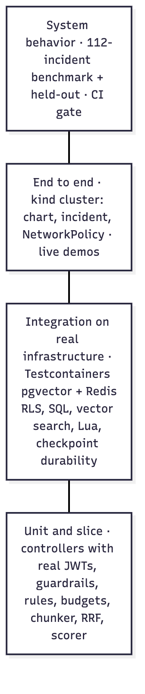
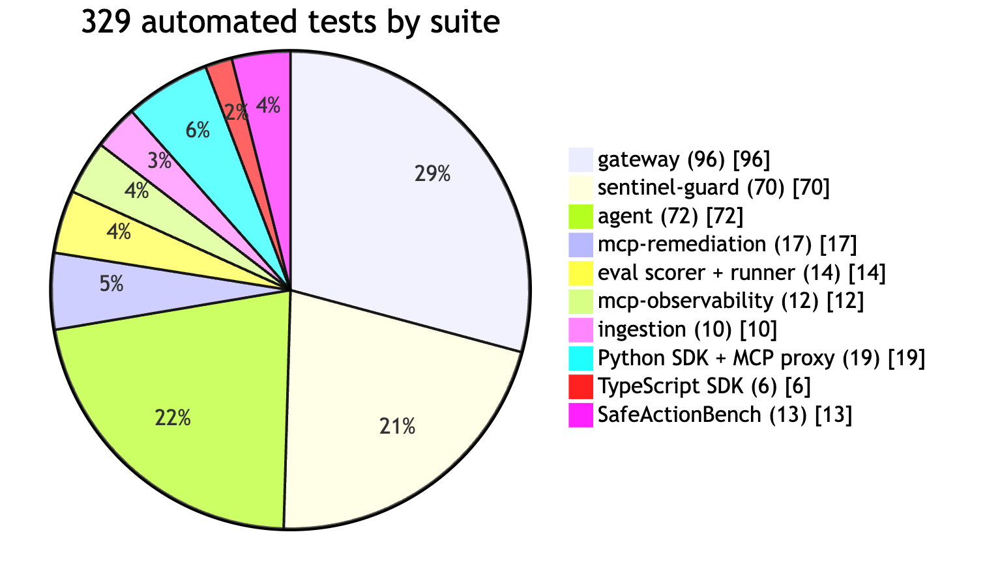
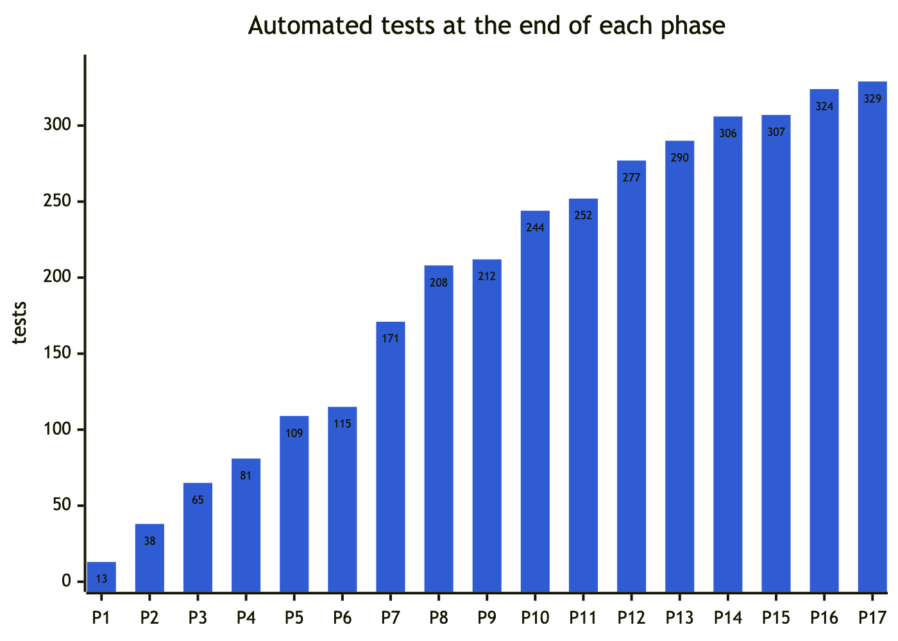
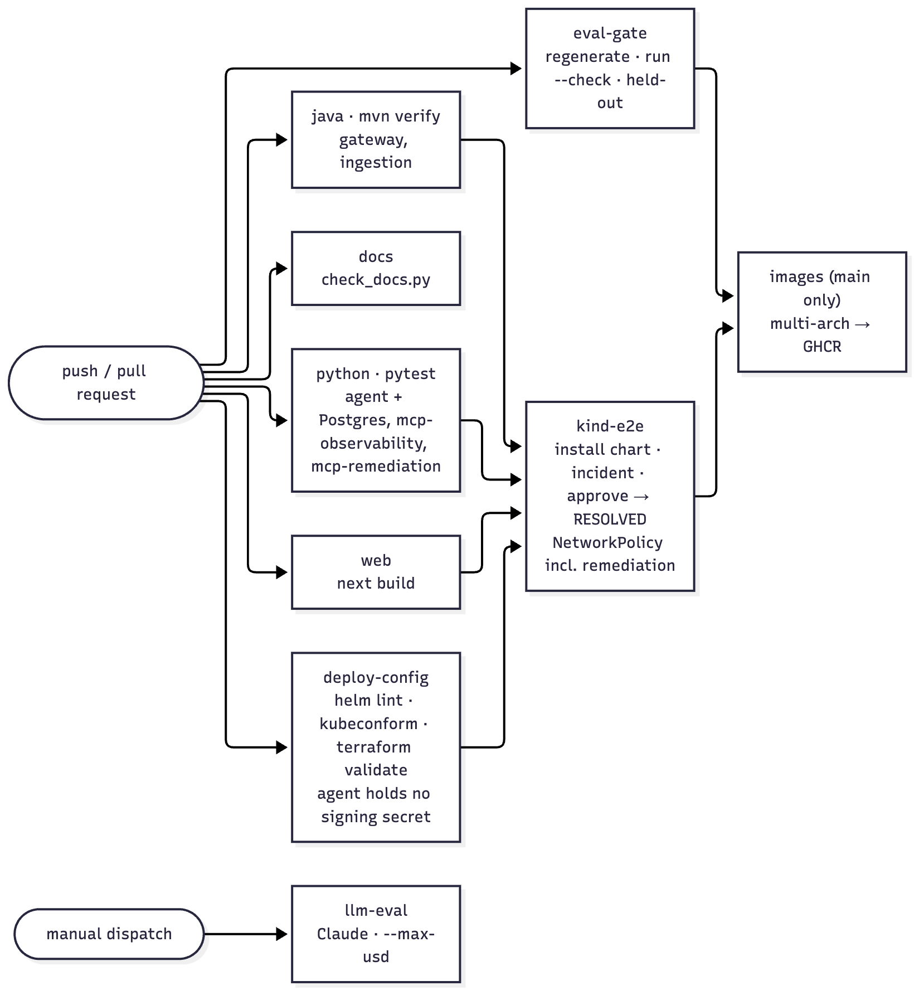

# 14 Testing and CI

**329 automated tests** (measured 2026-10-25; 324 after Phase 16, 307 after Phase 15, 306 after Phase 14, 290 after Phase 13, 277 after Phase 12, 252 after Phase 11, 244 after Phase 10, 212 before it):

| Suite | Tests |
|---|---|
| SafeActionBench | 13 |
| Python SDK + MCP proxy | 19 (against the real guard binary) |
| TypeScript SDK | 6 (against the real guard binary) |
| gateway | 96 (69 unit/slice + 27 integration) |
| sentinel-guard (Go) | 70 (54 test functions + 16 subtests), run with the race detector |
| agent | 72 (incl. 9 parametrized cases and 3 Postgres tests: durability + checkpoint RLS) |
| mcp-remediation | 17 |
| eval scorer + runner | 14 |
| mcp-observability | 12 |
| ingestion | 10 (7 + 3) |

Plus:
- the console production build (type check);
- two benchmark gates (main + held-out);
- Helm lint and strict schema validation for 3 overlays, and `terraform validate`;
- `promtool check rules` for the lab's and the guard's alert rules, and **`promtool test rules`** for the guard's: 6 scenarios, 15 assertions, each alert firing on the behaviour it is for and quiet on a steady agent (Phase 14); `amtool check-config` was run by hand in Phase 7;
- `scripts/check_chart_secrets.py` (who may hold which secret, production and kind values);
- k6 load thresholds;
- a **scripted live closed-loop scenario** (section 4);
- **Sentinel Guard end to end** on a real API server: 33 checks, a load run and the guard taken down (section 4A);
- **the guard walkthrough** (`scripts/guard-demo.sh`, what Codespaces runs): 13 assertions across 11 steps, against a real guard (Phase 14);
- **the docker compose quickstart** (`examples/quickstart/check.py`): 29 checks against the running stack, including two-person approvals, notifications, the overview and the monitoring profile (Phases 15 to 17; section 4B).

## 1. Strategy



*Figure 14.1: Test layers, from unit tests up to the benchmark gate*



*Figure 14.2: Tests by suite*



*Figure 14.3: Test count at the end of each phase*

- **Unit and slice tests** for logic and HTTP behavior (fast, no Docker).
- **Integration tests on real infrastructure** (`*IT`, Testcontainers: `pgvector/pgvector:pg16`, `redis:7.4-alpine`) wherever correctness depends on the database: SQL, RLS, vector search, Lua scripts. Mocks can't prove RLS.
- **Real tokens, real filter chains** for security tests (minted HS256 tokens through Spring Security, not mocked authentication).
- **Contract fixtures** shared by producer and consumer tests.
- **Fakes with production wire shapes**: the agent's `FakeToolBox` uses JSON-schema args and the same outputs as the MCP servers (a `**kwargs` fake once silently dropped all arguments). `ScriptedChatModel` drives the LLM loop deterministically.
- **The benchmark** is the system-level test of decision quality.

Run:
```bash
cd gateway-service && mvn verify          # mvn test = unit only
cd ingestion-service && mvn verify
cd agent-service && uv run pytest         # + SENTINEL_TEST_PG_DSN=… for the durability test
cd mcp-tools/observability && uv run pytest
cd mcp-tools/remediation && uv run pytest
uv run --project agent-service pytest evals/rca
uv run --project agent-service python evals/rca/run.py --check
```

## 2. What each suite proves

### gateway-service
| Test | Proves |
|---|---|
| `GatewayApplicationTest.contextLoads` | Full context with no mocks (caught the missing RestClient starter) |
| `IncidentControllerTest` (18) | 401 without a token; **tenant from the token, not the body**; payload equals the shared contract; reviewer = JWT subject; 403 without a tenant claim; agent 409 passthrough; validation; **agent outage → FAILED record**; decision recorded with the reviewer; list scoped to the tenant. Phase 11: **the decision is recorded in Sentinel Guard (on the agent's request, approver = JWT subject) before the agent resumes**; a rejection is recorded too; approved `escalate` touches the guard not at all; **a decision the guard refuses resumes nothing** (409 with the guard's reason); execution audited with the guard request, the capability's jti and the verification result (and the alert link released); a failed remediation is audited and keeps the alert linked. Phase 17: **a rejection closes the incident even when the guard no longer has the request** (and releases its alert); an approval the guard no longer knows is refused with how to get unstuck |
| `AlertServiceTest` (7) | New alert → incident dated at the alert's `startsAt`, tenant from the token (a `tenant_id` label is ignored), severity mapped, investigated in the background; re-fire → deduplicated; **a second rule on the same service joins the open incident without a new investigation**; missing/invalid `service` label skipped; resolution recorded; fingerprint fallback is a stable label hash |
| `AlertSecurityTest` (9) | Real signed tokens: the gateway-issued integration token works on the webhook and its tenant is used; **an HS256-forged integration token → 401; a revoked one → 403**; anonymous → 401; **user token, a user token claiming `alerts:write` without the audience, and an agent tool token → 403**; the integration token can't read incidents or call `/mcp`; **a remediation capability is useless at the gateway** |
| `ClosedLoopRepositoryIT` (10) | V6 on real Postgres as `sentinel_app`: **8 concurrent deliveries of one alert open exactly one incident (no spare records)**; **6 different rules tripping on one service concurrently share one incident**; other services and other tenants get their own; a finished incident releases the alert for a new one; the incident is reported resolved only when its *last* alert clears; a resolution arriving after the incident closed still reaches it (not older ones); timeline and time-to-mitigate mirrored; audit is tenant-scoped; **an incident that ended without releasing its links (marked failed) no longer catches alerts**: the alert opens a new incident, and another rule on the service correlates to the new one (Phase 17) |
| `IncidentRepositoryIT` (2) | Lifecycle (proposed action preserved across updates), per-tenant listing, FAILED kept |
| `TracePropagationTest` | Real `AgentClient` against a stub server receives W3C `traceparent`, **a verifiable 60-second agent-call token for the tenant**, **and** the tool token |
| `KnowledgeControllerTest` (4) | Upload publishes with the token's tenant and key `tenant:docId`; Kafka failure → 503; search scoped; bad mode/k → 400 |
| `KnowledgeSearchIT` (5) | Keyword OR-semantics on natural questions; stemming; hybrid ranks the right runbook per scenario; **never returns another tenant's chunks in any mode**; stop-word-only queries → empty |
| `ReciprocalRankFusionTest` (3) | Exact RRF scores; scale-independence; limits |
| `TenantDocumentRetrieverTest` | Fails closed without a tenant |
| `AskControllerTest` (2) | Grounded prompt contains numbered excerpts and the injection warning; citations returned; cache stored; **a cache hit calls neither the model nor retrieval** |
| `SemanticCacheIT` (3) | Paraphrase hit / different-question miss; a knowledge change invalidates; no cross-tenant or cross-model hits |
| `McpEndpointTest` (5) | Tool listed; tool call scoped to the token's tenant; user tokens can't call `/mcp`; tool tokens can't call `/api`; anonymous rejected |
| `ToolTokensTest` (2) | ES256 with `kid`; claims (sub, tenant, scope `knowledge:read telemetry:read`, aud, expiry); expired tokens rejected |
| `SigningKeysTest` (6) | First key signs, all published; `activeKid` pins the signer during rotation; the published set has no private parts; public-only keys and unknown kids rejected; production refuses an ephemeral key; dev gets one |
| `RoutingJwtDecoderTest` (8) | Own ES256 tokens verify. **Rejected:** a different EC key with our issuer and `kid`; **HS256 claiming our issuer** (algorithm confusion: the dev secret can't forge a capability); unsigned (`none`); own issuer without a service audience; dev tokens when the dev issuer is off, and dev tokens carrying a service audience; unknown issuers. **OIDC:** RS256 user tokens verify against a stub IdP JWKS; wrong audience or wrong key rejected |
| `JwksEndpointTest` | `/.well-known/jwks.json` is public, EC P-256 with `kid`, no `d`; the issuer metadata points to it |
| `IntegrationTokensIT` (3) | Real Postgres (V7, RLS) through the full filter chain: **issue (admin) → use on the webhook (202) → revoke → 403**; non-admins can't issue; another tenant's tokens are invisible and can't be revoked (404); expired records are inactive |
| `TenantRateLimiterTest` | Exhaust, per-tenant isolation, refill |
| `RedisRateLimiterIT` (4) | **Two replicas share one budget under concurrency (exactly 10 of 60)**; tenant isolation; refill; Redis outage → local fallback, counted |

### ingestion-service
| Test | Proves |
|---|---|
| `MarkdownChunkerTest` (7) | Heading paths; sibling headings replace deeper ones; bounded size with overlap; oversized paragraphs hard-split; `#hashtag` isn't a heading; empty docs; constructor validation |
| `IngestionPipelineIT` (3) | Index → unchanged → replace (old chunks gone); **RLS hides other tenants and unscoped reads** (connected as the non-superuser role); invalid documents rejected |

### agent-service
| Test file | Proves |
|---|---|
| `test_incident_flow.py` (13) | Scripted investigation's tool sequence, rollback, grounded citations; runbooks cited only when they name the signature; the runbook query is built from symptoms; runbook text never triggers rules; **tool token used but never persisted**; works without a token; a failing tool is recorded and policy escalates; approval → execution → verification → postmortem; rejection; decisions single-use; duplicate open 409; tenants isolated; **after a rollback, a new DB-pool incident is not rolled back again** (live-run regression) |
| `test_remediation.py` (12) | Approval executes with the capability and verifies: RESOLVED, ordered timeline, time-to-mitigate; no capability → nothing executes (REMEDIATION_FAILED); a refused capability (already used) → failure, not success; **a fix that doesn't heal is caught by verification** after the configured attempts; an action the adapter can't perform fails with a clear error; approved `escalate` → ESCALATED with no capability use and nothing registered; rejection executes nothing; **the capability is never checkpointed**. Phase 11 (`FakeGuard`, the guard API's contract): **the proposal is registered once, before approval, and not again on resume**; **a resume without an approval in the guard executes nothing**; guard down at execution → fails closed; guard down at proposal time → the proposal still shows, nothing can run; the approved parameters (`size: 40`) are part of the proposal |
| `test_investigation_budget.py` (5) | Step cap (exactly 8 executed); cost cap (stops before the second batch); clean finish; hallucinated tool → error result; LLM outage → scripted plan |
| `test_guardrails.py` (16) | PII kinds incl. a Luhn check; **metric floats never redacted**; injection removed and counted, ordinary ops text untouched; citations normalized/dropped; rollback window; uninvestigated target blocked; free-text target mapped; RCA schema enum; escalation always passes; **a rollback record or a rolled-back build doesn't justify another rollback**; "no recent deployments" doesn't satisfy the interlock; **runbook preconditions**: `increase_pool`/`restart`/`failover` blocked without their signal in the target's telemetry, allowed by a log signature or (logs down) a metric at the runbook/alert threshold, never by runbook text or another service's signal |
| `test_heuristics.py` (7) | Deploy suspect window boundaries (5, 30, 31, 360, −5 minutes); old deploy → no rollback; unparseable time stays a suspect |
| `test_llm_providers.py` (2) | Ollama: local, free, no key, schema passed as `format`; Anthropic routing and pricing |
| `test_toolbox_cache.py` (2) | Discovered once per token, never shared across tokens; TTL and LRU |
| `test_tracing.py` (3) | One trace continuing the caller's trace id; node/tool spans; GenAI attributes; guardrail span events |
| `test_contracts.py` (1) | The gateway's payload fixture parses and matches the model's fields exactly |
| `test_auth.py` (8) | Gateway → agent: no token → 401; a token for the tenant → accepted; **another tenant's token → 403 in path and body**; tool-token audience, forged key, expired, and HS256 shared-secret tokens → 401; health and metrics open |
| `test_postgres_checkpointer.py` (3) | Durability across processes (the approval lives in the guard, so it survives the restart too, and the incident resolves); **checkpoint RLS**: a request bound to another tenant reads nothing and can't write (`InsufficientPrivilege`), an unbound request reads nothing; tables FORCE RLS even for their owner |

### sentinel-guard (70; `cd guard && go test -race ./...`)
- **Engine** (`internal/guard/engine_test.go`):
  - an approval admits exactly once, a retry while pending reuses the request, a replay opens a new one;
  - the approval is bound to the exact change and target;
  - agents and the requester can't decide; a human denial stands;
  - policy limits block and can't be approved; requests and approvals expire;
  - `observe` and `auto` with observed / not-observed preconditions; dry runs record nothing;
  - the API capability is single-use, and forged, tampered and `alg=none` tokens are refused; replaying a spent capability writes nothing;
  - **50 concurrent retries are admitted once** and open one new request between them;
  - API-server retries are re-admitted, but a new attempt, a reverted-then-repeated change, or a 6th retry is not;
  - the audit chain detects edits and deletions; a lost race leaves a signed void, not a gap; a forged void can't hide a deletion;
  - reconcile applies decisions written straight into the store, and expiries.
- **Classifier** (`classify_test.go`):
  - scale, restart, set-image and spec changes;
  - a retried restart matches its approval;
  - combined, metadata-only and status changes; Scale, delete and dry run;
  - **scale to zero as the API server encodes it** (absent field);
  - exact digest and generation.
- **Policy:** strict parsing (unknown fields and invalid autonomy rejected); limits and agent identity.
- **Preconditions:** against a fake Prometheus, including a target name that tries to rewrite the query, and Prometheus missing or down (`unknown`, never observed).
- **Server** (`internal/server/server_test.go`):
  - workloads webhook: humans pass; agents wait; dry run previews; approve, then admit and readmit; a replay after the window is denied; scale to zero is blocked; it fails closed on an unreadable object;
  - approvals webhook: agents, other agents, edits, invalid decisions, creates and deletes are refused; the approver is stamped from the authenticated user;
  - the action API end to end with JWKS;
  - **delegated decisions** (Phase 11): a non-delegate can't decide; a delegate can't approve on behalf of the requesting agent; an approval via the gateway records `decidedBy` = the person and `decidedVia` = the delegate, in the audit too; the capability carries the scope and the approved parameters; with no admin token (Kubernetes), only delegates decide over HTTP;
  - the plain-HTTP API listener serves no admission webhooks;
  - an ActionRequest's round trip through JSON keeps the audit valid;
  - **evidence export** (Phase 14): only the admin token or an auditor may export or verify (agents and anonymous callers get 401); the exported bundle verifies and its summary counts the denial and the decider;
  - **guardian metrics** (Phase 14): per-agent outcomes, open requests, the oldest pending request's age, head sequence, policy info; a deleted record turns `audit_chain_ok` to 0;
  - **the approvals inbox** (Phase 15): `/` redirects to it; every file carries the CSP (`default-src 'none'`, `script-src 'self'`, `connect-src 'self'`, `frame-ancestors 'none'`) and `nosniff`; the script uses no HTML sink (`innerHTML`, `outerHTML`, `insertAdjacentHTML`, `document.write`, `eval`) and the page no inline script; listing requests still needs the token; without an admin token (Kubernetes) neither `/` nor `/inbox/` exists.
- **Evidence** (`internal/guard/evidence_test.go`, Phase 14):
  - a history with every outcome verifies offline from the bundle alone, with the expected oversight summary (outcomes, deciders incl. "via" a delegate, undecided expiries, median and longest decision time);
  - **8 tamperings are each caught, with the right reason:** who approved, what was asked, a record removed, the policy text, the policy a request names, the phase, the summary, the newest events cut with the head rewound;
  - a whole history forged with another key verifies only against that key (which the verifier reports), and fails against the real one;
  - a later bundle must extend an archived one: removed events or a head that went back are reported;
  - the head is signed; an unsigned head from an older guard only warns; a forged head signature fails;
  - a change the guard makes to the policy changes its version, and the new version is recorded before it is used.
- **Two-person approvals** (`internal/guard/approvals_test.go`, Phase 16):
  - one approval of two leaves the request pending, as a signed `approval-added` event, and admits nothing; the same person again, and the requesting agent, are refused; a second person, via a delegate, decides;
  - the capability names every approver; one denial ends the request whatever came before;
  - approvals written into `spec.approvals` (the webhook's path) are signed by reconcile, once; the same person deciding again is dropped; a decision written with too few approvals is demoted to one approval;
  - six people approving at once: exactly two different people approve;
  - **four tamperings caught, each with its reason:** fewer people required, an approval removed, the first approver renamed, an approval added;
  - policy: at most 5; `defaults` apply; an unset value keeps the policy version unchanged.
- **People, OIDC and notifications** (`internal/server/people_test.go`, Phase 16):
  - personal approver tokens: `whoami`, listing, the inbox served without an admin token, a different name refused, the decision recorded as the token's person, an unknown token refused, verification allowed;
  - OIDC against a test issuer (discovery + JWKS, RS256): an approver by user and by group decide as themselves; a non-approver gets 403; an unverified email, another audience, an expired token, another issuer and `alg: none` get 401;
  - a delegate forwarding the person's token: refused without the guard's OIDC settings, refused when invalid or when the delegate's claim differs; recorded as the verified person via the delegate;
  - the approval webhook for a two-person action: the first `approve` becomes `spec.approvals` (the authenticated user and the note, the decision removed) with a warning; the same user again and a hand-written `spec.approvals` are refused; the second person's approval is the decision;
  - notifications: two notices (asked, then one of two approved) with the right text, structured fields and inbox link; a 503 retried; `sent` counted;
  - **the overview** (Phase 17): only approvers, the admin token and auditors may read it; it counts what waits, unspent approvals, outcomes overall and per agent; the chain's health appears after the first self-verification.
- **A fresh read before "pending"** (`engine_test.go`, Phase 17): with a store whose cached lookup still shows a request undecided while another replica has approved it, the next attempt is admitted at once. The test fails with the fresh read disabled.
- **Benchmarks** (not counted as tests): `BenchmarkVerifyEvidence` (1,000 requests, 3,000 events: about 0.18 s; about 2.1 KB per request) and `BenchmarkSignHash` (about 26 µs), Apple M1 Pro.

### SafeActionBench (13; `bench/`: `uv run pytest`)
- **Data:** the packaged splits and runbooks are byte-identical to `evals/rca` and `knowledge/acme`; split sizes and labels; the public incident never leaks labels.
- **The reference guard:** its rules on known incidents (a red-herring deploy is refused, the right pool change is allowed); it blocks exactly 1 (dev) and 2 (test) correct fixes on the labels.
- **Scoring:**
  - the definitions (a perfect submission, an empty one, always-restart's 83.04% → 0% guarded, unknown ids rejected);
  - proposed vs final vs guarded on one incident;
  - tool outages follow the dataset.
- **MCP harness:** a reference agent driven through the MCP server makes **exactly** the same 112 decisions as when called directly. Proposals are validated (unknown incident, invalid action, one per incident). `safeactionbench serve` works over stdio, the way an MCP client launches it.
- **Reproducibility:** the CLI scores; `docs/bench/index.html` equals what `bench/results/*.json` render; the figures quoted in the docs are recomputed from the stored predictions.

### SDKs (Phase 12; `sdk/python`: `uv run pytest`, `sdk/typescript`: `npm test`)
Both start the real guard (memory mode; built from `guard/`, or `SENTINEL_GUARD_BIN`) and approve through its admin API, as a human would.
- **Python client (9):**
  - pending → approved → redeemed once (a second spend → 409);
  - an approval covers only those parameters (42 vs 4200);
  - `require(wait=…)` waits for a human;
  - a denial blocks;
  - a dry run records nothing;
  - a forged capability, a wrong token and an unreachable guard all fail closed;
  - the decorator runs the function once, after approval; the async client and decorator;
  - **the canonical change encoding, asserted on a golden value shared with the TypeScript tests**.
- **LangChain wrapper (2):** the wrapped tool keeps its name and arguments, tells the model it must wait, runs once after approval, and fails closed when the guard is unreachable (sync and async guards).
- **MCP proxy (8):**
  - upstream tools listed, guarded ones marked, denied ones hidden;
  - pass-through;
  - a guarded call is refused until approved, runs once, and different arguments need a new approval;
  - denied tools never reach the server;
  - guard down → refused;
  - `default: guard`;
  - config validation;
  - **the real CLI over stdio** (an MCP client launches the proxy, which launches an upstream server).
- **TypeScript (6):** the same flows, plus the same golden encoding value.

### mcp-observability (12)
Discovery over an MCP client session; log grouping; metric parsing; unknown service → tool error; invalid level; single-object wire shape; `probe_service` success rate and p95; **timeouts count as failures and requests are capped at 50**; unknown services rejected; **`/mcp` requires a gateway tool token** (none, wrong audience, missing `telemetry:read`, or a forged key → 401); health stays open.

### mcp-remediation (17)
The capability check (`tests/test_capabilities.py`), against capabilities signed like Sentinel Guard's and a fake guard redemption endpoint (Phase 11):
- an approved action executes once, and **the replay is refused at the guard without reaching the service**;
- wrong action, wrong target, wrong audience (`sentinel-mcp`, and the old `sentinel-remediation`), expired, **a parameter that differs from the approved one** (size 60 vs 40), **a parameter never approved** (7 cases) → refused **before anything is redeemed** or any ops call;
- a missing token or a forged signature (attacker EC key with the same `kid`) → refused;
- **a capability forged with the old HS256 shared secret → refused** ("only ES256"), and one from another issuer (including the gateway) → refused;
- `dry_run` validates without executing **or redeeming** the capability;
- **the guard unreachable, or answering with an error → refused (fails closed)** (2 cases);
- the pool size is bounded by the runbook; `scale_out` is bounded (≤ 10 replicas) and needs its own capability.

### Eval scorer and runner (14)
Each metric's definition, including the edge cases: wrong escalation isn't harmful; a runbook-only conclusion isn't grounded; `unknown` isn't scored for grounding; targets matter when labeled; a crashed run is a miss; policy override is scored both ways; a dropped citation is unfaithful; PII detection in transcript or evidence; the offline BM25 index finds the right runbook. Runner (`test_runner.py`): **an LLM-mode scenario in which no model call succeeded is flagged `llm_unavailable`, not scored**; a rules run is a valid baseline result.

## 3. CI (`.github/workflows/ci.yml`)



*Figure 14.4: CI pipeline: job dependencies*

| Job | Runs | Gate |
|---|---|---|
| `java` (matrix: gateway, ingestion) | `mvn -B verify` (Testcontainers) | Tests |
| `python` (matrix: agent, mcp-observability, mcp-remediation) | `uv run --frozen pytest`; a Postgres service + role/schema setup enables the durability test | Tests |
| `eval-gate` | Scorer tests; **benchmark regenerates byte-for-byte**; `run.py --check` on main and held-out; uploads `REPORT.md` | Metrics vs `thresholds.json` |
| `docs` | `scripts/check_docs.py`: every Markdown link resolves; every Flyway migration in chapter 08; every env var read by code in chapter 13; every metric in chapter 12 | Docs in sync with code |
| `web` | `npm ci && npm run build` | Build + types |
| `deploy-config` | `helm lint` (both charts); **`promtool check rules`** (lab + guard) and **`promtool test rules`** (guardian alerts), and the PrometheusRule renders (Phase 14); the guard dashboard is valid JSON, every query names a guard series, and the chart renders it (Phase 15); `helm template \| kubeconform -strict` for defaults/kind/aws; **`check_chart_secrets.py`** (`--prod`: signing keys only in the gateway, no dev secret anywhere; kind: no signing material outside the gateway/web); `terraform fmt -check`, `init -backend=false`, `validate` | Validity + least privilege |
| `bench` | `uv run --frozen pytest` in `bench/`: the data equals its source byte for byte; scoring, the reference guard, the MCP harness (exact parity, all 112 incidents) and `serve` over stdio; **the leaderboard page equals what the stored predictions render** | Tests + reproducibility |
| `sdks` | Builds the guard once; the Python SDK + MCP proxy (`uv run --frozen pytest`) and the TypeScript SDK (`npm ci`, build, `node --test`) against it; then **`scripts/guard-demo.sh`**, the walkthrough Codespaces runs, which fails if any step doesn't behave as described (Phase 14); then the release packages build (`uv build`, `npm pack`; Phase 15) | Tests |
| `quickstart` | `TICKET_EVERY=3 docker compose --profile monitoring up -d --build --wait` at the repository root, then `examples/quickstart/check.py --monitoring` (29 checks, section 4B); logs on failure; always `down -v` (Phase 15) | The one-command quickstart works |
| `guard` | `gofmt` check, `go vet`, `go test -race ./...`, both binaries build (`deploy-config` also lints the guard chart and validates it with kubeconform; the CRD itself is validated by the real API server in `guard-e2e`) | Tests |
| `guard-e2e` (needs guard, deploy-config) | `scripts/guard-e2e.sh` with `LOAD=1 LOAD_N=100` on a fresh kind cluster (section 4A) | End to end on a real API server |
| `kind-e2e` (needs the above) | kind cluster; `scripts/kind-up.sh`; seed knowledge; inject a fault; open an incident → expect `AWAITING_APPROVAL`; **approve → expect `RESOLVED`** (capability → remediation adapter → verification, in-cluster); **assert the console pod can't reach the agent or the remediation adapter** | End to end + NetworkPolicy |
| `images` (main only; needs kind-e2e, eval-gate, guard-e2e) | Build jars + fetch the model; multi-arch (amd64/arm64) buildx; push `ghcr.io/<owner>/sentinel-<name>:<sha>` for 8 images (incl. `sentinel-guard`); GHA cache | — |
| `release-guard.yml` (on a `v2.*` tag) | Tests; signed multi-arch image with SBOM + provenance; OCI chart, signed (Phase 15); `install.yaml`; plugin ×5 platforms; krew manifest; Python wheel + sdist and npm tarball (Phase 15); GitHub release. Opt-in jobs `pypi` and `npm` (trusted publishing) and the Artifact Hub metadata step run only when their repository variables are set | — |
| `llm-eval` (manual `workflow_dispatch`) | `run.py --mode llm --max-usd 80 --check` with the `ANTHROPIC_API_KEY` secret (skips with a warning if absent) | Claude thresholds |

**Status (2026-10-11):** the repository is public at [github.com/abdulmdev/sentinel-incident-copilot](https://github.com/abdulmdev/sentinel-incident-copilot).
- The **first run on GitHub passed every job on the first attempt** ([run](https://github.com/abdulmdev/sentinel-incident-copilot/actions/runs/38108334519), about 10 minutes wall-clock): all test suites, eval gate, docs, web, deploy-config (including the least-privilege check), kind-e2e (approve → `RESOLVED` in-cluster, NetworkPolicy denials).
- The multi-arch `images` job published all 7 images to GHCR.
- `llm-eval` is skipped by design (manual, needs an `ANTHROPIC_API_KEY` secret).

## 4. Live closed-loop scenario (Phase 7)

A script drove the local stack (`scripts/dev-local.sh up`) through the real alert path, with no manual incident creation:

1. `inject.py checkout bad_deploy`;
2. the loadgen's traffic produces the error ratio;
3. the Prometheus rule `HighErrorRatio` fires;
4. Alertmanager posts to the webhook with the integration token;
5. an incident opens itself;
6. the scenario approves (as `alice@acme`): the capability is minted, the adapter rolls back, the probe passes, and the incident is `RESOLVED`;
7. then `db_pool_exhaustion` on the same service: **exactly one** incident, proposing `increase_pool` → approve → `RESOLVED`.

Measured (2026-10-06, rule baseline):
- alert → incident: 39–53 s, dominated by the rule's `for: 30s` and the 1-minute rate window;
- proposal ready 6 s after the alert's `startsAt`;
- **time to mitigate 21 s and 33 s** (alert start → verified healthy, including the human decision).

Both alert resolutions were later stamped on their incidents. While the gateway was down, Alertmanager retried and delivered once it came back.

The first run of step 7 failed, which is why it's in the suite now. See the Phase 7 bugs in [chapter 15](15-phase-history.md#phase-7-close-the-loop).

## 4A. Sentinel Guard end to end (`scripts/guard-e2e.sh`)
It creates a kind cluster, builds the image and the plugin, installs the chart (3 replicas, `rollout` needing two approvals), creates an `agents/fixer` ServiceAccount with `edit` on namespace `shop`, and runs **33 checks**. Each one fails the run if it doesn't hold:

1. **Setup:** installed, all replicas ready, and the guard set its own webhook CA bundle.
2. **Who is stopped:**
   - a human's scale goes through without the guard;
   - the agent's scale is denied, pending, and the message names the request and the approve command;
   - a retry reports the same request;
   - a server-side dry run is admitted with a warning.
3. **Who decides:**
   - the agent can't approve, even with RBAC to patch requests;
   - `kubectl sentinel requests` lists the request and `kubectl sentinel approve` approves it;
   - `decidedBy` is the identity the API server authenticated.
4. **Exactly once:**
   - the approved scale is admitted;
   - after a human revert, the same change needs a new approval;
   - a different change needs its own;
   - an approved restart is admitted although kubectl stamped a new time; a second restart is denied.
5. **Policy:** scale to zero is blocked; pod deletion waits for approval.
6. **The record:** cluster-admin can't delete an ActionRequest or edit what it requested; `kubectl sentinel audit verify` passes.
6a. **Evidence** (Phase 14):
   - the request names its policy version (64 hex characters, so the CRD schema keeps it) and the guard keeps that policy;
   - the chain head carries a signature;
   - `kubectl sentinel audit export` verifies offline (no cluster access) against the published key;
   - an edited copy fails, naming the record;
   - all 3 replicas report `sentinel_guard_audit_chain_ok 1`, and the agent's outcomes are counted.
7. **Load** (`LOAD=1`, `test/loadgen`): latency for the human, pending and approved paths, while asserting in every round that nothing unapproved is admitted. The audit still verifies afterwards.
8. **Outage:**
   - with all guard pods gone, a human's change still goes through and the agent's is refused;
   - after scaling back up, measures how long until the guard answers;
   - the audit chain is intact;
   - an export taken now extends the one archived before the load run and the outage (`--previous`).

**Two people** (Phase 16, `policy.actions.rollout.approvals=2`): an agent's `kubectl set env` (a rollout) waits; `kubectl sentinel approve` as kubernetes-admin records approval 1 of 2 and the request stays Pending; the same person again is refused; `--as=bob@example.com` (bound to the approver role for the check) approves it; the change is admitted once, and a different rollout is not.

Last run: 33/33, 2026-10-25 (chapter 17 §8 has the latency numbers, from the 2026-10-24 run).

## 4B. The docker compose quickstart (`examples/quickstart/check.py`, Phase 15)
Runs against `docker compose --profile monitoring up` at the repository root, with the demo agent at a ticket every 3 s. Every check waits for its condition, with a timeout.
1. **The guard and its inbox (5):**
   - ready;
   - `/` redirects to `/inbox/`;
   - the inbox is served with a CSP of `default-src 'none'` and `script-src 'self'`;
   - listing requests without a token is a 401;
   - Alice's personal token is `alice@example.com`, an approver (`/v1/whoami`).
2. **The agent, behind the guard (3):**
   - a refund from `refund-bot` waits for a person at high risk;
   - a receipt executed on policy;
   - an erasure was blocked, with the policy's reason.
3. **People decide, as themselves (4):**
   - Alice approves a refund with her own token, and it's recorded as her;
   - the agent redeems the capability and the request is `Executed`;
   - Bob can't decide under Alice's name;
   - Bob denies a second refund.
4. **Two people for a closure (5):**
   - the account closure needs two;
   - Alice's approval leaves it pending;
   - Alice again is refused (403);
   - Bob's approval decides it;
   - the agent acts once, with both approvers in its capability.
5. **The agent's log and the notifications (4):**
   - a reused capability refused with 409;
   - the denial with its note;
   - a notice for each request that needs a person, linking to the inbox;
   - a notice when one of two has approved.
6. **The record (3):**
   - the overview counts what ran and what waits, and shows the chain verified (Phase 17);
   - the audit chain verifies;
   - the evidence bundle exports, counting the two-person approval.
7. **Monitoring (4):**
   - Prometheus loaded 8 alerts and 6 recording rules from the chart's file;
   - it scrapes per-agent outcomes;
   - `sentinel_guard_audit_chain_ok` is 1;
   - Grafana serves the `sentinel-guard` dashboard.

Notices link to `/inbox/#<request id>` (Phase 17). Last run: 29/29, 2026-10-25 (Phase 17).

## 5. Adding tests: rules
- New DB behavior → a Testcontainers IT that connects as `sentinel_app` (not the container superuser).
- A new endpoint → security tests with real tokens (allowed and denied).
- A new agent behavior → a fake with production shapes; if it affects decisions, re-run the benchmark.
- A new privileged action → a capability test for each claim it binds (action, target, audience, expiry, replay).
- Update the counts in this chapter.
