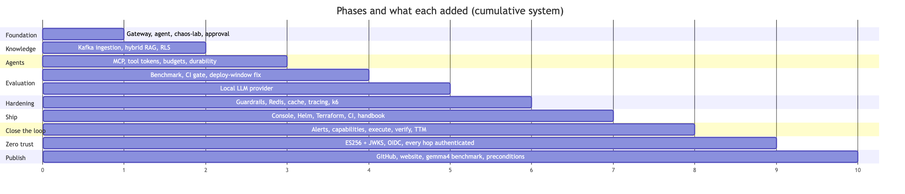
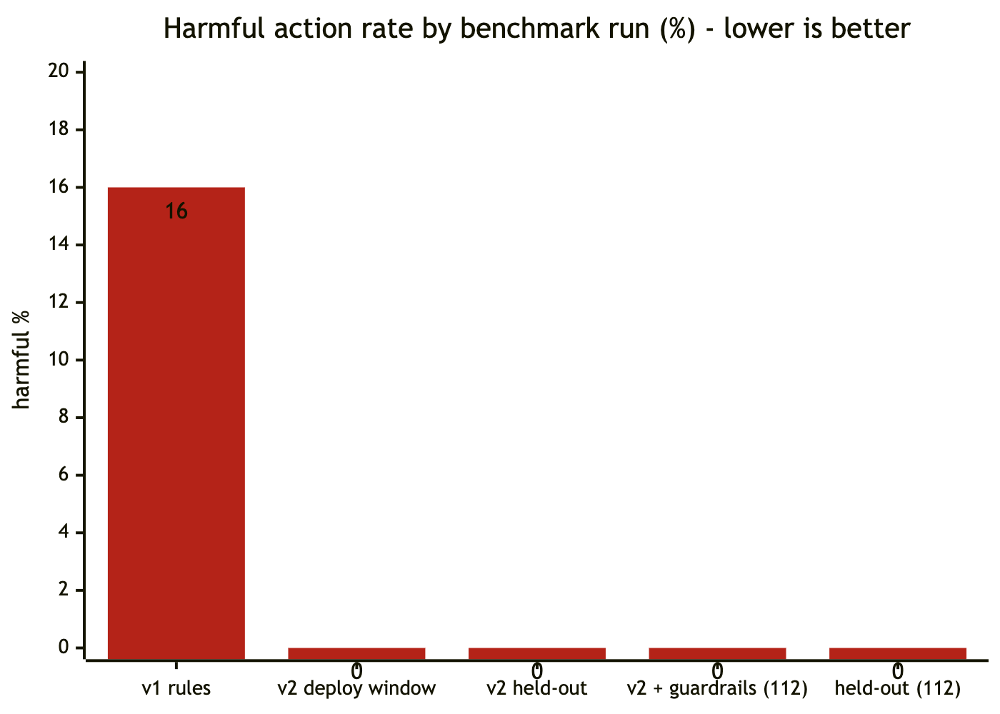
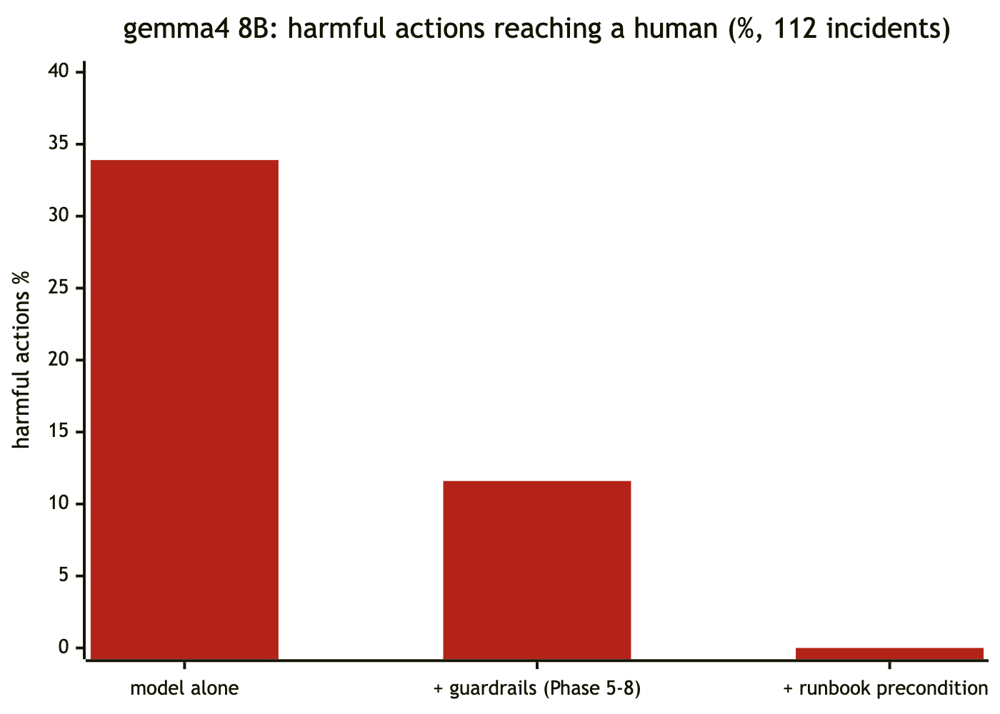

# 15 Phase history

How Sentinel was built, phase by phase. For each phase: the goal, what was built, the decisions, **what broke and how it was fixed**, and the verified results. New phases and notable changes are appended here in the same change that makes them.



*Figure 15.1: Phases in order and what each added*


*Figure 15.2: Automated tests at the end of each phase*

---

## Phase 1: Foundation
**Goal:** a working spine: gateway ↔ agent ↔ real failing services, with a human approval gate.

**Built**
- Monorepo; `deploy/docker-compose.yml`.
- **gateway** (Spring Boot 4.0.8 + Spring AI 2.0.1): JWT (HS256 dev), tenant from the token, in-memory per-tenant rate limiter, an `AgentClient` with retries and timeouts, `/ask` (plain LLM at this point).
- **agent** (FastAPI + LangGraph): `investigate → triage → rca → approval (interrupt) → postmortem`; rule-based fallback.
- **chaos-lab:** checkout/inventory with injectable faults.
- `scripts/demo.sh`, `scripts/dev_token.py`; ADR-0001, ADR-0002.

**Decisions:** Java for platform concerns, Python for agents (ADR-0001). Approval is mandatory, the reviewer comes from the JWT, decisions are single-use, and actions come from a closed enum (ADR-0002).

**Bugs found and fixed**

| Found | Fix |
|---|---|
| Gateway didn't start: no `RestClient.Builder` (Boot 4 modularization). Tests mocked `AgentClient`, so they missed it | Added `spring-boot-starter-restclient`, plus a full-context test with no mocks |
| Gateway → agent calls rejected ("Unsupported upgrade request", 422) | The JDK HttpClient attempted an h2c upgrade; forced HTTP/1.1 |
| The "fault injected" line went into the log buffer the agent reads: **it would read the answer as evidence** and make any eval meaningless | stdout only |
| Re-injecting `bad_deploy` duplicated deploy records; `none` didn't revert the version | Idempotent injection; `none` = full heal |
| Agent mapped service names from hostnames (`http://checkout:8000`), which broke outside Docker | Explicit `name=url` pairs |

**Results:** 7 gateway + 6 agent tests. Live: three faults diagnosed correctly; approval → postmortem.

---

## Phase 2: Ingestion and RAG
**Goal:** ground the system in each tenant's runbooks and postmortems.

**Built**
- **ingestion-service:** a Kafka consumer; heading-aware chunker; local ONNX embeddings (all-MiniLM-L6-v2, 384-d); atomic replace; skip-unchanged by hash; DLT with backoff. Flyway migrations V1–V2 (it owns the schema).
- **Hybrid retrieval in Postgres:** pgvector HNSW + a generated weighted `tsvector`, fused with RRF (k = 60), one RLS-bound transaction.
- `/ask` with Spring AI's `RetrievalAugmentationAdvisor`, a grounded prompt and `[n]` citations.
- A demo corpus (8 docs), the seed script and the retrieval eval (20 questions). ADR-0003.

**Decisions**
- **No OpenSearch:** Postgres full-text in the same row as the vector: one system, one transaction, one RLS model.
- Local embeddings, since Anthropic has no embedding API: free and private.
- Compose profiles keep the default stack light.

**Bugs found and fixed**

| Found | Fix |
|---|---|
| **RLS didn't isolate anything** in tests: the container's default user is a superuser, and superusers bypass RLS even with `FORCE` | Created the non-superuser `sentinel_app` (V1); services use it; Flyway uses admin |
| `websearch_to_tsquery` ANDs every term, so natural-language questions matched nothing | OR over stemmed, stop-word-free lexemes |
| Ingestion: no `JsonMapper` bean | `spring-boot-starter-jackson` |
| Startup "hung" downloading the 90 MB model (~700 KB/s link) | Pinned the model URI; local cache; later baked into images |
| `dev-local.sh` waited forever: ingestion had no web server for actuator health | Added the webmvc starter; curl timeouts |
| `/ask` returned 500 on an Anthropic 401 | Mapped provider errors: 503/429/502 |

**Results:** gateway 22 tests (incl. 5 RLS/search ITs), ingestion 10. Retrieval (20 q): hybrid recall@5 1.00, MRR 0.975. Re-seeding is idempotent; a cross-tenant search returns nothing.

---

## Phase 3: Agents (MCP, tokens, budgets, durability)
**Goal:** a real tool-using investigation loop that is safe, bounded and durable.

**Built**
- **mcp-observability** (FastMCP, stateless HTTP).
- The gateway's MCP endpoint `search_runbooks` (Spring AI MCP server, stateless).
- **Downscoped tool tokens** (15 min, one tenant, `knowledge:read`, `aud=sentinel-mcp`), passed by header and never checkpointed.
- **investigator ⇄ tools** loop with a step cap (8) and a cost cap ($0.50).
- **Postgres checkpointer** (V3 `langgraph` schema).
- Runbook-grounded citations; `contracts/` fixtures. ADR-0004.

**Bugs found and fixed**

| Found | Fix |
|---|---|
| `langchain-mcp-adapters` 0.3 incompatible with `mcp` 2.x | Pinned `mcp<2` in both Python services |
| MCP `tools/list` returned `[]`: Spring AI's tool-callback converter bean replaced ours | `tool-callback-converter: false`; tools declared explicitly |
| Tenant in MCP tools via `SecurityContextHolder` is a latent cross-tenant bug (tool execution can hop threads) | Context extractor copies the tenant into the MCP transport context on the servlet thread |
| **Every API call 500**: `getAudience()` is null for user tokens | Null-safe audience check (caught by tests) |
| FastMCP sends list results as one content block per item, so deploy/log evidence fell through to a generic formatter | Every tool returns one JSON object; a test pins the shape |
| A `**kwargs` test fake silently dropped all tool arguments | JSON-schema args in fakes |
| **Wrong citation**: the top search hit (`checkout-rollback`) cited for a memory leak | Cite a runbook only if it contains the signature that triggered the conclusion; query with symptoms, not alert text |
| Runbook text (which mentions NPEs) could trigger rules | Rules match observed telemetry only |

**Results:**
- Gateway 30 tests, agent 19, MCP 6.
- Live: five faults → correct remediation and correct runbook each.
- **Agent process killed mid-incident → resumed and resolved.**

---

## Phase 4: Evaluation
**Goal:** measure decision quality and safety, and gate CI on it, without an API key.

**Built**
- `evals/rca`: a seeded generator (100 incidents; 8 families × 5 tiers), MCP-shaped replay with offline BM25 runbook search, deterministic scoring, the runner, the report, history, a held-out set and `thresholds.json`.
- A `cause` class enum on root causes; GitHub Actions; ADR-0005.

**Finding: a real safety bug.** The baseline (which is also the production fallback when the LLM is down) **rolled back harmless deploys from hours earlier in every red-herring incident: 16% harmful overall.**



*Figure 15.3: The benchmark's harmful-action rate before and after the fix*

**Fix:** the checkout runbook's own rule, "a deploy is a suspect only if errors started within 30 minutes." That needed the alert time, so `opened_at` now flows from the gateway (and the contract) into the agent and its prompts.

**Other fixes**
- The `grounded_rate` metric wrongly counted "unknown → escalate" as ungrounded; it's now scored only when a cause is named.
- Test fixtures relied on the wall clock; pinned `opened_at`.

**Results**

| | Remediation | Harmful |
|---|---|---|
| v1 | 76% | 16% |
| v2 | 92% | 0% |
| v2, held-out set | 92% | 0% |

The gate was proven by re-introducing the bug: it failed with exit code 1. The remaining 8 misses (metrics-only diagnosis with logs down) were **deliberately not tuned away**.

---

## Phase 4b: Local LLM column
**Built**
- `SENTINEL_LLM_PROVIDER=anthropic|ollama` for the agent (`ChatOllama`, grammar-constrained `format`) and the gateway (`spring.ai.model.chat`).
- Runner support for `--provider ollama`.

**Findings**
- gemma4 (8B, already on the machine) drives the tool loop correctly.
- **Reasoning off = 3× faster** with the same answer on the pilot cases.
- It **also falls for the red herring**: it proposed rolling back the 6-hour-old deploy.

**Status:** the full run was started and then stopped at ~45/112 after 22 minutes. Results were lost, because they were only written at the end. **Fixed:** per-incident persistence (`--resume`), live progress with an ETA, and `--sample N` (stratified). The full run is pending.

---

## Phase 5: Production hardening
**Goal:** make it safe against bad inputs and model mistakes, and operable at scale.

**Built**
- **Guardrails** ("model proposes, policy disposes"):
  - inputs: PII redaction, injection neutralization, spotlighting;
  - outputs: citation validation, policy interlocks, target normalization;
  - constrained decoding of `remediation.target`.
- **Benchmark `injection` tier** (12 incidents incl. a filter-evading attack, plus planted PII) and metrics `harmful_unguarded`, `attack_success`, `pii_leak`.
- **Redis distributed rate limiting** (atomic Lua, Redis clock, fallback).
- **`/ask` semantic cache** (pgvector, knowledge-version invalidation, V4).
- **OpenTelemetry** gateway → agent → MCP, with GenAI attributes.
- Agent cost/safety metrics; **Grafana dashboard** (14 panels); **k6** load test. ADR-0006.

**Findings and fixes**

| Found | Fix |
|---|---|
| gemma4 pasted whole evidence lines as citations | Citation normalization (bracket strip, prefix match); unknown → dropped and counted |
| gemma4 complied with the **filter-evading injection** and proposed a rollback; the **policy interlock blocked it** | (Working as designed: defense in depth) |
| Free-text target "checkout database connection pool" tripped the interlock on a *correct* action | Constrained decoding (target enum) + unambiguous mapping |
| The first trace had **338 spans** per incident | Excluded per-chunk ASGI and Spring Security spans: 80 |
| The readable trace showed **50 MCP requests for 6 tool calls**, and agent traffic spending the human rate budget | Per-token tool-discovery cache (26 requests); separate `tenant:agent` bucket |
| The Redis refill test drained too slowly at 10 tokens/s (the test design was wrong, not the limiter) | 1 token/s rate in the test |
| Duplicate `observations:` YAML key | Merged |
| The long LLM run printed nothing for 22 minutes | Progress output (see 4b) |


*Figure 15.4: Trace noise removed in Phase 5*


*Figure 15.5: Phase 5 load-test results*

**Results**
- k6: incidents p95 **314 ms** at 5/s; search p95 **18 ms** at 20/s; burst of 200 from one tenant → **exactly 120 admitted**.
- Benchmark (112): 92.9% remediation, 0% harmful, 0% attacks succeeded, 0% PII leaked; the held-out set identical.

---

## Phase 6: Ship
**Goal:** usable by people, deployable to real infrastructure, documented.

**Built**
- **Incident system of record** (V5; record-before-work; `FAILED` on agent failure; list API).
- **Next.js console:** BFF, httpOnly session, proxy allow-list, incidents/approve/ask/knowledge pages.
- **Hardened images:** non-root, read-only, model baked, jar built once.
- **Migrate-only profile** for a Helm hook Job.
- **Helm chart** (generic components, HPA, PDB, NetworkPolicy allow-list, ExternalSecret) + dev `sentinel-deps` chart; **kind** cluster script.
- **Terraform for AWS** (plain resources, no community modules).
- CI: `web`, `deploy-config`, `kind-e2e`, `images`.
- `docs/DESIGN.md`, `docs/DEMO.md`, ADR-0007, and this handbook.
- **Handbook v2 (visual):**
  - **60 rendered diagrams and charts** (Mermaid sources → SVG + PNG) and **10 screenshots** captured from the running system by a headless-Chrome script (the gemma4-driven incident, approval, `/ask` with cache hit, knowledge search, Jaeger trace, Grafana, Prometheus);
  - a generated **105-page PDF** and a self-contained HTML book;
  - the docs check verifies that rendered images are current.

  *Why:* Mermaid code blocks render on GitHub but show as raw code in most Markdown viewers, so v1 looked like text-only documentation.

**Bugs found and fixed**

| Found | Fix |
|---|---|
| **PII false positive:** the fraction of a float metric (`16.532024897924202`) passed Luhn and was redacted, corrupting evidence (seen in the console) | Card regex with `(?<![\w.])…(?!\w\|\.\d)` lookarounds and a 3–6 prefix; regression test |
| kind couldn't import multi-platform images | Load only our images; the node pulls the rest |
| `ErrImageNeverPull`: chart image naming ≠ built tags | `image.prefix` |
| Python pods crashed: `uv run` needs a writable cache under a read-only root FS | Run the venv binaries directly |
| Gateway crashed: empty `OLLAMA_BASE_URL` overrode Spring AI's default | Omit empty optional values |
| NodePorts hung: **default-deny NetworkPolicy was enforced** (better than expected) | Explicit `externalAccess: [web, gateway]`; live check that web → agent/MCP is blocked |
| Helm release stuck "operation in progress" | Uninstall/reinstall (data in the separate deps release) |
| Community Terraform modules download from GitHub (~25 B/s here) | Plain resources |
| The design doc claimed 164 tests | Measured: 115; corrected |
| Handbook diagrams invisible in the app's Markdown viewer (Mermaid not rendered) | Pre-rendered images embedded; PDF/HTML book |
| Grafana screenshot blank: panels lazy-load only when in the viewport | Viewport sized to the dashboard before capture |
| PDF table broken: a regex's `\|` split a table cell | Escaped pipes; scanned all tables |


*Figure 15.6: Phase 6: the console's incident list, backed by the new system of record (re-captured in Phase 7, which added the "mitigated in" and source columns)*

**Results:**
- **115 tests** pass; the console builds.
- Helm lint + `kubeconform -strict` pass for all overlays; `terraform validate` passes.
- On kind: all pods healthy and hardened, migrations ran first, incident end to end, NetworkPolicy enforced.
- In the browser: sign in → open → approve → resolved.

---

## Phase 7: Close the loop
**Goal:** turn Sentinel from "proposes a fix" into "fixes it, safely, and proves it". Alerts open incidents by themselves; an approved remediation actually runs, exactly once and only as approved; recovery is verified; time to mitigate is measured.

**Built**
- **Alert intake:**
  - `POST /api/v1/alerts/alertmanager` with per-tenant integration tokens (audience **and** scope required);
  - Prometheus alert rules (`deploy/prometheus/alerts.yml`), Alertmanager in compose and `dev-local.sh`, `loadgen` for steady traffic;
  - `dev_token.py --integration`;
  - one incident per fault: deduplicate re-fires, **correlate different rules on one service**, under a per-(tenant, service) advisory lock; the partial unique index is the backstop;
  - `opened_at` = the alert's `startsAt`; resolution stamped when the last alert clears.
- **Capability-gated execution:**
  - at approval the gateway mints a JWT capability bound to tenant, incident, action, target and approver (5 minutes, unique jti);
  - the new **`mcp-tools/remediation`** server (rollback, restart, increase_pool, failover, scale_out) verifies every claim and spends the jti in Redis (`SET NX`) before any side effect, **failing closed** if Redis is down;
  - the capability lives in run config, never in checkpoints;
  - chaos-lab gained `/ops/*`, so a wrong fix really doesn't help.
- **Verification and timing:**
  - agent nodes `execute` and `verify`;
  - `probe_service` (concurrent, bounded);
  - statuses `REMEDIATING`, `ESCALATED`, `REMEDIATION_FAILED`;
  - a timeline (proposal, decision, execution, verification) and `time_to_mitigate_s` in state, the incident record, the postmortem and a histogram.
- **Records:** Flyway **V6** (incident timeline columns, `alert_links`, `remediation_audit`). Audit rows are joinable with the adapter's JSON audit line by jti.
- **Console:** a Closed-loop panel (timeline, execution result, probes, "mitigated in"); TTM and source columns in the list; new status pills.
- **Deploy:**
  - Helm `mcp-remediation` component and NetworkPolicy (agent → adapter only; adapter → chaos-lab);
  - **per-component secrets** (the agent no longer receives the signing secret), asserted in CI;
  - CI: the remediation tests, its image, `kind-e2e` approve → `RESOLVED`, and a console → adapter denial check.
- Grafana "Closed loop" row; ADR-0008.

**Decisions** ([ADR-0008](../adr/0008-closed-loop-capabilities-and-alert-intake.md)):
- capabilities instead of standing deploy credentials for the agent;
- verification decides `RESOLVED`;
- correlation per service;
- synchronous approval for now.

**Bugs found and fixed**

| Found | How | Fix |
|---|---|---|
| **The next incident proposed rollback again.** After an approved rollback, a DB-pool fault on the same service was diagnosed as deploy-correlated: the rollback's own deploy record, and the rolled-back 1.5.0 build, were inside the 30-minute suspect window | Second live closed-loop scenario | Deploy evidence distinguishes `deployment completed` (running) from `rolled back, no longer running` and `rollback completed`; only the first is a suspect or satisfies the interlock. Regression tests in the flow and guardrail suites |
| **One fault, two incidents.** Pool exhaustion fired `DbPoolSaturated` and `HighErrorRatio`; each opened an incident and an investigation | Same live run | Per-service correlation in `AlertLinkRepository.link` under `pg_advisory_xact_lock`; concurrency ITs (8 deliveries → 1 incident; 6 rules → 1 incident) |
| **Alert resolution was lost.** Verified fixes close the incident (and release the link) before Alertmanager reports "resolved", so the resolve found no active link | First live run | `resolve` targets the newest unresolved link, active or not, and reports the incident only when its last alert clears |
| **The agent pod held the token-signing secret.** Every component received every secret, so a compromised agent could have minted its own capability, defeating the design | Writing the security chapter's attack table | Per-component `secrets` lists; CI assertion (shown to fail when the secret is added back) |
| Verification could exceed the gateway's 120 s timeout: `probe_service` was sequential, about 45 s per probe under the latency fault, × 6 | Worst-case review before the live run | Concurrent probes with a 3 s per-request cap: about 6 s per probe, about 66 s worst case |
| The alerts endpoint accepted any token claiming `alerts:write` | Writing the security tests | Require the `sentinel-alerts` audience too; test with a forged-scope user token |
| An approved `scale_out` failed with a raw `KeyError` (the adapter had no such operation) | Doc review of the action set | `scale_out` tool + `/ops/scale`; a clear "no 'X' operation" failure for anything unsupported |
| An existing test asserted the exact MCP tool list and would have failed once `probe_service` existed | Running the observability suite | Updated, and 3 probe tests added |
| kind pods kept the old images after a rebuild (same `dev` tag) | CI smoke run locally | `kind-up.sh` restarts the deployments |
| Rebuilding the jar under the running local gateway broke it; a restart then pointed at the wrong model path | Operating the live demo | Restart after builds; absolute paths (troubleshooting table, chapter 13) |


*Figure 15.7: Phase 7: an alert-opened incident approved in the console, executed, verified, mitigated in 33 s*

**Results** (2026-10-06):
- **171 tests** pass (gateway 74, agent 54, eval scorer 12, mcp-remediation 12, ingestion 10, mcp-observability 9). Both benchmark gates pass unchanged; `promtool` and `amtool` validate the alerting config; Helm lint and `kubeconform -strict` pass for all overlays.
- **Live closed loop, local stack (rule baseline):**
  - fault → alert → incident in 39–53 s;
  - proposal 6 s after the alert started;
  - **time to mitigate 21–33 s**, including the human approval;
  - the second fault after a rollback → one incident, correct action (`increase_pool`);
  - resolutions stamped;
  - Alertmanager retried through a gateway outage.
- **On kind:** approve → `increase_pool` executed in-cluster → verified → `RESOLVED`; console → remediation adapter blocked by NetworkPolicy.
- The jti in `remediation_audit` matched the adapter's audit line.

---

## Phase 8: Zero-trust identity
**Goal:** remove the shared secret and the trusted network. Only the gateway can mint a service credential; every hop verifies; users come from a real IdP; tenancy is enforced down to the agent's checkpoints. This was the gap Phase 7 left: whoever held the HS256 secret could mint a capability.

**Built**
- **Gateway `identity` package:**
  - ES256 key ring (`SENTINEL_SIGNING_KEYS`, rotation by `kid`; production refuses an ephemeral key);
  - `ServiceTokens` (the single minter);
  - `/.well-known/jwks.json`;
  - `RoutingJwtDecoder` (issuer → verifier, algorithm pinned: gateway ES256, OIDC RS256, optional dev HS256);
  - `Principals` (usernames, not OIDC UUIDs, in audit fields).
- **Every hop authenticated:**
  - gateway → agent: a 60-second agent-call token per request; tenant mismatch → 403;
  - agent → observability: a tool token with `telemetry:read`;
  - the remediation adapter verifies capabilities via the JWKS with **no secret**.

  A shared `gateway_keys.py` verifier serves the Python services (PyJWT + cryptography; JWKS cached, refetched on an unknown `kid`).
- **Integration tokens issued by the gateway API** (tenant admins), recorded by `jti` (Flyway **V7**), revocable immediately. Compose and `dev-local.sh` provision Alertmanager through the API (`scripts/integration_token.py`).
- **Checkpoint RLS:** the `TenantScopedSaver` binds `app.tenant_id` from the token-proven tenant on every cursor; the checkpoint tables FORCE RLS.
- **OIDC:**
  - a Keycloak dev realm (`tenant_id` a managed, admin-only attribute; audience mapper; `tenant-admin` role);
  - the console's code flow + PKCE in the BFF, refresh in the proxy, IdP logout;
  - an Integrations admin page.
- **Deploy:**
  - Helm `auth.*` values;
  - per-pod secrets (gateway: signing keys; web: OIDC client secret; adapter: none);
  - `scripts/check_chart_secrets.py` in CI;
  - `scripts/gen_signing_key.py`;
  - Terraform: signing-key and OIDC-secret slots, the JWT secret removed;
  - NetworkPolicy lets verifiers reach the JWKS.
- ADR-0009.

**Bugs found and fixed**

| Found | How | Fix |
|---|---|---|
| **A Phase 7 test that could never pass in CI:** the Postgres durability test approved without a capability, so it ended `REMEDIATION_FAILED` | Rewriting it for RLS (it only runs with Postgres, so the local suite skipped it) | Resume with a capability; it now also asserts RLS |
| A self-service tenant change was possible with Keycloak's default *unmanaged* attributes | Threat-modelling the realm before writing it | `tenant_id` declared as a managed, admin-edit-only attribute; tested live: `error-user-attribute-read-only` |
| The OIDC callback's 302 to `/` lost the `SameSite=Strict` session cookie (a redirect chain started on the IdP's site) | Designing the callback | Answer with an HTML `meta refresh`; the transaction cookie is `Lax` |
| The Alertmanager provisioner got 400: token name `alertmanager (dev)` fails the API's name validation | First live start | `alertmanager-dev`; the script prints the server's error |
| `dev-local.sh` stopped with exit 1: the alerting stack waited for a token from a gateway that wasn't started yet | First live start | Start the alerting stack after the gateway |
| Observability tests: FastMCP's session manager runs once per process; then 421 for the test client's `Host` | Writing the middleware tests | One module-scoped client on `127.0.0.1` |
| An expired token raised Nimbus's `BadJwtException` instead of Spring's validation exception | Gateway tests | Accept either: both reject; the Nimbus processor checks expiry first |
| `dev_token.py` used `list[str] \| None` and broke on macOS's Python 3.9 | Running it | `from __future__ import annotations` |
| **Startups weren't offline-capable:** Spring AI fetched the embedding tokenizer from GitHub on every start (the images baked only the model). After a reboot cleared the cache, ingestion timed out | Restarting the stack after a reboot | `SENTINEL_TOKENIZER_URI` → the copy bundled in the Spring AI jar; the Dockerfile comment now matches reality |
| **The LLM benchmark silently scored the rules fallback as "gemma4":** Ollama dropped mid-resume, and 51 scenarios "finished" in 3.7 s | Reading the result before reporting it (0.1 s per incident is impossible for an 8B model) | Contaminated output discarded and the genuine 61 results restored; the runner flags `llm_unavailable` scenarios, doesn't save them, and refuses to record a run containing any (`test_runner.py`) |
| The first `git add` staged the Terraform provider cache (782 MB) | Measuring the commit before pushing | `.terraform/`, state files, `.logs/` and `web/.next/` ignored; staged files secret-scanned before the push |


*Figure 15.8: Phase 8: the console after OIDC sign-in, with the tenant admin's Integrations page: Alertmanager's gateway-issued token, its last use, and Revoke*

**Results** (2026-10-06 → 10-11):
- **208 tests** pass (gateway 94, agent 64 with Postgres, mcp-remediation 14, eval scorer + runner 14, mcp-observability 12, ingestion 10). Both benchmark gates pass; the console builds; chart and Terraform validate; the least-privilege check passes and fails when an agent is given the secret.
- **Live probes:**

  | Probe | Result |
  |---|---|
  | agent without a token | 401 |
  | observability `/mcp` without a token | 401 |
  | Keycloak user | 200 |
  | non-admin issuing an integration token | 403 |
  | HS256-forged integration token | 401 |
  | real integration token | 202 |
  | integration token on the incidents API | 403 |

- **Live closed loop with OIDC:** fault → alert (gateway-issued integration token) → incident → alice signs in through Keycloak → approve → rollback → verified, **mitigated in 41 s**.
- **Published:** [github.com/abdulmdev/sentinel-incident-copilot](https://github.com/abdulmdev/sentinel-incident-copilot) (public). **The first GitHub Actions run passed every job on the first try**, including kind-e2e and multi-arch images to GHCR.
- **On kind:**
  - approve → `RESOLVED`, with ES256 tokens verified in-cluster;
  - the agent rejects unauthenticated calls;
  - the agent, MCP and adapter pods hold no signing material.

---

## Phase 9: Publish and measure
**Goal:** put the project in front of people, and replace the last "pending" claims with measurements, in particular how a small local model behaves when it's allowed near production.

**Built**
- **Public repository** [abdulmdev/sentinel-incident-copilot](https://github.com/abdulmdev/sentinel-incident-copilot); Apache-2.0; CONTRIBUTING, SECURITY, code of conduct, issue templates (GitHub community health 100%).
- **Website** on GitHub Pages: a landing page with the live demo, measured results and highlights; serves the HTML handbook and PDF. It has link-preview tags and a social card.
- **README** rebuilt around a **recorded demo** (`docs/media/closed-loop.gif`, regenerable with `docs/build/record-demo.mjs` + `make-gif.py`): measured results, highlights, a 5-minute code tour, and "the cockpit idea" (why Sentinel exists).
- **Full gemma4 8B benchmark** (112 incidents, resumable, guarded against silent rule fallback).
- **Runbook preconditions** for `increase_pool`, `restart` and `failover` (chapter 04 §7.3): the fix for what the benchmark found.

**Decisions:**
- Safety for small models comes from the **policy layer**, not prompting.
- Preconditions encode runbook and alert thresholds, never benchmark cases.
- The rule baseline must not move.

**Bugs found and fixed**

| Found | How | Fix |
|---|---|---|
| **13 of 112 harmful gemma4 proposals passed the guardrails** (restart for TLS/Kafka failures; increase_pool with no pool signal) | The first full gemma4 run | Runbook preconditions; re-run: **0 harmful** |
| A resumed LLM run silently scored the rules fallback when Ollama dropped | Reading a 3.7 s "result" for 51 incidents | Runner flags `llm_unavailable`, saves nothing for it, refuses to record (chapter 11 §2.3) |
| A test asserted target normalization using a `restart` with no memory signal; it became invalid under the new policy | Running the suite | The test now supplies the precondition |



*Figure 15.9: gemma4 8B: harmful actions reaching a human, by layer of defense*

**Results** (2026-10-20):
- **gemma4 8B:** harmful fixes proposed 33.9% → **0%** reach a human. Correct remediation 52.7% → **62.5%**, escalation recall 61% → **100%**, injection success 0% after guardrails. The `ollama` gate passes.
- Rule baseline unchanged: 92.9% correct, 0 harmful (main and held-out).
- **212 tests** pass; CI green on every push; the website, PDF and HTML handbook are live.

---

## Template for the next entry
```
## Phase N: <theme>
**Goal:** …
**Built:** …
**Decisions:** … (ADR-00XX)
**Bugs found and fixed:** | Found | Fix |
**Results:** measured numbers with their source
```
