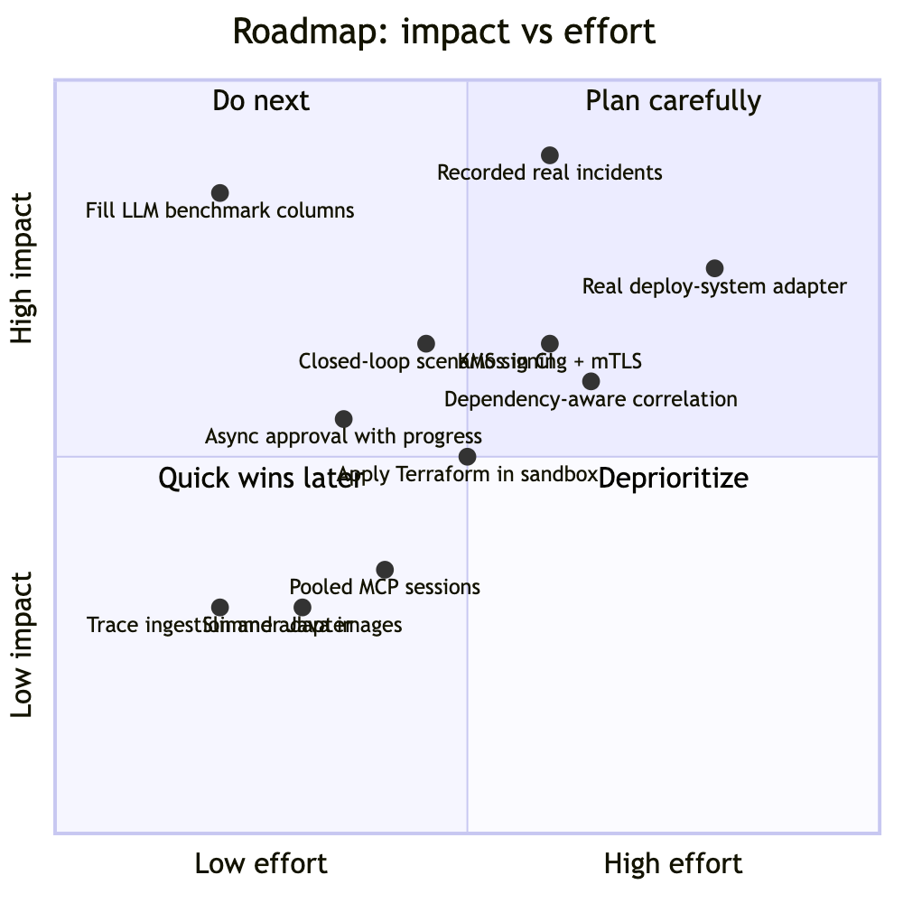

# 16 Limitations and roadmap

Honest list of what's missing or weak, with the risk and the intended fix. Remove items when they're done (and note it in chapter 15).

## 1. Known limitations

| Area | Limitation | Risk | Planned fix |
|---|---|---|---|
| Evaluation | LLM columns (gemma4, Claude) not yet measured on the full set | Claims about LLM quality are anecdotal (pilot only) | `run.py --mode llm --provider ollama` (~60 min, resumable); Claude with a key and `--max-usd` |
| Evaluation | Generator and labels share one author | Benchmark blind spots invisible | Incidents recorded from chaos-lab and real postmortems; externally written red-team cases |
| Evaluation | Retrieval eval has 20 questions | Mode differences not significant | Grow to ~100; add a cross-encoder reranker and measure |
| Auth | The gateway's ES256 private keys live in a Kubernetes Secret, not a KMS/HSM | A compromised gateway pod can read them | Sign through AWS KMS (asymmetric `ECC_NIST_P256`) so the key never leaves the HSM |
| Auth | No mTLS between pods | Tokens authenticate, but in-cluster traffic is plaintext | Service mesh (Linkerd/Istio) or SPIFFE identities, in addition to the tokens |
| Auth | Dev issuer (HS256) still exists for scripts, CI and kind | Misconfigured production could accept dev tokens | Off by default; `check_chart_secrets.py --prod` fails if the dev secret reaches any pod |
| Security | Regex injection filter | Novel phrasings get through (by design, the interlock is the backstop) | Classifier-based detection; more red-team cases |
| Security | No egress NetworkPolicy | Wider blast radius if a pod is compromised | Egress allow-lists; mTLS (service mesh) or a service token gateway → agent |
| Agent | Each MCP tool call opens a stateless session (~3 HTTP requests) | Latency and request overhead | A pooled MCP session per incident |
| Agent | The rule baseline can't diagnose from metrics alone (8 benchmark misses) | Escalation where a fix was possible (safe, slower) | Left for the LLM path to close; measure |
| Remediation | The approval request is synchronous across execution and verification (up to about a minute) | Slow UI response; a gateway restart mid-call loses the response (the agent still finishes and the record catches up on the next read) | Return 202 at approval and stream progress (SSE) from the agent's checkpoints |
| Remediation | The adapter fronts the chaos-lab ops API only | Real deploy systems (Argo CD, Spinnaker, a cloud API) need their own adapters | Same MCP tool contract per backend; `dry_run` first in production |
| Remediation | No automatic rollback of a failed remediation; no auto-approval | A wrong fix waits for a human (safe, slower) | Per-tenant auto-approval for low-risk actions gated on measured precision; compensating actions |
| Alerts | Correlation is per service | A cascade (checkout errors caused by inventory) still opens two incidents | Correlate along the service dependency graph within a time window |
| Alerts | Integration tokens are bearer credentials (≤ 90 days) | A leak allows forged alerts for that tenant until revoked (investigations are read-only and rate-limited) | Short TTLs plus automated re-issue; or mTLS from Alertmanager |
| Evaluation | The benchmark scores *proposals*; execution and verification are tested by unit, integration and live runs, not by the 112-incident set | The TTM claim rests on two live scenarios | Replay closed-loop scenarios (fault → alert → approve → verify) in CI with the lab, recording TTM per fault type |
| Observability | ingestion-service and mcp-remediation aren't traced (the adapter has a JSON audit log); no log aggregation; alert rules exist for the lab services but not SLOs for Sentinel itself | Gaps when debugging ingestion | OTel in both; Loki; SLOs for incident latency, error rate and TTM |
| Images | Java images ~1.2 GB (ONNX natives for all platforms + model) | Slow pulls/scale-up | Platform-specific natives, jlink, a model layer shared via a volume or init container |
| Deployment | Terraform validated, never applied; ESO/ALB/OTel Collector assumed | Unknown apply-time issues | Apply in a sandbox account; add the add-ons via Helm/Terraform |
| Data | No retention or deletion policy for incidents, the cache, checkpoints | Unbounded growth; data-protection obligations | TTL jobs; tenant deletion workflow |
| Product | Alertmanager only (no PagerDuty/Opsgenie) | Teams on other tools open incidents by hand | Further receivers on the same `AlertService` |
| Guard | `ActionRequest` objects are never deleted (they are the audit record), about 2 KB each; the evidence export exists (Phase 14) but nothing compacts | Unbounded growth of objects in `sentinel-system` and etcd; the watch cache holds them all | Compaction after a verified, archived export: keep the signed head of the archived segment as the new chain's anchor |
| Guard | A restored older signed head, with the newest events deleted, verifies on its own (Phase 14) | Someone with write access to the guard's objects and a saved older head could hide recent actions until compared with an archive | Already caught by `--previous` against an archived bundle and by `SentinelGuardAuditHeadWentBack`; stronger: an external timestamping or transparency log for each head |
| Guard | Guardian alert thresholds are starting points, unit-tested on synthetic series, not tuned on real traffic | Noisy or late alerts on real agents | Tune on real traffic |
| Guard | The inbox has no OIDC sign-in of its own (people paste a token); notifications are best effort (an in-memory queue, two retries) and one-way (no approving from Slack yet) | A guard restart can lose queued notices; approvers switch to the inbox or kubectl to decide | An OIDC code flow in the inbox; interactive Slack approvals through a delegate that forwards the person's token |
| Guard | Two-person rules count distinct people but not distinct teams (no "one from SRE, one from finance") | Two people from the same team can satisfy a rule meant to span teams | Per-action approver groups |
| Compliance | `docs/compliance` maps features to the EU AI Act and NIST AI RMF; it is not legal advice or a conformity assessment | Readers may over-read a mapping as compliance | Review by counsel; follow the revised AI RMF and Commission guidance as they appear |
| Guard | The chain head is one ConfigMap: every event is serialized through it, and `voids` grows with lost races | Throughput suits human approvals, not a high-volume event log; voids accumulate slowly | Segment the chain per period with signed checkpoints; compact voids into the export |
| Guard | Signing key and TLS cert in Kubernetes Secrets; rotating the key drops the old public key | Events signed with an old key can't be verified after rotation | Keep a key history in the JWKS ConfigMap; optional KMS signing |
| Guard | Only the configured operations are guarded (workload updates and deletes, deletes of common objects); `exec`, `port-forward`, CRDs from other operators and RBAC changes are not, by default | An agent with broad RBAC can still act through unguarded paths | Grow the default rules; pair with least-privilege RBAC for agent ServiceAccounts; Kyverno/Gatekeeper packs |
| Guard | The guard trusts the gateway's word for who the console reviewer is (a delegate, as v1 trusted the gateway to mint) | A compromised gateway could record approvals in a reviewer's name (visible in the signed audit as "via" the gateway) | Forward the reviewer's own OIDC token and verify it at the guard (issuer, audience, tenant) |
| Guard | The chart's agent and delegate identities are static values assuming release and namespace `sentinel` | A different install silently loses separation of duties until the values are fixed | Derive them from the release in templates (needs the subchart to accept templated values) |
| Guard | The local (single-process) guard keeps requests in memory | A dev restart loses pending approvals; those incidents must be re-opened | A durable single-process store |
| Guard | Approvals for generic agents only via `kubectl sentinel` / the API (the copilot's go through its console since Phase 11); no Slack | Approvers of other agents must use the terminal | Slack interactive approvals; a guard page in the console |
| SDKs | Not yet published to PyPI/npm: the release builds the packages and the publishing jobs exist, but they wait for the maintainer's one-time registry setup ([publishing](../guard/publishing.md)); until then, install from the repository or the release assets; no Java SDK; no native Claude Agent SDK or OpenAI Agents SDK adapters (MCP-based agents are covered by the proxy) | Friction for teams that only install from registries | Set `PUBLISH_PYPI` / `PUBLISH_NPM` after the registry setup; adapters on the same contract |
| SDKs | The decorator and `guard_tool` redeem the capability inside the agent's own process | They stop the model's mistakes and manipulation, not a compromised process (stated in the docs, ADR-0012) | Redeem in a separate executor, put the proxy between the agent and the server, or use the webhook |
| MCP proxy | stdio towards the client only (no HTTP server mode); one upstream per proxy | Remote MCP clients can't use it yet | A streamable-HTTP server mode; several upstreams |
| SafeActionBench | Synthetic incidents (one author for generator and labels); each fault has one clean defining metric, so the reference guard's guarded numbers are an upper bound | Real-world guards will block less harm and more good fixes | Recorded chaos-lab incidents and anonymized real postmortems; a second labeller |
| SafeActionBench | No frontier-model entries yet (Claude, GPT); the reference guard is single-threshold and metrics-only | The board compares a small local model, rules and baselines | Run the MCP harness with frontier agents (needs API keys); a richer reference policy |

## 2. Roadmap (proposed order)

*Figure 16.1: Roadmap items by impact and effort*

0. **Sentinel Guard, next** (v2): frontier-model entries on SafeActionBench; turn on PyPI, npm and Artifact Hub publishing (one-time registry setup); approvers from different groups; Slack approvals that forward the person's token; the copilot's gateway forwarding reviewers' tokens; native Claude Agent SDK and OpenAI Agents SDK adapters; a Java SDK; compaction after archived export; external anchoring of chain heads; Kyverno/Gatekeeper packs.
1. **Claude column** (needs an API key); improve the local model's accuracy on red-herring and injection tiers (currently 33–38%: safe, but escalated).
2. **Real-world benchmark data:** record chaos-lab incidents; import anonymized postmortems.
3. **Identity, next:** KMS-backed signing; mTLS/SPIFFE between pods; egress NetworkPolicies.
4. **Closed loop, next:** async approval with streamed progress; dependency-aware alert correlation; closed-loop scenarios in CI; a real deploy-system adapter with mandatory dry run.
5. **Scale and cost:** pooled MCP sessions, reranker, slimmer images, apply Terraform in a sandbox.

*Done in Phase 7 (removed from this list):* alert webhooks, and remediation execution behind interlocks with capability tokens, verification and audit.
*Done (Phase 8):* pushed to GitHub with CI green and images published.
*Done in Phase 8:* OIDC users, asymmetric (ES256) service tokens with a JWKS, gateway ↔ agent service identity, checkpoint RLS, revocable integration tokens.
*Done in Phase 11:* the incident copilot runs on Sentinel Guard (one approval and capability path).
*Done in Phase 12:* SDKs (Python, TypeScript) and an MCP proxy for agents outside Kubernetes.
*Done in Phase 13:* SafeActionBench, the open benchmark with an MCP harness and a reproducible leaderboard.
*Done in Phase 14:* the signed evidence export with offline verification, policy versions, signed checkpoints, guardian monitoring and alerts, the EU AI Act / NIST AI RMF mapping, and a one-click Codespaces demo.

*Done in Phase 15:* `docker compose up` with a live agent, the approvals inbox, the guard's Grafana dashboard (in the chart too), signed charts and SDK packages on every release, with publishing ready to switch on.

*Done for v2.0.0:* a stable `sentinel.dev/v1` API, with the alpha version still served and upgrades from the alphas tested in CI.

*Done in Phase 17:* an Overview and per-request details in the inbox; incidents can't get stuck on a lost guard request or a stale alert link; an approval made a moment ago through another replica counts at once.

*Done in Phase 16:* *N*-of-*M* approvals (distinct, authenticated people; signed and verified), approvers verified by OIDC or personal tokens, delegates forwarding the person's token, notifications.
