# 17. LLD: Sentinel Guard (v2)

Sentinel Guard is Sentinel's safe-action core (approval → single-use capability → execute once → audit), extracted into a service any agent is held to. It enforces at the Kubernetes API with an admission webhook, so unmodified agents can't route around it, and serves an HTTP API for agents outside Kubernetes. Decision record: [ADR-0010](../adr/0010-sentinel-guard.md). User guide: [docs/guard](../guard/README.md).

## 1. Shape

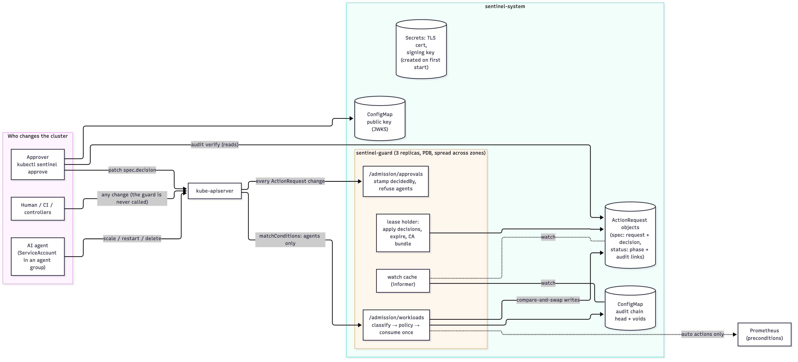

*Figure 17.1: Sentinel Guard: who calls what, and where state lives*

| Part | Where | Role |
|---|---|---|
| `sentinel-guard` | `guard/cmd/sentinel-guard` | The service: two admission webhooks, the action API, JWKS, metrics. Modes `kubernetes` (in a cluster) and `memory` (one process, `docker run`) |
| `kubectl-sentinel` | `guard/cmd/kubectl-sentinel` | The kubectl plugin: `requests`, `describe`, `approve`, `deny`, `audit verify`, `audit export`, and offline `audit verify --bundle` |
| Core | `guard/internal/guard` | Request lifecycle (`engine.go`), policy (`policy.go`), change classification (`classify.go`), capabilities and signatures (`signer.go`), audit chain (`audit.go`), evidence bundle and oversight summary (`evidence.go`), Prometheus preconditions (`precondition.go`) |
| Storage | `guard/internal/store` | `Memory` (one process) and `Kube` (ActionRequest objects, watch cache, compare-and-swap writes) |
| Transport | `guard/internal/server` | HTTP handlers, both webhooks, metrics, the guardian monitor (`monitor.go`), the approvals inbox (`inbox.go` + `inbox/`, single-process mode), people's identities (`oidc.go`) and notifications (`notify.go`) |
| Kubernetes glue | `guard/internal/kube` | Creates its TLS certificate and signing key on first start, keeps the webhook CA bundles, publishes the JWKS, TokenReview authentication |
| Chart | `deploy/helm/sentinel-guard` | CRD, 3 replicas + PDB, RBAC (the guard, approvers, viewers), both webhook configurations, policy ConfigMap; optional PrometheusRule (`alerts/`) and Grafana dashboard (`dashboards/`) |
| Quickstart | `compose.yaml`, `examples/quickstart/` | The guard, a demo agent, and optionally Prometheus and Grafana, in one `docker compose up` (§12) |
| Default policy | `guard/policies/default.yaml` | Embedded in the binary |

One static Go binary (37.5 MB linux/amd64, stripped); the image is 11.5 MB compressed on distroless `static:nonroot`.

## 2. Request lifecycle

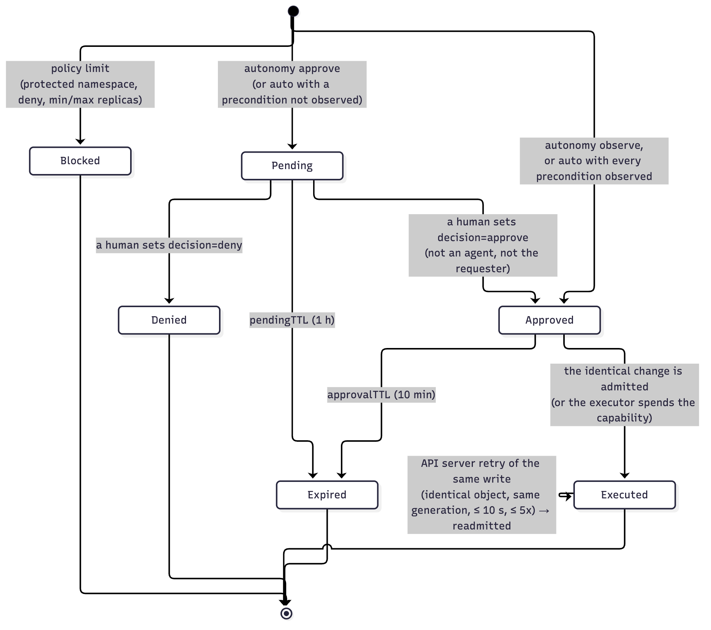

*Figure 17.2: The lifecycle of an action request*

A **request** (`guard.Request`) carries:
- what was asked: agent, action, target, the human-readable change, the fingerprint, intent, risk, autonomy;
- the decision: who, when and a note;
- the outcome: phase, reasons, preconditions, expiry, execution, the exact object admitted and its generation;
- its links in the audit chain.

`Engine.Evaluate(proposal)`, in order:
1. **Hard limits** (`Policy.Violations`): autonomy `deny`, a protected namespace (the guard adds its own), a namespace allow-list, `minReplicas`/`maxReplicas`. A violation means **Blocked**: it can't be approved, and repeats within `pendingTTL` reuse one record.
2. **An earlier request for the same key** (`useExisting`):
   - an API-server retry of an executed write is re-admitted (§4);
   - an `Approved` request is consumed (Kubernetes) or yields a capability (API);
   - a `Pending` one is reported again;
   - a recent human denial stands.
3. **A fresh decision.** `observe` is allowed and recorded. `auto` is allowed only if every precondition is observed by the guard. Otherwise a **Pending** request is created, with the guard's precondition results attached.

Dry runs evaluate without recording anything and are admitted with a warning.

**Request ids** are `ar-<first 8 of the key>-<n>`. Concurrent identical attempts compute the same name, so the store's create-if-absent keeps one. An attempt that loses re-evaluates and joins the existing request (`errDuplicate`). The unit test with 50 parallel attempts ends with exactly 2 requests: the executed one and one new pending.

## 3. Classification and the approval binding
`ClassifyAdmission` (`classify.go`) turns an `AdmissionRequest` into an action:

| Request | Action | Fingerprint |
|---|---|---|
| `UPDATE …/scale` | `scale` | `replicas=<n>`. On the wire, Scale's `replicas: 0` is an absent field (`omitempty`); absent is read as 0 there, but as the default 1 for a workload's pointer field |
| `UPDATE` workload, only `spec.replicas` | `scale` | as above |
| only the `kubectl.kubernetes.io/restartedAt` template annotation | `restart` | `restart`. The timestamp is not bound, because kubectl stamps a new one on every attempt |
| container images | `set-image` | `images=<container=image,…>` |
| any other pod-template change | `rollout` | digest of the normalized new template |
| other spec fields, or several kinds at once | `update` | digest(s) |
| `DELETE` | `delete` | `delete` |
| `CREATE` (opt-in) | `create` | digest of the object without metadata |

Metadata-only changes and status or other subresources are not actions.

The **approval key** is a digest of agent + action + target + fingerprint: an approval admits that and nothing else. The proposal also carries:
- `Exact`: a digest of the whole resulting object, incl. the restart timestamp;
- `Generation`: the target's `metadata.generation` before the change.

Both are used only to recognise API-server retries (§4).

## 4. Exactly once on a real API server
- **Consuming an approval** is a compare-and-swap on the `ActionRequest` (`resourceVersion`): `Approved → Executed`. When replicas race, one wins and the others see `Executed`.
- **API-server retries.** When a write conflicts (a controller updated status in between), the API server re-reads the object, re-applies the patch and **runs admission again**. The first call already consumed the approval, so the retry was denied and the approval burned (found by the e2e load test, §8).
  - The guard now re-admits a write that is the **identical resulting object** (`Exact`) **at the same generation**, within `ReadmitWindow` (10 s), at most `MaxReadmits` (5) times, as event `readmitted`.
  - Re-applying an identical object can't change anything twice.
  - A change that landed and was then reverted has moved the generation on twice, so it needs a new approval (found by the same load test).
  - Scale objects carry no generation; the guard reads the workload's (`get` on deployments, statefulsets and replicasets).

## 5. The audit chain
Every event (`requested`, `blocked`, `approved`, `denied`, `capability-issued`, `executed`, `readmitted`, `expired`) is a link:
- `Hash = sha256(seq | prev | type | at | actor | detail | requestId | digest | kid)`.
- `Digest` covers the request's identity fields, so editing what was requested breaks every event of that request.
- `Sig` is an ES256 signature over the hash.

The head (`seq`, `hash`) lives in the ConfigMap `sentinel-guard-audit-head`; the public key in `sentinel-guard-jwks`. Since Phase 14 every new head is also signed (`at`, `kid`, `sig`): a checkpoint (§11).

**Writes:**
1. `transition` first checks the change against the current (cached) state. A refused attempt, such as a replayed capability, writes nothing.
2. It then claims the next place (compare-and-swap on the head).
3. It writes the state change and the event together.

If step 3 loses a race, the claimed place becomes a **signed void** (`Head.Voids`), so the chain stays complete. A void signed by any other key fails verification, so voids can't hide a deletion (unit test).

**Verification** (`VerifyAudit`, run by `kubectl sentinel audit verify` with only read access) checks:
- the sequence is contiguous up to the head;
- every link and signature;
- the digests against the requests;
- the head hash.

It reports: an edited request; a deleted request (a gap); a forged event or void; a broken link; since Phase 14, a forged head signature (an unsigned head from an older guard is only a warning).

## 6. Kubernetes integration
- **Workloads webhook** (validating, `failurePolicy: Fail`, `sideEffects: NoneOnDryRun`, 5 s timeout).
  - Its `matchConditions` select agent groups and users (CEL with `has()` guards, so a missing field can't error and fail closed for everyone).
  - The handler checks `IsAgent` again. Any error for an agent denies (fail closed).
- **Approvals webhook** (mutating, on `ActionRequest` create/update/delete):
  - The guard's own ServiceAccount passes.
  - Creates and deletes by anyone else are refused, even cluster-admin.
  - Spec edits other than the decision are refused.
  - A decision is refused for agent identities, the requester, decided or expired requests. Otherwise it is admitted with a JSON patch that sets `decidedBy` and `decidedAt` from the authenticated identity.
- **Bootstrap.** On first start the guard creates `sentinel-guard-tls` (a CA plus a serving cert for the Service names, 10-year validity) and `sentinel-guard-signing` (a P-256 key). Replicas racing on create read the winner's copy. The guard writes the CA into both webhook configurations, re-checking every minute, so a re-applied manifest heals itself.
- **Reads** come from a watch-fed cache (informer on ActionRequests, indexed by approval key; one on the head ConfigMap), plus this replica's own just-written versions until the watch delivers them. **Writes** are compare-and-swap; a stale read costs a conflict and a fresh read, never correctness. Client throttling is raised (QPS 200, burst 400) because the webhook sits on the request path.
- **Housekeeping** (applying decisions, expiries, the CA bundle) runs every second on the replica holding the `sentinel-guard-housekeeping` Lease (15 s lease, 10 s renew). The admission path also applies a just-made decision inline, so an agent's retry right after an approval doesn't wait for the tick.
- **Agents on the HTTP API** authenticate with their ServiceAccount token (TokenReview, 30 s cache).

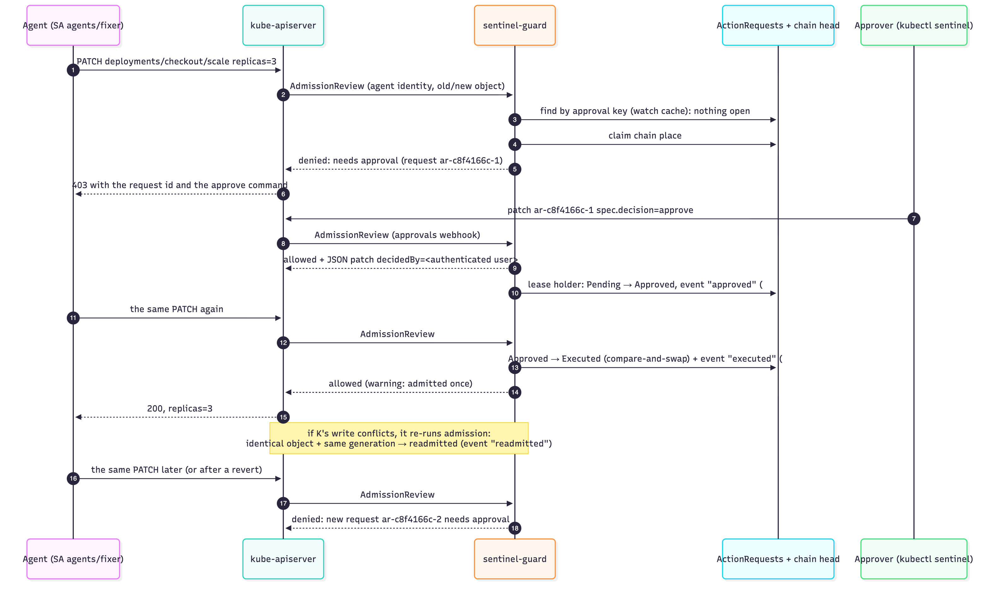

*Figure 17.3: An approval end to end, including an API-server retry*

## 7. Capabilities (HTTP API)
For agents outside Kubernetes, an approved request yields one ES256 JWT:
- `aud` `sentinel-action`;
- `request_id`, `action`, `target`, `namespace` (the target's scope: a namespace or, for Sentinel, the tenant), `change` (the approved parameters, for the executor to check), `fingerprint`, `approved_by`, `jti`;
- it expires with the approval.

**Delegated decisions (Phase 11).** A service that authenticated a person itself may record that person's decision over HTTP, if its identity is listed under the policy's `delegates` (the admin token is the only other way, and only in single-process mode).
- The request stores `decidedBy` = the person and `decidedVia` = the delegate; the audit event reads "note [via delegate]".
- A delegate can't decide on behalf of the requester, and the requester can't be the delegate.
- Sentinel's own gateway is the first delegate: the copilot's console approvals go through it ([ADR-0011](../adr/0011-copilot-approvals-through-the-guard.md)).

**In-cluster API listener.** With `SENTINEL_GUARD_API_ADDR` (chart `api.plainHTTP`), the guard also serves the action API, without the admission webhooks, over plain HTTP. Clients in other namespaces can't trust the webhook's private CA; a NetworkPolicy limits who reaches the port.

It is issued once (`capability-issued` records the `jti`). The executor calls `POST /v1/capabilities/spend`, which verifies it (algorithm pinned, issuer, audience, expiry) and moves the request `Approved → Executed` only if the `jti` matches: single use, enforced by the store's compare-and-swap. The API's fingerprint is a digest of the proposed `change` map, so an approval for €42 doesn't cover €4,200 (unit test).

## 8. Measured
All numbers from `scripts/guard-e2e.sh` with `LOAD=1` on a fresh kind cluster (1 node, Docker Desktop, Apple Silicon), 3 guard replicas, re-measured 2026-10-25 after Phase 17, which adds a fresh read before a "pending" answer. The full Sentinel stack was running in Docker on the same laptop during this run. Raw data: [`evals/guard/latency.json`](../../evals/guard/latency.json). Latency is measured by the client through the API server (TLS, the webhook call, the guard's work, the write), with `test/loadgen`.

| Scenario | n | p50 | p95 | p99 | max |
|---|---|---|---|---|---|
| Human scales a deployment (the guard is never called) | 400 | 2.5 ms | 4.0 ms | 6.1 ms | 9.2 ms |
| Agent repeats a change that's pending (a cache lookup, then a fresh read of that request) | 400 | 3.8 ms | 5.6 ms | 7.5 ms | 13.6 ms |
| Agent's change after a human approved it (admitted once) | 100 | 25.6 ms | 31.8 ms | **34.6 ms** | 42.9 ms |
| Worst case: approval and retry in the same instant (the decision is applied on the request path) | 100 | 32.4 ms | 48.0 ms | 66.8 ms | 79.6 ms |

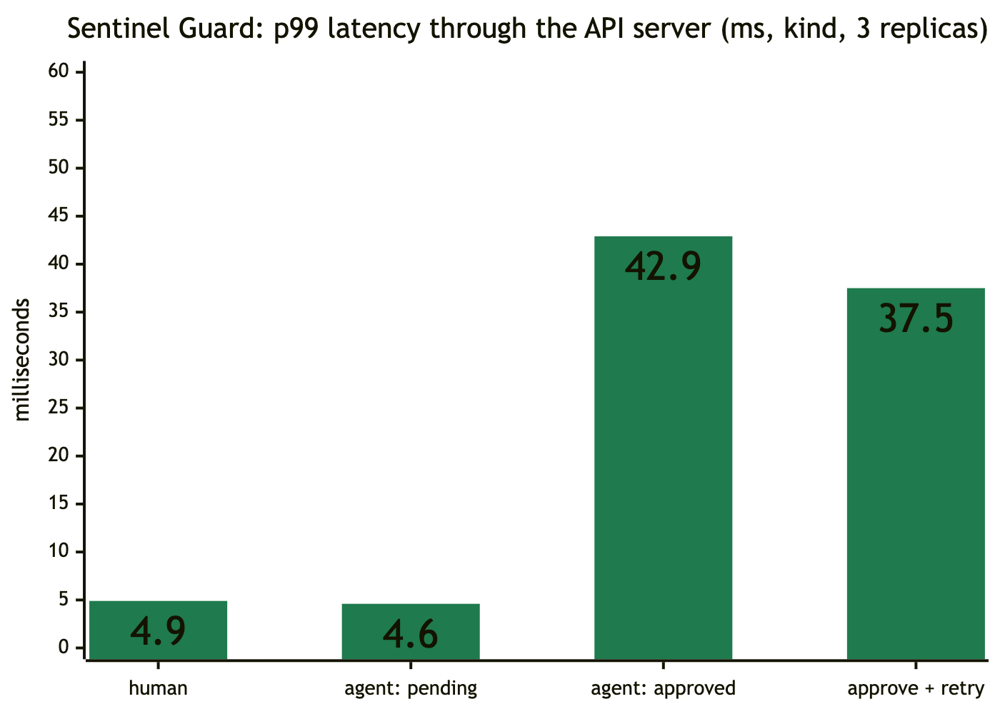

*Figure 17.4: Sentinel Guard: p99 latency through the API server*

- **What a pending check costs.** Since Phase 17, a request found pending in the watch cache is read once more from the API server before the guard answers, so an approval made a moment ago through another replica counts.
  - That read is the cost: p50 3.8 ms against 2.4 ms in Phase 14, p99 7.5 against 6.0 ms. Still single digits, about one human-path latency.
- **The approved path** makes two writes: the chain head, and the request's state together with its event. p99 is 34.6 ms, under the 50 ms target.
- **The worst case got slower, and that's the point.** It's an approval and a retry in the same instant: p99 66.8 ms, against 45.6 ms.
  - Before, such a retry could read a cache that hadn't seen the approval yet, and be told to wait (CI saw it once).
  - Now it always finds the approval and applies it on the request path.
  - A real person retries seconds later, on the approved path above.
- **Run-to-run variation.** The approved path measured 42.9 ms (Phase 10), 40.8 ms (Phase 14) and 34.6 ms here; the human baseline 4.9, 8.8 and 6.1 ms. Neither path changed in the code: that spread is the laptop. Read the table as "tens of milliseconds for an approved change, single digits otherwise".
- **Safety under load:** every load round also asserts that an unapproved change is denied, that a different change doesn't ride on an approval, and that the same change after a revert needs a new approval. The chain verified after 630 events across 213 requests, **with no voids** (no lost races).
- **Guard down:** humans' changes still go through and agents' changes are refused. After scaling back up from zero, the guard answered again within **2 s** (1 s in the Phase 10 run).
- **The end-to-end suite:** 33 checks, all passing (chapter 14; the 2 added in Phase 16 cover two-person approval). The 6 added in Phase 14 cover policy versions, the signed head, offline verification of the export, tamper detection, every replica's self-verification, and a later export extending an archived one.

## 9. Configuration
Environment variables and chart values: [chapter 13 §8](13-deployment-and-operations.md#8-sentinel-guard). Metrics: [chapter 12 §2](12-observability.md#2-metrics-catalog-prometheus). Endpoints and the CRD: [chapter 09 §8](09-api-and-contracts.md#8-sentinel-guard).

## 10. SDKs and the MCP proxy (Phase 12)

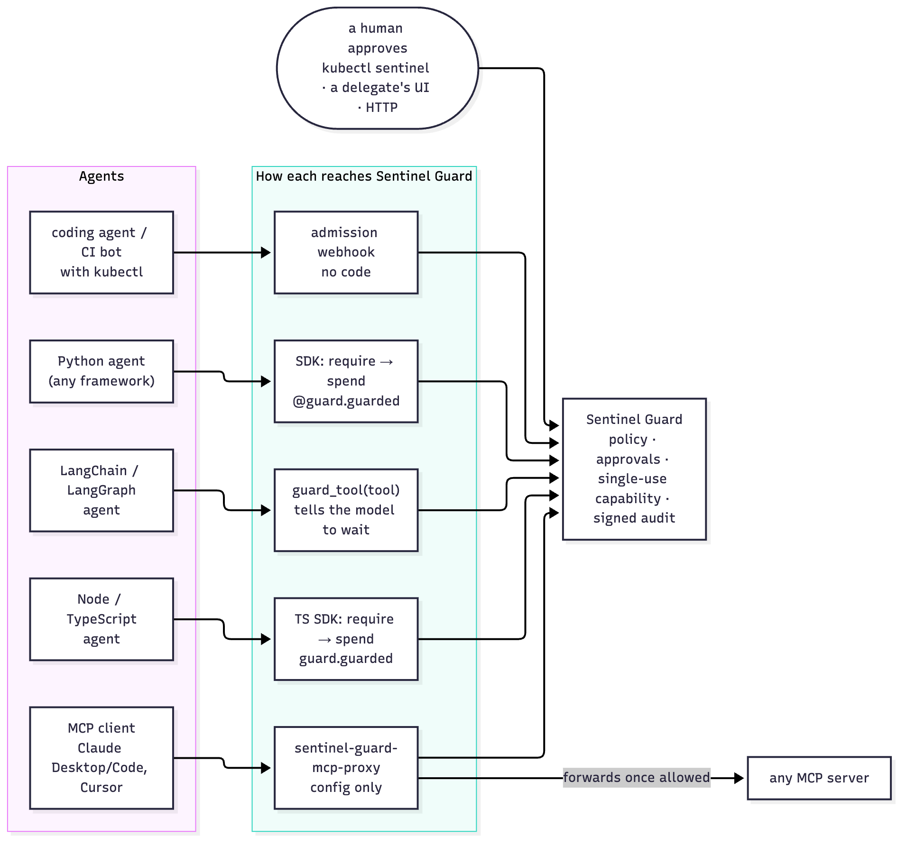

*Figure 17.5: Every kind of agent, one guard: webhook, SDKs, the LangChain wrapper and the MCP proxy*

Design record: [ADR-0012](../adr/0012-sdks-and-the-mcp-proxy.md).

| Piece | Where | What it does |
|---|---|---|
| Python SDK | `sdk/python/sentinel_guard/client.py` | `Guard` / `AsyncGuard`: `propose`, `status`, `require(…, wait)` (polls `GET /v1/actions/{id}` until allowed, blocked or out of time), `spend`, the `guarded` decorator (approval bound to all arguments by default; `target` and `change` as values, `"{arg}"` templates or callables) |
| LangChain wrapper | `sdk/python/sentinel_guard/langchain.py` | `guard_tool(tool, guard, …)`: same name, description (plus a note) and arguments; while not allowed, it returns an explanation **to the model** instead of acting |
| MCP proxy | `sdk/python/sentinel_guard/mcp_proxy.py`, CLI `sentinel-guard-mcp-proxy` | stdio MCP server in front of any MCP server (stdio or streamable HTTP). Per tool `pass`, `guard` or `deny`; upstream results returned unchanged; refusals are error results |
| TypeScript SDK | `sdk/typescript/src/index.ts` | `Guard`: the same `propose`, `status`, `require`, `spend`, `guarded`; zero dependencies |

**Errors fail closed in both SDKs:**
- `ApprovalPending` (with the request id to show a human);
- `ActionBlocked` (policy, or a human denied it);
- `CapabilityRejected` (already used, expired, forged);
- `GuardUnavailable` (unreachable, or any unexpected status such as a 401: never read as permission).

**The change encoding is canonical and shared.** Strings stay as they are; anything else becomes compact JSON with sorted keys (`canonical_change` / `canonicalChange`). The approval binds to the fingerprint of these values, so both SDKs must agree byte for byte; a golden value is asserted in both test suites.

**Where the capability is redeemed decides the protection** (ADR-0012 §4):
- **The decorator and the wrapper** redeem in the agent's own process. That stops the model's mistakes and manipulation, not a compromised process.
- **A separate executor, the MCP proxy, or the webhook** also stop a compromised agent.

**Measured:** both SDKs and the proxy run against the real guard binary in CI (`sdks` job).
- Python: 19 tests, including the proxy launched by a real MCP client over stdio, launching a real upstream server.
- TypeScript: 6 tests.
- The refund example (`examples/guarded-refunds`) ran as documented: pending → approved with the printed `curl` → refunded once → the same refund again opened a new request.

## 11. Governance: evidence, policy versions, guardian monitoring (Phase 14)

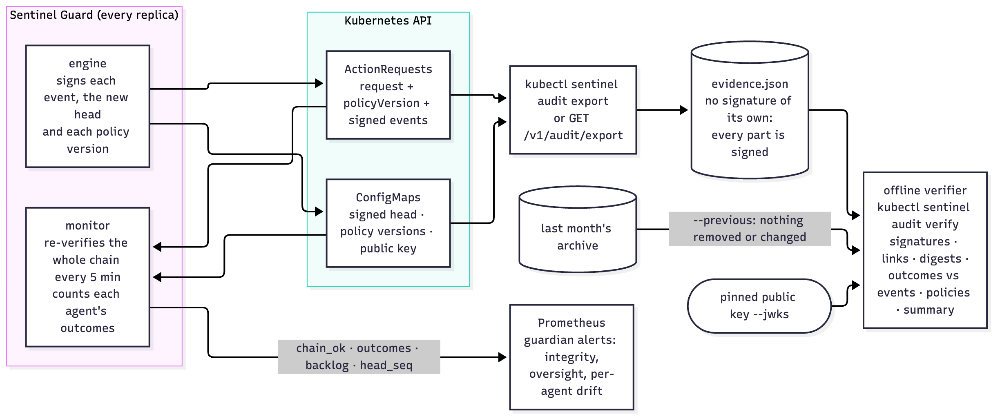

*Figure 17.6: Evidence and guardian monitoring: what is signed, where it lives, and who checks it*

Design record: [ADR-0014](../adr/0014-governance-evidence-and-guardian-monitoring.md). User-facing: [docs/compliance](../compliance/README.md).

**Policy versions.**
- `Policy.Canonical()` marshals the *effective* policy (defaults applied; the guard's own namespace and memory-mode delegates added). Its SHA-256 is the version.
- `Engine.SetPolicy` computes it once. `Engine.RecordPolicy` signs `sha256("policy|version|loadedAt")` and stores the record (Memory, or one key per version in the ConfigMap `sentinel-guard-policies`); a version already stored keeps its first record.
- `create()` records the version before the first request that names it, so no request can name an unkept policy.
- `Request.PolicyVersion` joins the request digest (only when set, so pre-Phase-14 requests still verify).

**Signed checkpoints.** `chain()` signs the new head (`sha256("head|seq|hash|at")`) in the same compare-and-swap that claims the event's place. That is one extra ES256 signature per event: about 26 µs (`BenchmarkSignHash`, M1 Pro). Voids keep the head's signature; they are signed themselves.

**The evidence bundle** (`evidence.go`).
- `BuildEvidence` orders requests by their first event and policies by load time, and attaches `Summarize(requests)`.
- `VerifyEvidence(bundle, keys)` runs `VerifyAudit`, then checks:
  - each policy (hash of its text, signature);
  - that every request's version is kept;
  - each request's phase, decision and decider against its signed events (`consistency`);
  - the summary against a recomputed one.
- `keys == nil` means "the bundle's own keys", reported by ID.
- `Engine.Verify` now goes through the same path, so the HTTP verify, the monitor and `kubectl sentinel audit verify` check exactly what an auditor checks.

**The oversight summary** derives everything from signed events:
- outcome counts overall and per agent: `proposed` / `blocked` / `auto_approved` / `approved` / `denied` / `executed` / `expired` (`EventOutcome`, shared with the metric);
- who decided (a person, or "person via delegate");
- expiries nobody decided;
- median and longest time from request to human decision.

**Anchoring.** `Continues(older, newer)` requires the head not to go back, and every event and void of the older bundle to be present and unchanged in the newer one (`audit verify --previous`). That catches the one thing a signed head can't: a restored older signed head with the newest events removed.

**The guardian monitor** (`server/monitor.go`, every replica, from its watch cache):
- every 15 s: open requests by phase, the oldest undecided request's age, the head's sequence;
- every `SENTINEL_GUARD_VERIFY_INTERVAL` (5 min): a full `Verify`, giving `sentinel_guard_audit_chain_ok` and a timestamp; a failure is also logged with the problems;
- `sentinel_guard_agent_outcomes_total` is counted in the event hook;
- the alert rules are in chapter 12.

**Measured** (`BenchmarkVerifyEvidence`, Apple M1 Pro): verifying 1,000 approved-and-executed requests (3,000 events) takes **about 0.18 s**, almost all of it ECDSA verification. The bundle is **about 2.1 KB per request** (compact JSON).

**Bug found and fixed.** The CRD schema lacked `spec.decidedVia`, so the API server pruned it. Delegated decisions in Kubernetes mode (the copilot's path since Phase 11) kept the delegate only in the signed event's detail. The schema now has `decidedVia` and `policyVersion`; the e2e checks that `policyVersion` survives.

## 12. The quickstart and the approvals inbox (Phase 15)

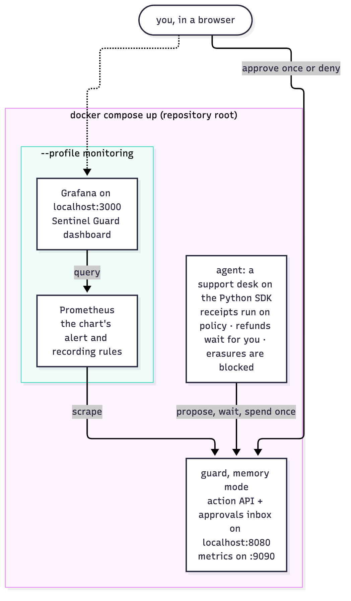

*Figure 17.7: The docker compose quickstart: the guard, a live agent, and the optional monitoring profile*

**The demo agent** (`examples/quickstart/agent.py`) is a small event loop over the synchronous SDK, not a framework. Every second it polls its waiting requests:
- **Once approved**, it redeems the capability (`spend`) and only then "issues" the refund. After every third approval it spends the same capability again and logs the 409.
- **Once denied**, it logs the decider and note.
- **A 404 for its own request** means a restarted memory-mode guard forgot it, so it asks again.

It keeps at most `MAX_WAITING` (3) requests open and queues the rest. That way the inbox never floods, and the oldest-pending gauge and backlog alert behave as they would with a real queue.

**The inbox** (`server/inbox.go`) is mounted by `handler()` only when `AdminToken` is set:
- `GET /` redirects to `/inbox/`.
- `http.FileServerFS` serves the embedded `inbox/` directory, wrapped to add the CSP, `nosniff`, `no-referrer` and `no-cache` headers.
- The page is three static files (18 KB), and the script uses only the existing API:
  - `GET /v1/actions` every 2 s while signed in;
  - `POST /v1/actions/{id}/approve|deny` with `{approver, note}`;
  - `GET /v1/audit/verify`;
  - `GET /v1/audit/export`, saved through a blob URL so the token never appears in a link.
- Pending cards are reconciled by request id rather than re-rendered, so a half-typed note survives the refresh.
- Agent-supplied strings only ever reach `textContent` or attribute values set with `setAttribute`. `TestInboxIsServedOnlyWithHTTPApprovals` keeps it that way by refusing HTML sinks in the script.

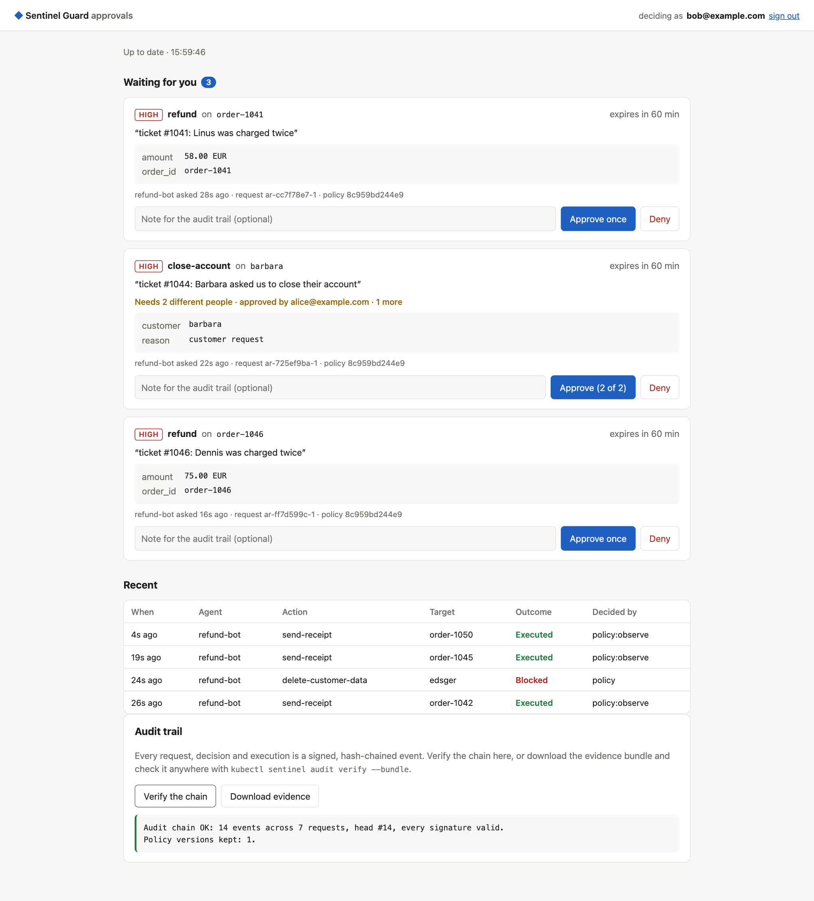

*Figure 17.8: The approvals inbox in the quickstart: three refunds waiting, recent outcomes (receipts on policy, erasures blocked, one refund approved and executed), and the chain verified*

**What it costs:** 136 KB of binary (stripped, darwin/arm64 build), and no route at all in Kubernetes mode.

## 13. Two people, verified approvers, notifications (Phase 16)

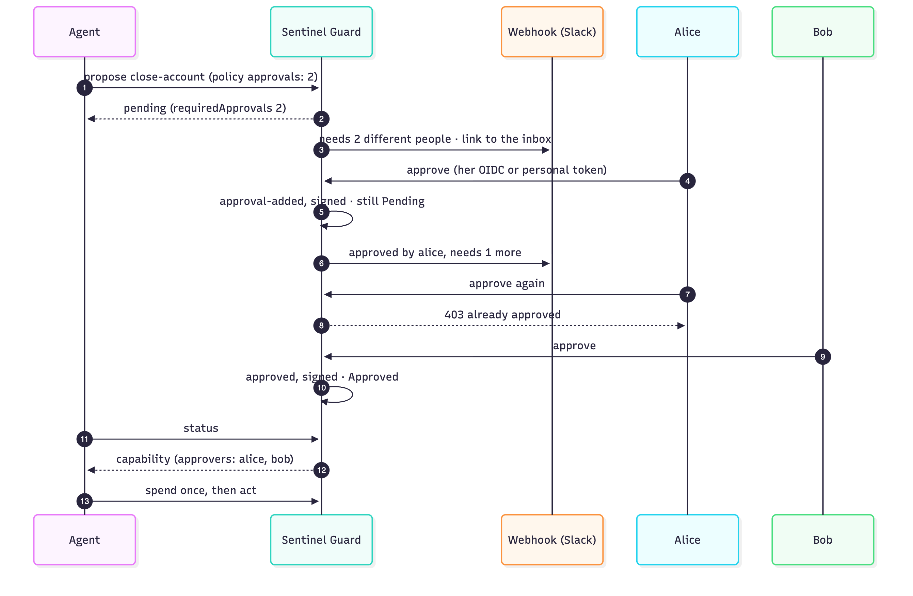

*Figure 17.9: Two-person approval: one approval keeps the request pending, the same person can't count twice, the second person decides*

**Engine.** `Request.RequiredApprovals` is set at creation, for requests that wait for people, when the action's `approvals` is above 1; it goes into the digest. `Request.Approvals` holds the approvals before the last. The rules are two shared functions:
- `Partial(r)`: an approval now would be one of several;
- `CanApprove(r, person)`: nobody counts twice.

They are used by:
- **`Engine.Decide` (HTTP):**
  - a partial approval is a `transition` that appends to `Approvals` and chains `approval-added`;
  - the last one is the usual decision, then `finalize`;
  - two people approving at once may both see "partial": the loser's `transition` finds the other approval and returns `errStale`, and `Decide` retries it as the decision, up to 3 times. Six concurrent approvers leave exactly two approvals (tested).
- **The approval webhook (Kubernetes):**
  - an `approve` that is partial is turned, in the same JSON patch, into an `add /spec/approvals` (the authenticated user) plus `remove /spec/decision`;
  - users can't change `spec.approvals`, and `sameRequest` ignores it so that check is explicit.
- **`finalize` / `Reconcile`:**
  - `recordApprovals` chains an `approval-added` for every listed approval that has no event yet, as the guard's own write, before a decision is applied;
  - `demote` turns a decision that arrives with too few approvals into one more approval, and drops one by a person who already approved;
  - reconcile also picks up Pending requests whose approvals aren't all signed.

**Verifier.** `consistency` walks the signed events:
- each `approval-added` must match the next listed approval;
- an `approved` event by a person must make the required number of distinct people, with no repeats;
- a request that has left Pending may not list unsigned approvals.

`Summarize` counts every approver under `deciders` and adds `multiPersonApproved`. `approval-added` leaves the phase Pending (`phaseAfter`) and is not an outcome, so the guardian metrics and alerts are unchanged.

**People** (`server/server.go`, `server/oidc.go`). `person()` resolves a token to a person:
- a personal approver token (`StaticTokens`);
- or an OIDC token, if its unverified `iss` is the configured issuer. It is then verified with keys from discovery and JWKS (RSA and EC, cached, refetched at most once a minute for an unknown `kid`), and must be in the policy's `approvers`.

The middleware order is admin token, person, delegate. `decide` takes the decider from the authenticated person, when there is one. A delegate's `X-Sentinel-Person-Token` is verified the same way and recorded as `decidedBy`, with the delegate as `decidedVia`. The chart renders `approvers` into both the RBAC RoleBinding and the policy, so the two lists can't drift.

**Measured live** against the dev Keycloak (realm `sentinel`, client `sentinel-cli`, RS256 access tokens with audience `sentinel-api`), 2026-10-25:
- Alice's token is verified as `alice@acme.example`, an approver;
- her approval is one of two, and her second is refused (403);
- Carol, not an approver, is refused (403); Bob can't decide under Alice's name (400);
- Bob's approval decides it, and the capability names both;
- a token with a broken signature is refused (401);
- the chain verifies.

**Notifications** (`server/notify.go`):
- `Observe` runs in the event hook. It turns `requested` (still Pending), `approval-added` and an undecided `expired` into a `Notice`.
- A single worker posts from a 256-slot queue, with a 5 s timeout and two retries on errors and 5xx. A full queue drops, and counts the drop.
- In Kubernetes the hook runs on the replica that chained the event, so each notice is sent once.

## 14. The whole picture, and no stuck incidents (Phase 17)

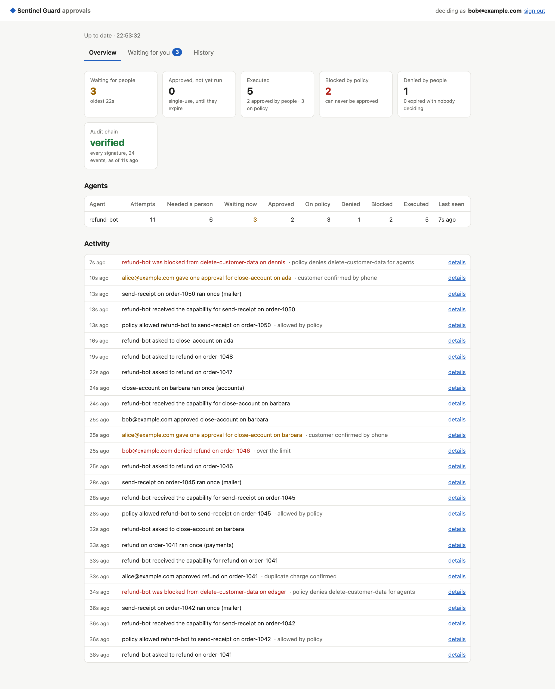

*Figure 17.10: The inbox's Overview in the quickstart: what waits and for how long, what ran, what was blocked or denied, the chain's health, each agent's record, and the activity as sentences*

**`GET /v1/overview`** (`server.go`):
- Lists the requests once and reuses `guard.Summarize`, the evidence bundle's own summary, for outcomes overall and per agent.
- Adds what is open now: pending, the oldest wait, unspent approvals, and each agent's waiting count and last request.
- `chain` is the guardian monitor's last self-verification, kept in an `atomic.Pointer`, so the inbox can poll every 2 seconds without re-verifying the chain.

**The inbox** has three tabs:
- *Overview*: the tiles, the agents table, and the activity feed. The feed takes the 30 newest audit events across requests and phrases each from its event type and actor, for example "policy allowed refund-bot to send-receipt on order-1050".
- *Waiting for you*: the cards, as before.
- *History*: recent outcomes, verification and the evidence download.

A **details view** (a `<dialog>`) opens from any card, activity line or history row, and from `/inbox/#<request id>`, which notifications now link to. It is built from the requests already fetched:
- the facts: agent, when, why, risk, autonomy, reasons, required and given approvals, the decision, expiry, execution, capability and policy version;
- the exact change and the guard's own precondition observations;
- the signed audit trail: sequence, event, time, actor, detail and hash prefix.

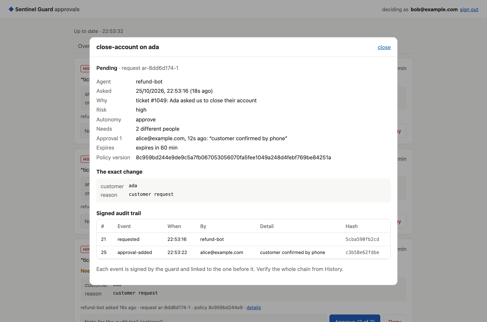

*Figure 17.11: A request's details: a two-person closure that Alice has approved, with the exact change and the signed audit trail*

**A fresh read before "pending"** (`engine.go` `useExisting`; `store.Kube.Refresh`):
- When a request found through the cache is Pending with no decision, the engine reads that one request again through the `Refresher` interface before answering.
- The Kubernetes store implements it as a GET to the API server; it keeps its own newer write if it has one.
- So an approval made through another replica a moment ago is applied, not answered with "waiting".
- The memory store reads its own state and doesn't implement it.

**The gateway side** (chapter 03 §decision and §alert linking): a rejection closes the incident even when the guard no longer has the request; stale alert links on ended incidents are released before an alert is linked.

## 15. A stable API (v2.0.0)
- **The CRD serves `sentinel.dev/v1`** (stored) and `v1alpha1` (deprecated). Both versions have the same schema, so the API server serves either without a conversion webhook. The store, the plugin and the guard's own objects use `v1`.
- **Rolling restarts:** guard pods have a `preStop` pause of 5 s, so they keep answering webhook calls while they're removed from the Service. Without it, a call routed to a pod that had just stopped hung until the 5 s webhook timeout (seen in CI right after a restart).
- **Writes outlive their caller:** a guard write claims its chain place, then writes the request and its status. These steps run on a context detached from the caller, with a 15 s timeout, so an API server that stops waiting for a webhook can't leave a gap. If a status write still fails, the half-made object is deleted and the signed void covers its place.
- **Verifying while the guard writes:** an event's place in the chain is claimed (the head advances) before its request is written. So a verification that reads in between can see the head a step ahead of the newest event. `kubectl sentinel audit verify` and the self-verification re-read once, 3 s later, before reporting a problem (v2.0.0). A write in flight finishes within the webhook timeout (5 s); tampering doesn't go away.

- **A startup check** (`cmd/sentinel-guard`): in Kubernetes mode the guard asks discovery whether `sentinel.dev/v1` is served. If not, it exits with the fix: apply the chart's CRD file, because `helm upgrade` never updates CRDs.
- **The promise** ([ADR-0018](../adr/0018-a-stable-api-for-v2.md)): within v2, the v1 API, the action API and the evidence format only gain optional fields, and records from any v2 release keep verifying. Records from the alphas verify too: the upgrade test checks the events alpha.3 signed (chapter 14 §4C).

